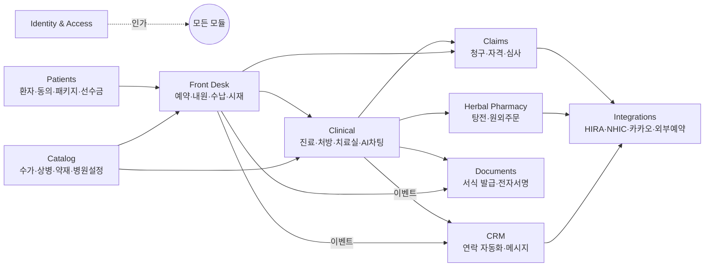

# 한의원 EMR 백엔드 재설계

Upstream EMR 웹 클라이언트를 정적 분석한 결과(`docs/reference/spec/`, `docs/reference/endpoints.md`, 현행 클라이언트 규칙을 실행해 뽑은 [`docs/reference/rules/`](../reference/rules/README.md))를 근거로, 같은 업무를 처리하는 백엔드 API 서버를 처음부터 다시 설계한 문서입니다. 코드는 저장소 루트의 `src/`에 있습니다. 이 문서 묶음은 구현 전에 도메인 경계·리소스·상태 전이·규칙의 위치를 합의하는 데 씁니다.

- **근거:** 현행 동작은 정적 분석으로만 확인했습니다. 원본 서버는 호출하지 않았고, 서버 내부 구현은 클라이언트가 보내고 읽는 값으로만 추정했습니다
- **목표:** 현행 913개 엔드포인트가 다루는 업무를 빠짐없이 덮되, 서버가 규칙과 트랜잭션을 책임지는 구조로 바꿉니다
- **범위 밖:** UI, 원격 앱(BI·재무·포털·MEMBERS)의 내부, 심평원·공단 전문 포맷의 바이트 단위 명세

## 현행 구조의 핵심 문제

분석에서 반복해서 나온 문제를 다섯 갈래로 묶었습니다. 재설계 결정은 모두 이 중 하나 이상을 고치기 위한 것입니다.

| # | 문제 | 대표 사례 | 고치는 문서 |
|---|---|---|---|
| P1 | **규칙이 클라이언트에 있음** | 첩약 한도 8/60/600, 추나 연 20회, 예약 수용 한도·휴진 검증, 내원 상태 전이표, 시술 타이머 만료, 참조데이터 버전 컷오프 `2026-01-01` 하드코딩, 야간 광고 제한(값도 20:30/20:50으로 불일치) | 각 도메인 문서 |
| P2 | **여러 호출을 클라이언트가 이어 붙임 (원자성 없음)** | 수납 = 진료별 `record/save` → `receipts` → `waiting 수납완료`. 진료 완료 = `save` → `done` → 추나 승인 → 치료완료 → 내원 상태. 심평원 전송 후 `POST /chunggu/after` 실패 시 "다시 기록" 버튼 | [conventions.md](conventions.md#커맨드), [front-desk.md](front-desk.md), [clinical.md](clinical.md) |
| P3 | **도메인 경계가 섞임** | 진료가 `/record`·`/chart`·`/patients/{id}/…`에 흩어짐. 탕전이 `/ocs`(v1)·`/tangjeon`·`/ocsv2`(실은 외부 주문) 세 갈래이고 둘 중 무엇을 쓸지 하드코딩된 요양기관기호로 가름. CRM 개념(연락 일정·트리거)이 EMR 서버에 있음. 연락 자동화가 v1·lite·v2 세 벌 | [README.md](#바운디드-컨텍스트) |
| P4 | **API 형태가 제각각** | 응답 envelope 6종(`data.results`, `data.data`, `data.result`, `data.message`…), 한글·snake·camel 키 혼재, 상태 enum 한글·UPPER·lower 혼재, 페이지네이션 4종, POST로 삭제, 동사 경로, 경로 속 `v2`, 선행 `/` 누락 | [conventions.md](conventions.md) |
| P5 | **접근 제어·보안이 클라이언트에 기댐** | 라우트 이름 불일치로 연말정산 가드 누락, 권한 메타 없는 라우트, 비대면 게이트가 localStorage 값, 역할 `01`/`02` 정확일치 비교, refresh token이 localStorage, 로그아웃 시 토큰 폐기 없음, 병원명·기관기호 하드코딩 분기 | [identity-access.md](identity-access.md) |

## 설계 원칙

1. **서버가 규칙의 단일 출처입니다.** 클라이언트는 서버가 계산한 `allowedActions`, `warnings`, 파생 상태를 그립니다. 같은 규칙을 클라이언트가 미리 검사하는 것은 UX 최적화일 뿐 강제 수단이 아닙니다
2. **업무 단위 하나 = 요청 하나 = 트랜잭션 하나.** 여러 엔티티를 바꾸는 업무(수납, 진료 완료, 접수)는 커맨드 엔드포인트 하나로 받고 서버에서 원자적으로 처리합니다
3. **상태는 enum 하나로, 전이는 서버가 검증합니다.** `취소여부·부도여부·내원여부·삭제여부` 같은 플래그 조합 대신 `status` 하나와 전이표를 둡니다
4. **진료 데이터는 지우지 않고 정정합니다.** 진료기록·처방·수납은 버전과 정정 이력을 남깁니다 ([compliance.md](compliance.md))
5. **외부 기관 연동은 비동기 작업으로 모델링합니다.** 심평원·공단·카카오·원외탕전처럼 실패하거나 늦게 끝나는 호출은 `Job` 리소스로 상태를 추적합니다. 데스크톱에만 있는 기능(HIRA DDMD 등)은 "에이전트"가 작업을 가져가 처리하는 구조로 서버가 진행 상태를 소유합니다
6. **한 가지 형태.** 경로·필드·enum·오류·페이지네이션 규칙은 [conventions.md](conventions.md) 하나를 따릅니다

## 바운디드 컨텍스트

현행 서버 분할(emr-api·crm-api·auth-api·insurance-api·sync-api)은 배포 단위이지 도메인 경계가 아니었습니다. 재설계는 업무 경계로 나눕니다. 처음에는 **모듈러 모놀리스 하나**로 구현하고, 모듈 사이에는 아래 표의 공개 인터페이스와 도메인 이벤트로만 통신하게 합니다. 분리 배포는 CRM 발송처럼 부하 특성이 다른 모듈부터 필요할 때 합니다.

| 컨텍스트 | 소유하는 것 | 현행 대응 | 문서 |
|---|---|---|---|
| Identity & Access | 병원(테넌트), 사용자, 역할, 권한 정책, 세션, 기기(태블릿), API 토큰(MCP) | auth-api, `/users`, `/permissions`, `/tablet/accounts` | [identity-access.md](identity-access.md) |
| Catalog | 수가코드·상병·약재 참조데이터(버전), 병원별 설정(비급여 항목·패키지 상품·약속처방·치료실·진료시간) | static CDN, `/settings/*` 181개 | [catalog.md](catalog.md) |
| Patients | 환자, 차트번호, 연락처·주소·가족, 동의, 메모, 보험 자격 스냅샷, 패키지 계약, 선수금 계정 | `/patients`, `/desk/addresses`, `/desk/prepaid`, `/patients/{id}/packages` | [patients.md](patients.md) |
| Front Desk | 예약(요청·차단·마킹), 내원, 수납·환불, 시재·지출 | `/desk/*` | [front-desk.md](front-desk.md) |
| Clinical | 진료(encounter), 진료기록 버전, 상병, 처방 라인, 치료실 시술, AI 차팅 | `/record`, `/chart`, `/treatments` | [clinical.md](clinical.md) |
| Herbal Pharmacy | 탕전 처방, 조제·배송, 원외탕전 주문 | `/ocs`, `/tangjeon`, `/ocsv2` | [herbal-pharmacy.md](herbal-pharmacy.md) |
| Claims | 청구 묶음, 명세서, 전송, 심사결과, 보완·재청구, 자격조회, 의료급여 승인 | `/chunggu`, `/nhic`, `/record/hira/*` | [claims.md](claims.md) |
| Documents | 서식 초안·발급·발급대장, 전자서명 요청 | `/documents`, `/signing` | [documents.md](documents.md) |
| CRM | 연락 프로그램(규칙)·연락 작업, 메시지 캠페인·발송, 템플릿, 수신거부, 발신번호 | crm-api, EMR `/crm/*` | [crm.md](crm.md) |

실손보험 조회(insurance-api)는 환자 테이블까지 따로 가진 별도 제품이라 이 설계에서는 Integrations 아래 외부 시스템으로 취급하고, EMR 환자와는 `patientId` 링크만 둡니다.

## 문서 목록

| 문서 | 내용 |
|---|---|
| [conventions.md](conventions.md) | 경로·필드·enum·오류·페이지네이션·커맨드·멱등성·동시성·작업(Job) 규칙 |
| [identity-access.md](identity-access.md) | 테넌트·역할·권한 모델, 인증 흐름, 감사 로그 |
| [catalog.md](catalog.md) | 참조데이터 버전, 병원 설정 리소스 정리 (181개 → 리소스 20여 개) |
| [patients.md](patients.md) | 환자 애그리거트, 패키지·선수금 |
| [front-desk.md](front-desk.md) | 예약·내원·수납 상태 머신과 커맨드 |
| [clinical.md](clinical.md) | 진료·처방·치료실·AI 차팅 |
| [herbal-pharmacy.md](herbal-pharmacy.md) | 탕전 통합 모델 |
| [claims.md](claims.md) | 청구 단일 리소스, 데스크톱 에이전트 구조 |
| [documents.md](documents.md) | 서식 발급·전자서명 |
| [crm.md](crm.md) | 연락 자동화 통합, 메시지 발송 |
| [events.md](events.md) | 도메인 이벤트와 실시간 채널 |
| [offline.md](offline.md) | 오프라인 접수·수납, 엣지 캐시, 동기화와 충돌 해결 |
| [compliance.md](compliance.md) | 의료·개인정보 법적 요구가 설계에 주는 제약 |
| [review.md](review.md) | 설계 검토: 현행 대비 매핑, 위험, 결정 필요 사항 |
