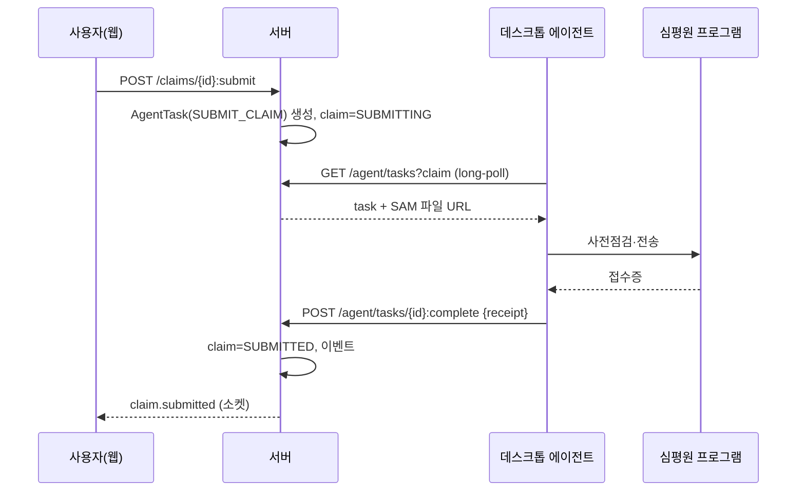
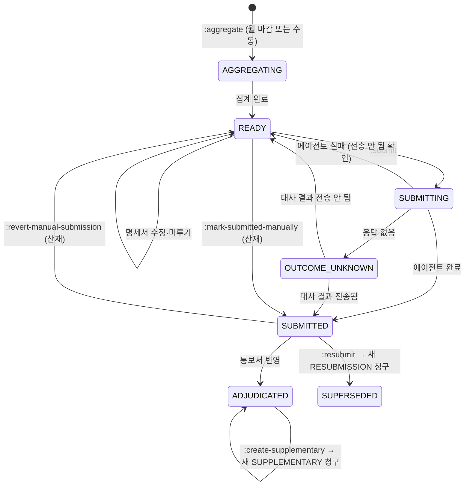

# Claims: 청구·자격·심평원 연동

심평원(HIRA) 요양급여비용 청구, 공단(NHIC) 자격조회·의료급여 승인, 심평원 사전 제출(추나·첩약), 자보·산재·제주 지원사업 청구를 다룹니다.

## 현행에서 고칠 점

- **같은 청구가 상태에 따라 두 컬렉션으로 나뉩니다.** `/chunggu/before`(청구필요)와 `/chunggu/after`(전송 후)
- **핵심 처리가 데스크톱 클라이언트에 있습니다.** DDMD 청구 프로그램 실행, 사전점검, 전송, 통보서 수신·파싱(`parseF010/N010/N020/F060/F020`), 청구번호 매칭이 모두 Electron 브리지(`hiraDdmdProxy`)입니다. 서버는 파싱 결과만 받습니다
- **원자성이 없습니다.** 전송 후 `POST /chunggu/after`가 실패하면 사용자가 "다시 기록"을 눌러야 합니다. 심평원 사전 제출(추나·자보첩약) 결과의 서버 반영 실패는 무시합니다
- **에러코드 카탈로그(88개, 자동수정 21개)가 클라이언트 하드코딩입니다.** 자동수정은 클라이언트가 진료기록을 직접 저장합니다. "수정 안 함"은 메모리에만 있어 새로고침하면 사라집니다
- **청구 집계 시점을 알 수 없습니다.** 생성 API가 없고 서버가 월별로 자동 집계합니다
- **산재는 상태를 클라이언트가 직접 씁니다** (`PATCH /chunggu/before/{id}/status {전송완료|집계중}`)
- **동사형 경로:** `/nhic/m2/get-data`, `/nhic/m4/get-external-data`, `/chunggu/after/{id}/retry`
- 재심사·이의신청 기한(통보일 + 90일)을 클라이언트가 계산합니다

## 용어

| 업무 용어 | 키 |
|---|---|
| 청구 (청구서 묶음) | `Claim` |
| 명세서 (청구 내 진료 한 건) | `ClaimStatement` |
| 원청구 / 보완청구 / 재청구 | `ORIGINAL` / `SUPPLEMENTARY` / `RESUBMISSION` |
| 청구구분 | `claimType` |
| 진료기준월 | `serviceMonth` |
| 심사결과 통보서 | `AdjudicationNotice` |
| 삭감 / 지급불능 | `reduction` / `nonPayable` |
| 미루기 | `deferred` |
| 심사불능사유코드 | `unreviewableReasonCode` |
| 자격조회 | `EligibilityLookup` |
| 의료급여 승인 | `MedicalAidApproval` |
| 사전 제출 (추나 승인, 첩약 제출) | `HiraPreSubmission` |
| 청구 프로그램 (DDMD) | 데스크톱 에이전트의 `hira-ddmd` 기능 |

## 데스크톱 에이전트

심평원 전송·통보서 수신·사전 제출은 공인인증서와 심평원이 배포한 PC 프로그램이 필요해 서버에서 직접 할 수 없습니다. 현행은 웹 앱이 Electron 브리지를 직접 부르고 결과를 서버에 따로 보고합니다. 재설계는 **서버가 작업을 소유하고 에이전트가 가져가 실행**합니다.



```
AgentTask
├─ id, kind: SUBMIT_CLAIM | PRECHECK_CLAIM | FETCH_NOTICES | SUBMIT_CHUNA | SUBMIT_PILOT_HERBAL | SUBMIT_AUTO_INSURANCE_HERBAL | CANCEL_PRE_SUBMISSION | RECONCILE
├─ targetRef, payload
├─ status: QUEUED | CLAIMED | SUCCEEDED | FAILED | OUTCOME_UNKNOWN | EXPIRED
├─ claimedBy (deviceId), attempts, lastError
└─ result
```

```
GET  /agent/tasks?kinds=&wait=30            에이전트용 long-poll, 기기 토큰
POST /agent/tasks/{id}:claim
POST /agent/tasks/{id}:complete             { result }      Idempotency-Key
POST /agent/tasks/{id}:fail                 { error, retryable }
GET  /agent/status                          웹이 "에이전트 연결됨" 표시에 사용
```

- **원자성:** 전송 성공 기록을 에이전트가 멱등 키로 보내므로, 네트워크가 끊겨도 보고 재시도가 중복 기록을 만들지 않습니다. 현행 "다시 기록" 버튼과 localStorage `claim:unsentGuard`가 필요 없어집니다
- **결과를 모르는 경우:** 멱등 키는 *보고*의 중복만 막고, 심평원 *전송*의 중복은 막지 못합니다. 에이전트가 작업을 가져간 뒤(`CLAIMED`) 응답 없이 시간이 지나면 서버는 `FAILED`가 아니라 `OUTCOME_UNKNOWN`으로 둡니다
  - `OUTCOME_UNKNOWN` 작업의 대상(청구·사전 제출)은 자동으로 다시 큐에 넣지 않습니다
  - 서버가 `RECONCILE` 작업을 만들어 에이전트가 심평원 송신 내역(현행 `inspectSamIn` recentDocs)과 접수증을 조회해 대사합니다. 전송된 것이 확인되면 `SUCCEEDED`로, 아니면 `FAILED`로 확정한 뒤에만 재전송할 수 있습니다
  - 이중 청구는 삭감·환수 사유가 되므로, 재전송 버튼은 대사가 끝난 뒤에만 켭니다
- **통보서 파싱은 에이전트가 원문을 올리고 서버가 파싱합니다.** 파서가 서버 한 곳에 있어 통보서 형식이 바뀌어도 서버 배포로 끝납니다. 원문은 감사·재처리를 위해 보관합니다
- 웹에서는 에이전트가 연결된 PC가 병원에 하나라도 있으면 전송 버튼이 켜집니다. 현행은 Electron 앱 안에서만 됐습니다

## 청구

### 모델

```
Claim
├─ id, coverage: NHIS | MEDICAL_AID | AUTO_INSURANCE | INDUSTRIAL_ACCIDENT | PILOT_HERBAL
├─ claimType: ORIGINAL | SUPPLEMENTARY | RESUBMISSION
├─ serviceMonth, periodFrom, periodTo
├─ parentClaimId? (보완·재청구의 원청구)
├─ businessType? (산재 요양/예방)
├─ totals: { statements, billed, reductionRisk }
├─ status
├─ submission?: { submittedAt, receiptNumber, documentNumber, agentTaskId }
├─ adjudication?: { noticeId, decidedAmount, reduction, nonPayable, pending, round, noticedOn, appealDeadline }
└─ version

ClaimStatement
├─ claimId, encounterId, patientId, serialNumber, originalSerialNumber?
├─ billed, expectedReduction
├─ issues[]: { code, severity: HIGH|MEDIUM, autoFixable, message, suppressed: { by, at, reason }? }
├─ deferred: boolean
└─ unreviewableReasonCode?
```



| 현행 상태 | 재설계 |
|---|---|
| `집계중` | `AGGREGATING` |
| `청구가능`, `전송대기` | `READY` |
| (없음) | `SUBMITTING`, `OUTCOME_UNKNOWN` |
| `전송완료` | `SUBMITTED` |
| (재청구된 원청구) | `SUPERSEDED` |
| `심사중` | `SUBMITTED` + 통보 대기 (표시 전용이었음) |
| `심사완료` | `ADJUDICATED` |
| `보완청구` | 새 청구의 `claimType` |

- **집계는 명시적 커맨드입니다.** `POST /claims:aggregate {coverage, serviceMonth}` → Job. 진료가 정정되면 해당 월 `READY` 청구를 다시 집계하라는 경고(`STALE_STATEMENTS`)를 띄웁니다. 현행은 집계 시점을 알 수 없었습니다
- **재청구는 산재 제외, 재청구 이력이 없고 `SUBMITTED`일 때만 됩니다.** 심사완료 후에는 보완청구만 됩니다. 현행 규칙과 같고 서버가 `allowedActions`로 줍니다
- **산재:** 근로복지공단 전송은 SAM 파일 다운로드 후 수동 업로드입니다. 재설계는 `POST /claims/{id}:mark-submitted-manually {receiptNumber?}`로 남기고, 이 커맨드는 `coverage: INDUSTRIAL_ACCIDENT`에서만 허용합니다. 현행 체크박스가 `전송완료 ↔ 집계중`을 오갈 수 있었으므로 `:revert-manual-submission {reason}`도 둡니다. 제주 지원사업은 별도 리소스입니다 ([제주 지원사업](#제주-지원사업))

### 엔드포인트

```
GET  /claims?status=&coverage=&serviceMonth=&cursor=
POST /claims:aggregate                              → Job
GET  /claims/{id}
GET  /claims/{id}/statements?issue=&deferred=&cursor=
PATCH /claim-statements/{id}                         { deferred?, unreviewableReasonCode? }
POST /claim-statements/{id}/issues/{code}:suppress   { reason }     # 현행 "수정 안 함", 서버에 저장
POST /claim-statements/{id}/issues/{code}:autofix    → 서버가 정정 제안 생성 (의사 승인 후 반영)
POST /claims/{id}:precheck                           → AgentTask
POST /claims/{id}:submit                             → AgentTask       Idempotency-Key
POST /claims/{id}:mark-submitted-manually
POST /claims/{id}:revert-manual-submission           { reason }
POST /claims/{id}:resubmit                           → 새 청구
GET  /claims/{id}/supplementary-candidates
POST /claims/{id}:create-supplementary              { statements[{ statementId, unreviewableReasonCode }] } → 새 청구
PATCH /claims/{id}/submission                        { documentNumber }    # 현행 document-number (20자)
GET  /claims/{id}/sam-file                           → 서명된 URL (없으면 생성 Job)
GET  /claim-issue-codes                              에러코드 카탈로그 (서버 소유)
```

- **자동수정은 정정 제안입니다.** 현행은 청구 담당자의 클릭으로 클라이언트가 `POST /record/{id}/save`를 보내 진료기록을 바꿨습니다. 진료기록 정정은 면허 행위이므로, 재설계는 서버가 [정정 제안](clinical.md#진료-encounter)(`reason: CLAIM_AUTOFIX:{code}`)을 만들고 담당 의사가 반영합니다. 의사가 일괄로 반영할 수 있게 `GET /amendment-proposals?reason=CLAIM_AUTOFIX&doctorId=` 목록을 둡니다
- 명세서는 반영된 정정을 기준으로 다시 집계됩니다. 반영 전에는 이슈가 `PENDING_FIX`로 보입니다

### 심사결과

```
POST /adjudication-notices                    에이전트가 원문 업로드 { kind: F010|N010|N020|F060|F020, raw }   → 서버 파싱
GET  /adjudication-notices?from=&to=
GET  /claims/{id}/adjudication
GET  /adjudications/patients?from=&to=        환자별 삭감 내역 (현행 examresult/patients)
```

- 파싱한 통보서를 청구번호로 청구에 매칭하고 `ADJUDICATED`로 바꿉니다. 매칭 실패는 `unmatched` 상태로 남겨 사용자가 고르게 합니다
- `appealDeadline = noticedOn + 90일`은 서버가 계산합니다
- 현행 "일괄 POST가 404면 단건 POST로 재시도"는 없앱니다

### 제주 지원사업

```
GET  /jeju-claims/summary?serviceMonth=&program=
POST /jeju-claims/{serviceMonth}/documents          → 제출 서류 생성 Job
POST /jeju-claims/{serviceMonth}:mark-submitted
GET  /jeju-claims/badge                              → { lastMonthCount }
```

## 심평원 사전 제출

추나 승인, 건보 첩약 시범사업 제출, 자보 첩약 제출은 진료 중에 심평원에 먼저 신고해야 하는 절차입니다. 현행은 클라이언트가 Electron으로 직접 제출하고 결과를 `POST /record/hira/prescriptions/approval`로 사후 통지했습니다.

```
HiraPreSubmission
├─ id, kind: CHUNA | PILOT_HERBAL | AUTO_INSURANCE_HERBAL
├─ encounterId, prescriptionLineIds[]
├─ payload (서버가 진료에서 생성)
├─ status: QUEUED | SUBMITTED | APPROVED | REJECTED | CANCEL_REQUESTED | CANCELED | FAILED | OUTCOME_UNKNOWN
├─ agentTaskId, hiraRef
└─ checklist? (첩약 체크리스트 제출 여부)
```

```
POST /encounters/{id}/hira-pre-submissions         { kind, prescriptionLineIds }   → AgentTask
GET  /encounters/{id}/hira-pre-submissions
POST /hira-pre-submissions/{id}:cancel
GET  /patients/{id}/hira-usage?kind=CHUNA&year=     연간 사용량 (현행 /chart/chuna/patients/{pid})
GET  /patients/{id}/pilot-herbal-history            누적 투약일수 (현행 /chart/pcmd/patients/{pid}, /patients/{id}/chubyak-records)
GET  /hira-pre-submissions?kind=&status=&from=     현황 (현행 /record/hira/{chuna|pcmd|car-pcmd})
```

- 처방 라인의 `hiraApproval.status`는 이 리소스 결과로만 바뀝니다
- **추나 자동 승인:** 진료 완료 시 정책(`encounter-policy.autoSubmitChuna`)이 켜져 있고, 건보·의료급여·자보이며, 연간 한도 내이고(자보는 한도와 상관없이), 같은 날 삭제되지 않은 심평원 이력과 `CANCELED`가 아닌 제출이 없으면 서버가 `QUEUED`로 만듭니다. 에이전트 연결과 상관없이 만들고, 연결되면 에이전트가 처리합니다. 판정은 [chuna-auto-submission.ts](../../src/modules/clinical/chuna/chuna-auto-submission.ts) ([결정](rule-decisions.md#chuna-auto-approval))
- 첩약 처방 한도(하루 8 / 월 60 / 연 600)용 의사별 집계는 `GET /doctors/{id}/pilot-herbal-counts?date=`로 줍니다 (현행 한글 경로 `/record/list/pcmd-count/{date}/doctor/{doctorId}`)

## 자격조회 (NHIC)

공단 전문 번호(M2~M5)를 경로에 드러내지 않고 업무 이름으로 둡니다.

```
POST /eligibility-lookups                 { patientId, coverage: NHIS, serviceDate, identityVerified }   → 결과 (M2)
GET  /eligibility-lookups/{id}
GET  /medical-aid-approvals?from=&to=     (M3 목록)
GET  /encounters/{encounterId}/medical-aid-approval
POST /medical-aid-approvals               { encounterId, copay, referral{...} }   → (M4) 승인 결과 { id, ... }
GET  /medical-aid-approvals/{id}
POST /medical-aid-approvals/{id}:cancel   (M5)
GET/PUT /settings/nhic-certificate        인증서 업로드 (.der/.key + 암호). 암호는 KMS로 암호화
```

- 조회 결과는 저장하고 ID를 줍니다. 접수(`:check-in`)는 `eligibilityLookupId`로 이 결과를 참조합니다
- 오프라인 접수는 자격이 `UNVERIFIED`이고, 동기화 때 서버가 자동으로 조회합니다. `UNVERIFIED` 내원의 진료는 청구 집계에서 빠지고 청구 화면에 "자격 미확인"으로 보입니다 ([offline.md](offline.md#접수))
- 공단 호출은 서버가 대행합니다 (현행과 같음). 인증서는 테넌트별 비밀 저장소에 두고, 만료일(`인증서만료일자`)이 30일 이내면 경고 이벤트를 냅니다
- **의료급여 U001 → B005 전환:** 현행은 `PATCH /desk/waiting`으로 보험정보를 고쳐 수납이 재계산됐습니다. 재설계는 `POST /visits/{id}:change-coverage`입니다

## 기타 청구 관련 화면

| 화면 | 재설계 |
|---|---|
| 방문진료 점검서식 | `GET /encounters?encounterType=HOME_VISIT&formStatus=`, `PATCH /encounters/{id}/home-visit-form { status: TODO|READY_TO_SUBMIT|DONE }` |
| 비대면 시범사업 비율 | `GET /reports/telemedicine-pilot-ratio?month=` |
| 연말정산 | [documents.md](documents.md#연말정산) |

## 실손보험 조회

현행 insurance-api는 자체 환자 테이블·구독·결제를 가진 별도 제품입니다. 재설계에서는 Integrations 경계 밖 시스템으로 두고 EMR과는 다음만 공유합니다.

- `POST /patients/{id}/indemnity-links` → 외부 시스템 환자와 연결
- 외부 시스템이 조회 완료를 알리면 `indemnity.lookup_completed` 이벤트로 환자 타임라인에 기록

## 이벤트

`claim.aggregated`, `claim.submitted`, `claim.submission_failed`, `claim.outcome_unknown`, `claim.adjudicated`, `hira_pre_submission.status_changed`, `agent.connected/disconnected`, `nhic_certificate.expiring`, `indemnity.lookup_completed`
