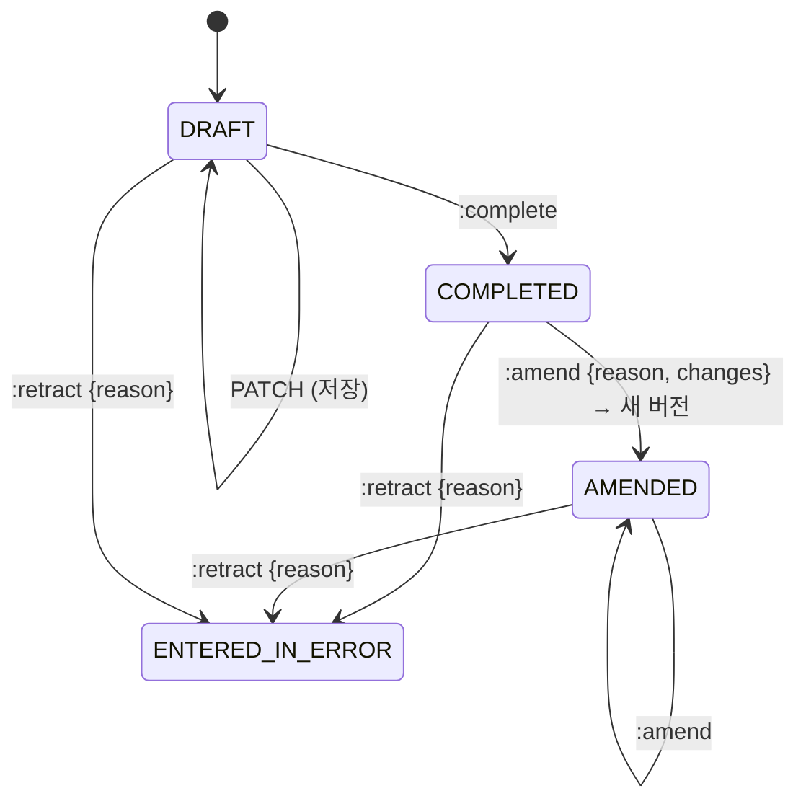
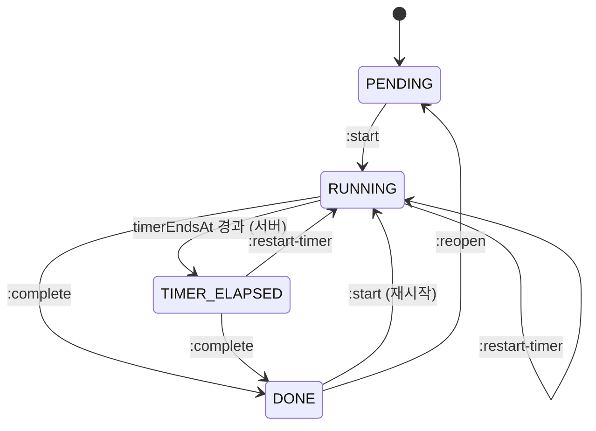

# Clinical: 진료·처방·치료실

진료(encounter), 진료기록, 상병, 처방, 치료실 시술, AI 차팅을 다룹니다.

## 현행에서 고칠 점

- **진료 데이터가 세 접두사에 흩어져 있습니다.** `/record`(CRUD, 심평원 승인, 캔버스 템플릿, 방문진료, 비대면 시범), `/chart`(첩약·추나 제출 이력, AI 차팅, 최근 상병, 지표), `/patients/{id}/…`(첩약 이력, 캔버스 이미지)
- **"treatment"가 두 뜻입니다.** `/treatments`는 치료실(시술)인데 진료 설정은 `/settings/treatments`이고, 진료항목은 `/settings/medical-treatments`입니다
- **진료 완료가 다섯 단계 클라이언트 오케스트레이션입니다.** `save` → `done` → 추나 자동승인(Electron) → 치료완료 → 내원 상태
- **진료기록 저장이 `POST /record/{id}/save`(동사) + 클라이언트 diff입니다.** 낙관적 잠금 흔적이 없어 진료실·데스크가 동시에 고치면 마지막 저장이 이깁니다
- **규칙이 클라이언트 상수입니다.** 첩약 처방 한도 하루 8 / 월 60 / 연 600, 상병 2개 규칙, 추나 연 20회, 진찰료 중복, 산정특례 검증, 야간·공휴·토요 가산 판정
- **시술 타이머 만료를 클라이언트가 판정합니다.** 서버에는 그런 전이가 없고, 다른 시술을 시작할 때 클라이언트가 만료된 시술을 대신 `complete`합니다. 치료실 화면은 5초 폴링입니다
- **진료기록 삭제가 영구 삭제입니다.** 서명·통계·수납·청구에서 빠지고 복구할 수 없습니다

## 용어

| 업무 용어 | 키 |
|---|---|
| 진료 | `Encounter` |
| 진료기록 (본문) | `ClinicalNote` |
| 상병 | `Diagnosis` (`kind: PRIMARY | SECONDARY`) |
| 처방 | `PrescriptionLine` |
| 수가코드 | `feeCode` |
| 시술 (치료실) | `Procedure` |
| 치료 세트 | `ProcedureSet` |
| 발침 | `needleRemoval` |
| 첩약 시범사업 (건보 첩약) | `PILOT_HERBAL` |
| 추나 | `CHUNA` |
| 약침 | `PHARMACOPUNCTURE` |
| 고정된 기록 | `locked` |

## 진료 (Encounter)

진료는 내원 하나에 하나 생깁니다 ([front-desk.md](front-desk.md#접수-커맨드)). 방문진료·전화 상담처럼 내원 없는 진료도 `POST /encounters`로 만들 수 있습니다.

```
Encounter
├─ patientId, visitId?, doctorId, coverage, serviceAt (현행 기준일시)
├─ encounterType: OFFICE | HOME_VISIT | TELEMEDICINE
├─ note: ClinicalNote (현재 버전)
├─ diagnoses[]
├─ prescriptionLines[]
├─ vitals[]
├─ benefitFlags (내원에서 복사, 진료별 수정 가능)
├─ status: DRAFT | COMPLETED | AMENDED | ENTERED_IN_ERROR
├─ locked: boolean (현행 고정된기록여부)
├─ signature?: { signatureRequestId, signedAt }
├─ version
└─ allowedActions[], warnings[]
```



- **완료 후 수정은 정정(amend)입니다.** 완료된 진료의 본문·상병·처방을 바꾸면 이전 버전을 보존하고 `reason`과 함께 새 버전을 만듭니다 ([compliance.md](compliance.md#진료기록-정정))
  - `:amend`는 바꿀 내용(`changes`, PATCH와 같은 형식)을 함께 받아 **한 번에 새 버전을 확정**합니다. 열어 두고 여러 번 PATCH하는 방식이 아니라서, 서명 대상 버전과 청구 재집계 시점이 커맨드 하나로 정해집니다
  - 정정은 면허가 있는 사용자만 할 수 있습니다. 다른 사용자나 시스템(청구 자동수정, 보험구분 변경)은 **정정 제안**(`AmendmentProposal { encounterId, changes, reason, proposedBy, status: PENDING|APPLIED|DISMISSED }`)만 만들고, 담당 의사가 `POST /amendment-proposals/{id}:apply`로 반영합니다
- **삭제 대신 `ENTERED_IN_ERROR`입니다.** 현행 `DELETE /record/{id} {삭제사유}`를 대체합니다. 기록은 남고 통계·수납·청구 집계에서 빠집니다. 이미 수납·청구된 진료는 409이고 먼저 수납 취소·청구 제외를 해야 합니다. 내원째 정리할 때는 [연쇄 취소](front-desk.md#연쇄-취소)가 이 순서를 한 트랜잭션으로 처리합니다
- **고정(lock):** 현행 `PATCH /record/{id}/fixed`는 `:lock` / `:unlock`이 됩니다. 초진 처방이 있는 진료는 정책(`encounter-policy.autoLockInitialRecord`)에 따라 처음 완료할 때 서버가 고정합니다

### 엔드포인트

```
GET   /patients/{id}/encounters?from=&to=&type=&cursor=       현행 /record/patient/{pid}, /latest, /record/date
GET   /encounters/{id}
GET   /encounters/{id}/versions
GET   /encounters/{id}/versions/{n}
POST  /encounters                                                내원 없는 진료
PATCH /encounters/{id}                                           If-Match, 부분 갱신 (아래)
POST  /encounters/{id}:complete                                  아래
POST  /encounters/{id}:amend                                     { reason, changes }   If-Match
POST  /encounters/{id}:retract                                   { reason }
GET   /encounters/{id}/amendment-proposals?status=PENDING
POST  /amendment-proposals/{id}:apply | :dismiss
POST  /encounters/{id}:lock / :unlock
POST  /encounters/{id}:repeat                                    { dates[] } → Job
GET   /patients/{id}/clinical-summary                            최근 상병, 진행 중 첩약·추나 사용량, 활성 패키지
```

### 저장

```jsonc
PATCH /encounters/enc_...
If-Match: "7"
{
  "note": { "body": "<p>...</p>" },
  "diagnoses": { "upsert": [ { "code": "U23.4", "kind": "PRIMARY" } ], "remove": ["dx_..."] },
  "prescriptionLines": { "upsert": [ ... ], "remove": ["pl_..."] }
}
→ 200 { encounter, warnings[] }
```

- 현행 클라이언트 diff 페이로드(`buildPatientRecordPayload`)의 의도를 살리되 `upsert/remove` 형태로 명확히 합니다
- 새 라인은 클라이언트가 `clientRef`(현행 `temp…` 임시 ID)를 붙여 보내고, 응답이 서버 ID와의 대응을 줍니다
- 저장은 규칙 위반이 있어도 통과시키고 `warnings`로 알립니다. 완료는 막습니다 (아래)

### 완료 커맨드

```jsonc
POST /encounters/enc_...:complete
If-Match: "8"
{ "nextVisitStatus": "AWAITING_PAYMENT", "acknowledge": [] }
→ 200 { encounter, visit, hiraSubmissions[] }
```

한 트랜잭션에서 하는 일:

1. 완료 검증 (아래 규칙). 막히면 422와 `violations[]`
2. 처방 라인 금액 확정(price lock), 패키지 사용 생성. 이미 수납에서 확정됐으면 건너뜁니다 ([patients.md](patients.md#패키지-계약))
3. 탕전이 필요한 한약 처방은 탕전 미등록 목록에 나타납니다. 탕전 처방은 현행처럼 탕전 담당자가 등록합니다 ([herbal-pharmacy.md](herbal-pharmacy.md#엔드포인트))
4. 추나 자동 승인 대상이면 심평원 제출 작업 생성 (`hiraSubmissions[]`, 상태 `QUEUED`). 외부 호출은 트랜잭션 밖에서 데스크톱 에이전트가 처리합니다
5. 내원 상태를 `nextVisitStatus`로 이동. 기본값은 현행과 같이 `IN_TREATMENT`(치료실로 보냄)입니다. `WAITING`이나 `AWAITING_PAYMENT`로 보낼 때만 진행 중인 치료실 시술을 종료합니다 (현행 `치료완료` 호출 조건)
6. 이벤트 `encounter.completed`

현행은 1–5를 클라이언트가 순서대로 불렀고, 4의 서버 반영 실패는 무시했습니다 ("다음 저장 시 반영됨").

### 완료 검증 규칙

모두 서버가 `serviceAt` 기준 참조데이터와 정책으로 판정합니다.

| 규칙 | 오류 코드 | 현행 위치 |
|---|---|---|
| 첩약 시범사업 처방은 모두 심평원 승인 상태여야 함 | `PILOT_HERBAL_NOT_APPROVED` | 클라이언트 |
| 의사별 첩약 처방 한도 하루 8 / 월 60 / 연 600. 초과분은 본인부담률 코드 `U`로 자동 변경 + 경고 | `PILOT_HERBAL_DOCTOR_LIMIT` (warning) | 클라이언트 상수 |
| 다른 상병코드로 누적 투약 이력이 2개 이상이면 처방 불가 | `PILOT_HERBAL_DIAGNOSIS_LIMIT` | 클라이언트 |
| 추나 연 20회 한도 | `CHUNA_ANNUAL_LIMIT` | 클라이언트 상수 |
| 같은 날 진찰료 중복 | `DUPLICATE_CONSULTATION_FEE` | 클라이언트 |
| 자보 같은 날 두 번째 진료는 진찰료 제외 | 자동 조정 + warning | 클라이언트 |
| 산정특례 특정기호와 상병 일치 | `SPECIAL_CASE_CODE_MISMATCH` | 클라이언트 |
| 야간·공휴·토요 가산 | 서버가 진찰료 수가코드 결정 | 클라이언트 |
| 보험구분과 처방 카테고리 대역 일치 (건보 31·33·34·35, 비급여 51·53·54, 자보 73·74, 산재 93·94) | `COVERAGE_CATEGORY_MISMATCH` | 클라이언트 |
| `OWN` 범위 사용자는 담당 환자 진료만 | 403 | 클라이언트 + (추정) 서버 |
| 이관된 진료는 수정·반복 불가 | `MIGRATED_ENCOUNTER_READONLY` | 클라이언트 |

한도 규칙의 상수(8/60/600, 20회)는 고시로 바뀔 수 있으므로 참조데이터 `regulatory-limits`에 유효기간과 함께 둡니다.

### 다른 날짜 반복

현행은 날짜마다 클라이언트가 `nhic/m2` 자격조회 → `POST /desk/waiting` → `save` → `done` → 수납 이동을 반복했습니다. 재설계는 `POST /encounters/{id}:repeat {dates[]}` → `Job`이고, 항목별 결과(성공·자격조회 실패·규칙 위반)를 돌려줍니다. 현행 `/treatment/repeat-results` 화면이 이 결과를 보여 줍니다.

## 처방 라인

```
PrescriptionLine
├─ id, clientRef?
├─ kind: CONSULTATION | ACUPUNCTURE | MOXIBUSTION | CUPPING | CHUNA | PHARMACOPUNCTURE | INSURED_MEDICINE
│        | PILOT_HERBAL | HERBAL | NONBENEFIT | PACKAGE_SALE | PACKAGE_USE | HOME_VISIT | OTHER
├─ feeCode, categoryCode (현행 카테고리숫자코드), name
├─ dose { perDay, days, quantity }, bodySites[]?
├─ unitPrice, amount (서버 계산, 진료일 단가)
├─ performedBy? (시술 의사), performerLicense?
├─ lineSpecifics? (현행 줄단위특정내역)
├─ prn: boolean
├─ packageContractId?
├─ hiraApproval?: { status: NOT_REQUIRED|PENDING|APPROVED|REJECTED, submissionId?, decidedAt }
└─ herbalPrescriptionId? (한약이면)
```

- **단가는 라인에 고정합니다.** 처방 시점 단가를 복사해 두고, 설정 단가가 바뀌어도 과거 진료 금액이 변하지 않게 합니다
- **직전 회차 조회:** 현행 `POST /record/prescriptions/last-rounds`(읽기인데 POST)는 `GET /patients/{id}/prescription-history?feeCodes=&before=`로 바꿉니다
- **승인 상태 변경**은 Claims 모듈의 심평원 제출 결과로만 바뀝니다 ([claims.md](claims.md#심평원-사전-제출)). 현행처럼 클라이언트가 `POST /record/hira/prescriptions/approval {승인여부}`로 직접 쓰지 않습니다
- 승인된 추나 라인은 삭제할 수 없고(409), 바꾸려면 승인 취소 제출이 먼저 필요합니다

## 상병

```
GET /patients/{id}/recent-diagnoses?visitTypeId=        현행 chart/kcd/recent
GET /reference/diagnoses-kcd?q=&asOf=                   서버 검색 (현행은 전체 JSON을 받아 클라이언트 검색)
```

## 활력징후·신체계측

현행 `/desk/body-measurements`는 진료와 무관한 환자 단위 측정입니다. 재설계는 `Observation { patientId, encounterId?, kind, value, unit, measuredAt }` 하나로 두고, 진료 중 측정은 `encounterId`를 겁니다.

```
GET  /patients/{id}/observations?kind=
POST /patients/{id}/observations
PATCH/DELETE /observations/{id}
```

## 치료실

치료실은 내원 단위로 환자를 베드에 배정하고 시술(침·뜸·부항·물리치료…)을 타이머로 진행합니다.

```
Procedure
├─ visitId, patientId, roomId, bedNumber
├─ name, sourcePrescriptionLineId? (현행 seed_from_chart)
├─ order, assignee: DOCTOR | STAFF
├─ setInstanceId?
├─ durationSeconds
├─ status: PENDING | RUNNING | TIMER_ELAPSED | DONE
├─ startedAt?, timerEndsAt?, completedAt?
└─ version
```



- **타이머 만료는 서버 상태입니다.** 서버가 `timerEndsAt`에 맞춰 `TIMER_ELAPSED`로 바꾸고 이벤트를 보냅니다. 현행은 클라이언트가 로컬에서 `pending + 타이머종료`로 바꿨고 서버에는 그 전이가 없었습니다
- **자동 완료 정책:** 현행은 "다른 시술을 시작하면 타이머가 끝난 시술을 자동 완료"를 클라이언트가 했습니다. 재설계는 `:start`가 같은 베드의 `TIMER_ELAPSED` 시술을 정책(`procedure-timers.autoCompleteElapsedOnNextStart`)에 따라 함께 완료합니다
- `DONE → RUNNING` 재시작은 현행 `uncomplete` → `start` 두 번 호출이었습니다. 한 커맨드로 합칩니다

```
GET  /treatment-rooms/board?date=          → rooms[].beds[].{ visit, procedures[] } + serverTime   (현행 /treatments/snapshot)
POST /visits/{id}/procedures               { name, durationSeconds, ... } | { procedureSetId }   (현행 apply-group, from-popover)
PATCH /procedures/{id}                     durationSeconds, order
DELETE /procedures/{id}                    PENDING만
POST /procedures/{id}:start / :complete / :restart-timer / :reopen
POST /visits/{id}/procedures:start-all / :complete-all     (현행 group/start, group/complete)
PUT  /visits/{id}/procedures:reorder       { ids[] }
POST /visits/{id}:finish-treatment                          (현행 PATCH /treatments/patients/{id}/status {치료완료})
POST /visits/{id}/needle-removals          { removedBy }
GET  /needle-removals?date=
```

- 보드는 이벤트(`procedure.updated`, `visit.bed_changed`)로 갱신합니다. 현행 5초·1분 폴링을 없앱니다
- `serverTime`을 함께 줘서 클라이언트 시계가 어긋나도 남은 시간을 맞게 그립니다 (현행 `serverNow` 보정 유지)

## 캔버스 (그림 차트)

현행에서 이미지는 `/patients`, 템플릿은 `/record`에 있고 진료와 연결되지 않습니다.

```
GET  /patients/{id}/drawings?cursor=
POST /patients/{id}/drawings                { templateId?, vectorData, name, encounterId? }
GET/PUT/DELETE /drawings/{id}
GET/POST/PATCH/DELETE /settings/drawing-templates
```

- `encounterId`를 선택적으로 걸어 진료기록 버전과 함께 보존되게 합니다. 진료에 걸린 그림은 진료와 같은 정정 규칙(지우지 않음)을 따릅니다

## AI 차팅

음성·텍스트로 진료기록 초안을 만드는 기능입니다 (현행 `record-llm`).

```
AiChartingSession (현행 진료llm대화그룹)
├─ encounterId, createdBy
└─ turns[]: { id, input{ text | audioRef, durationSeconds }, output?, status: QUEUED|RUNNING|SUCCEEDED|FAILED|CANCELED, createdAt }
```

```
GET  /encounters/{id}/ai-sessions
POST /encounters/{id}/ai-sessions                 → 새 세션
POST /ai-sessions/{id}/turns                       { text | audioUploadId, context{ age, sex } }  → 202
POST /ai-turns/{id}:cancel                         (현행 PATCH {status: STOPPED})
GET  /ai-sessions/{id}/turns?cursor=
POST /ai-turns/{id}:apply                          { target: "note", mode: "append"|"replace" }  → 진료 PATCH와 같은 효과
```

- 결과는 `ai_turn.succeeded/failed` 이벤트로 알립니다. 현행 `RECORD_LLM_COMPLETED`의 3중 중첩 payload를 정리합니다
- **AI 결과는 진료기록에 자동으로 들어가지 않습니다.** 의사가 `:apply`해야 반영되고, 정정 이력에 `source: AI_ASSISTED`로 남습니다 ([compliance.md](compliance.md#ai-보조))
- 녹음 파일은 `audioUploadId`(서명된 업로드 URL)로만 받고, 보존 기간이 지나면 지웁니다

## 이벤트

`encounter.created/updated/completed/amended/retracted`, `amendment.proposed`, `prescription_line.approval_changed`, `procedure.updated`, `ai_turn.succeeded/failed`, `observation.recorded`

베드 배정은 내원의 속성이라 `visit.bed_changed`는 Front Desk가 냅니다.
