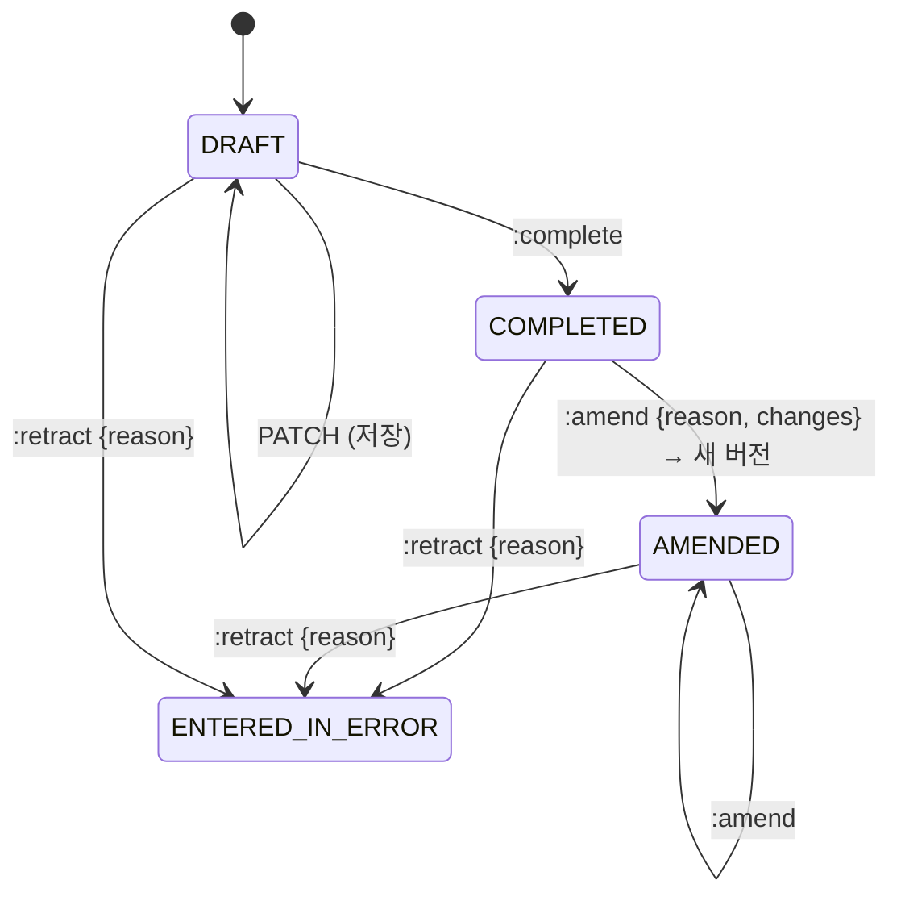
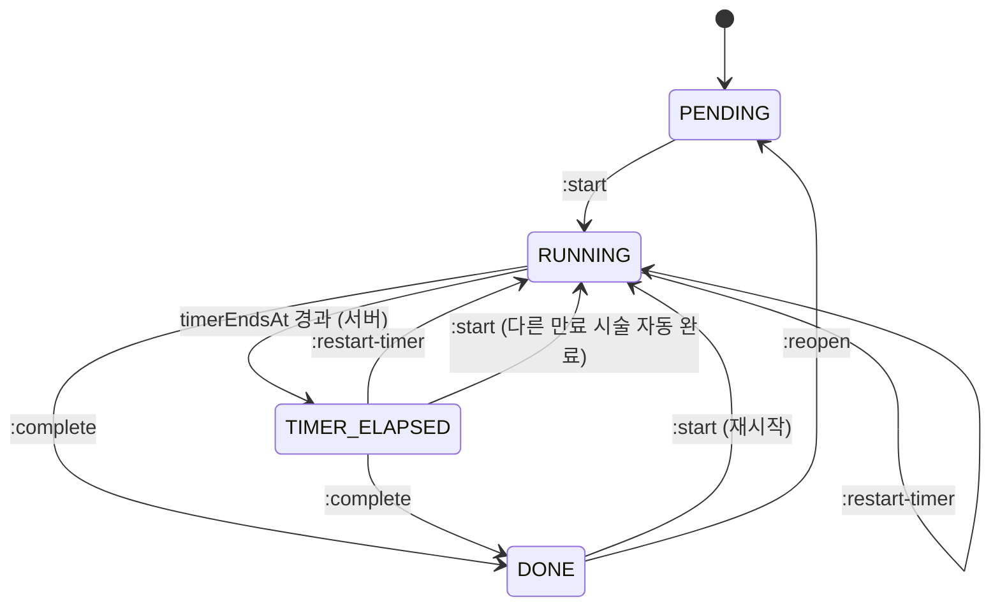

# Clinical: 진료·처방·치료실

진료(encounter), 진료기록, 상병, 처방, 치료실 시술, AI 차팅을 다룹니다.

## 현행에서 고칠 점

- **진료 데이터가 세 접두사에 흩어져 있습니다.** `/record`(CRUD, 심평원 승인, 캔버스 템플릿, 방문진료, 비대면 시범), `/chart`(첩약·추나 제출 이력, AI 차팅, 최근 상병, 지표), `/patients/{id}/…`(첩약 이력, 캔버스 이미지)
- **"treatment"가 두 뜻입니다.** `/treatments`는 치료실(시술)인데 진료 설정은 `/settings/treatments`이고, 진료항목은 `/settings/medical-treatments`입니다
- **진료 완료가 다섯 단계 클라이언트 오케스트레이션입니다.** `save` → `done` → 추나 자동승인(Electron) → 치료완료 → 내원 상태
- **진료기록 저장이 `POST /record/{id}/save`(동사) + 클라이언트 diff입니다.** 낙관적 잠금 흔적이 없어 진료실·데스크가 동시에 고치면 마지막 저장이 이깁니다
- **규칙이 클라이언트 상수입니다.** 첩약 처방 한도 하루 8 / 월 60 / 연 600, 상병 2개 규칙, 추나 연 20회, 진찰료 중복, 산정특례 검증, 야간·공휴·토요 가산 판정
- **시술 타이머 만료를 클라이언트가 판정합니다.** 서버에는 그런 전이가 없고, 다른 시술을 시작할 때 클라이언트가 만료된 시술을 대신 `complete`합니다. 치료실 화면은 5초 폴링입니다
- **진료기록 삭제가 영구 삭제입니다.** 서명·통계·수납·청구에서 빠지고 복구할 수 없습니다

## 용어

| 업무 용어 | 키 |
|---|---|
| 진료 | `Encounter` |
| 진료 상태 | `EncounterStatus`: `DRAFT`(초안), `COMPLETED`, `AMENDED`, `ENTERED_IN_ERROR` |
| 진료기록 (본문) | `ClinicalNote` |
| 상병 | `Diagnosis` (`kind: PRIMARY \| SECONDARY`) |
| 처방 | `PrescriptionLine` |
| 수가코드 | `feeCode` |
| 시술 (치료실) | `Procedure` |
| 시술 상태 | `ProcedureStatus`: `PENDING`, `RUNNING`, `TIMER_ELAPSED`(타이머 만료), `DONE` |
| 시술 완료 / 다시 열기 | `:complete` (`DONE`) / `:reopen`. 진료 완료·내원 다시 열기와 다릅니다 |
| 치료 세트 | `ProcedureSet` |
| 발침 | `needleRemoval` |
| 첩약 시범사업 (건보 첩약) | `PILOT_HERBAL` |
| 추나 | `CHUNA` |
| 약침 | `PHARMACOPUNCTURE` |
| 진료 완료 | `:complete` (`COMPLETED`). 내원 `COMPLETED`(수납완료)·시술 `DONE`과 다릅니다 |
| 진료기록 정정 | `:amend` (`AMENDED`). 수납 정정(`correct`, front-desk.md)과 다릅니다 |
| 판 (완료·정정마다 남는 기록) | `revision`, `EncounterRevision` (`source: COMPLETION \| AMENDMENT`). 낙관적 잠금 `version`과 다릅니다. 판 조회 경로는 예외로 `/encounters/{id}/versions/{n}`이고 `n`이 판입니다 |
| 철회 (잘못 연 진료) | `:retract` (`ENTERED_IN_ERROR`, `retraction`) |
| 고정된 기록 | `locked` (`:lock` / `:unlock`) |
| 정정 제안 / 반영 / 버림 | `AmendmentProposal`(응답 `AmendmentProposalView`) / `:apply` (`APPLIED`) / `:dismiss` (`DISMISSED`) |
| 낡은 제안 (제안 뒤 정정됨) | `stale` (`baseRevision` ≠ 지금 `revision`) |
| 확인하고 넘어감 (경고) | `acknowledge` / `acknowledged` |

## 진료 (Encounter)

진료는 내원 하나에 하나 생깁니다 ([front-desk.md](front-desk.md#접수-커맨드)). 방문진료·전화 상담처럼 내원 없는 진료도 `POST /encounters`로 만들 수 있습니다.

```
Encounter
├─ patientId, visitId?, doctorId, coverage, serviceAt (현행 기준일시)
├─ encounterType: OFFICE | HOME_VISIT | TELEMEDICINE
├─ note: ClinicalNote (현재 버전)
├─ diagnoses[]
├─ prescriptionLines[]
├─ vitals[]
├─ benefitFlags (내원에서 복사, 진료별 수정 가능)
├─ status: DRAFT | COMPLETED | AMENDED | ENTERED_IN_ERROR
├─ locked: boolean (현행 고정된기록여부)
├─ signature?: { signatureRequestId, signedAt }
├─ version
└─ allowedActions[], warnings[]
```



- **완료 후 수정은 정정(amend)입니다.** 완료된 진료의 본문·상병·처방을 바꾸면 이전 버전을 보존하고 `reason`과 함께 새 버전을 만듭니다 ([compliance.md](compliance.md#진료기록-정정))
  - `:amend`는 바꿀 내용(`changes`, PATCH와 같은 형식)을 함께 받아 **한 번에 새 버전을 확정**합니다. 열어 두고 여러 번 PATCH하는 방식이 아니라서, 서명 대상 버전과 청구 재집계 시점이 커맨드 하나로 정해집니다
  - 정정은 면허가 있는 사용자만 할 수 있습니다. 다른 사용자나 시스템(청구 자동수정, 보험구분 변경)은 **정정 제안**(`AmendmentProposal { encounterId, changes, reason, proposedBy, status: PENDING|APPLIED|DISMISSED }`)만 만들고, 담당 의사가 `POST /amendment-proposals/{id}:apply`로 반영합니다
- **삭제 대신 `ENTERED_IN_ERROR`입니다.** 현행 `DELETE /record/{id} {삭제사유}`를 대체합니다. 기록은 남고 통계·수납·청구 집계에서 빠집니다. 이미 수납·청구된 진료는 409이고 먼저 수납 취소·청구 제외를 해야 합니다. 내원째 정리할 때는 [연쇄 취소](front-desk.md#연쇄-취소)가 이 순서를 한 트랜잭션으로 처리합니다
- **고정(lock):** 현행 `PATCH /record/{id}/fixed`는 `:lock` / `:unlock`이 됩니다. 초진 처방이 있는 진료는 정책(`encounter-policy.autoLockInitialRecord`)에 따라 처음 완료할 때 서버가 고정합니다

### 엔드포인트

```
GET   /patients/{id}/encounters?from=&to=&type=&cursor=       현행 /record/patient/{pid}, /latest, /record/date
GET   /encounters/{id}
GET   /encounters/{id}/versions
GET   /encounters/{id}/versions/{n}
POST  /encounters                                                내원 없는 진료
PATCH /encounters/{id}                                           If-Match, 부분 갱신 (아래)
POST  /encounters/{id}:complete                                  아래
POST  /encounters/{id}:amend                                     { reason, changes }   If-Match
POST  /encounters/{id}:retract                                   { reason }
GET   /encounters/{id}/amendment-proposals?status=PENDING
POST  /amendment-proposals/{id}:apply | :dismiss
POST  /encounters/{id}:lock / :unlock
POST  /encounters/{id}:repeat                                    { dates[] } → Job
GET   /patients/{id}/clinical-summary                            최근 상병, 진행 중 첩약·추나 사용량, 활성 패키지
```

### 저장

```jsonc
PATCH /encounters/enc_...
If-Match: "7"
{
  "note": { "body": "<p>...</p>" },
  "diagnoses": { "upsert": [ { "code": "U23.4", "kind": "PRIMARY" } ], "remove": ["dx_..."] },
  "prescriptionLines": { "upsert": [ ... ], "remove": ["pl_..."] }
}
→ 200 { encounter, warnings[], prescriptionLineRefs[] }
```

- 현행 클라이언트 diff 페이로드(`buildPatientRecordPayload`)의 의도를 살리되 `upsert/remove` 형태로 명확히 합니다
- 새 라인은 클라이언트가 `clientRef`(현행 `temp…` 임시 ID)를 붙여 보내고, 응답의 `prescriptionLineRefs[] { clientRef, id }`가 서버 ID와의 대응을 줍니다
- 저장은 규칙 위반이 있어도 통과시키고 `warnings`로 알립니다. 완료는 막습니다 (아래)

### 완료 커맨드

```jsonc
POST /encounters/enc_...:complete
If-Match: "8"
{ "nextVisitStatus": "AWAITING_PAYMENT", "acknowledge": [] }
→ 200 { encounter, hiraSubmissions[] }
```

한 트랜잭션에서 하는 일:

1. 완료 검증 (아래 규칙). 막히면 422와 `violations[]`
2. 처방 라인 금액 확정(price lock), 패키지 사용 생성. 이미 수납에서 확정됐으면 건너뜁니다 ([patients.md](patients.md#패키지-계약))
3. 탕전이 필요한 한약 처방은 탕전 미등록 목록에 나타납니다. 탕전 처방은 현행처럼 탕전 담당자가 등록합니다 ([herbal-pharmacy.md](herbal-pharmacy.md#엔드포인트))
4. 추나 자동 승인 대상이면 심평원 제출 작업 생성 (`hiraSubmissions[]`, 상태 `QUEUED`). 외부 호출은 트랜잭션 밖에서 데스크톱 에이전트가 처리합니다. 판정은 [chuna-auto-submission.ts](../../src/modules/clinical/chuna/chuna-auto-submission.ts) ([결정](rule-decisions.md#chuna-auto-approval))
5. (정책, M2) 내원 상태를 `nextVisitStatus`로 이동. 기본값은 현행과 같이 `IN_TREATMENT`(치료실로 보냄)입니다. `WAITING`이나 `AWAITING_PAYMENT`로 보낼 때만 진행 중인 치료실 시술을 종료합니다 (현행 `치료완료` 호출 조건). 내원이 이미 그 상태여도 종료합니다
6. 이벤트 `encounter.completed` (`nextVisitStatus` 포함)

5와 진행 중 시술 종료는 [domain-model.md](domain-model.md#정책)의 결정(M2)대로 트랜잭션 밖에서 `encounter.completed`를 받는 정책이 맡습니다. 내원이 이미 취소됐으면 이동만 빠지고 진료 완료는 그대로입니다. 지금 구현은 아직 같은 트랜잭션에서 옮기고 응답에 `visit`을 싣습니다

현행은 1–5를 클라이언트가 순서대로 불렀고, 4의 서버 반영 실패는 무시했습니다 ("다음 저장 시 반영됨").

### 완료 검증 규칙

모두 서버가 `serviceAt` 기준 참조데이터와 정책으로 판정합니다.

| 규칙 | 오류 코드 | 현행 동작 ([규칙 근거](../reference/rules/README.md)) |
|---|---|---|
| 첩약 시범사업 처방(카테고리 `35001001`)은 모두 심평원 승인 상태여야 함 | `PILOT_HERBAL_NOT_APPROVED` | [pilot-herbal-approval-required](../reference/rules/pilot-herbal-approval-required.md). 계정·완료 경로 예외 없음, LITE 단독 테넌트는 시범사업 줄 생성이 422 `PILOT_HERBAL_NOT_AVAILABLE` ([결정](rule-decisions.md#pilot-herbal-approval-required)). 판정은 [pilot-herbal-approval.ts](../../src/modules/clinical/pilot-herbal/pilot-herbal-approval.ts) |
| 의사별 첩약 처방 한도 하루 8 / 월 60 / 연 600 (초과는 9/61/601부터). 초과분은 본인부담률 코드 `U`로 자동 변경 + 경고 | `PILOT_HERBAL_DOCTOR_LIMIT` (warning) | [pilot-herbal-doctor-limit](../reference/rules/pilot-herbal-doctor-limit.md). 순번은 `serviceAt` 순으로 일부부담 건만 셈 ([결정](rule-decisions.md#pilot-herbal-doctor-limit)). 판정은 [pilot-herbal-doctor-limit.ts](../../src/modules/clinical/pilot-herbal/pilot-herbal-doctor-limit.ts) |
| 같은 기관 누적 투약 20일 이상이면 `U` + 경고, 다른 상병 이력 2개 이상·다른 기관 이력이면 처방 불가. 이력을 아직 받지 못했거나 등록 여부를 모르면 경고만 | `PILOT_HERBAL_DIAGNOSIS_LIMIT`, `PILOT_HERBAL_HISTORY_UNKNOWN`·`PILOT_HERBAL_HISTORY_UNVERIFIED` (warning) | [pilot-herbal-diagnosis-limit](../reference/rules/pilot-herbal-diagnosis-limit.md). 현행 두 함수가 서로 다르게 판정 ([결정](rule-decisions.md#pilot-herbal-diagnosis-limit)). 판정은 [pilot-herbal-diagnosis-limit.ts](../../src/modules/clinical/pilot-herbal/pilot-herbal-diagnosis-limit.ts) |
| 첩약 시범사업 청구 검사 C0001–C0012 | 검사별 warning | [pilot-herbal-claim-checks](../reference/rules/pilot-herbal-claim-checks.md). 현행은 C0001·C0003·C0005만 결과에 남음 ([결정](rule-decisions.md#pilot-herbal-claim-checks)). 판정은 [pilot-herbal-claim-checks.ts](../../src/modules/clinical/pilot-herbal/pilot-herbal-claim-checks.ts) |
| 추나 연 20회 한도 (자보는 사고 단위, 경고만) | `CHUNA_ANNUAL_LIMIT`, 사용량을 모르면 `CHUNA_USAGE_UNKNOWN` warning | [chuna-annual-limit](../reference/rules/chuna-annual-limit.md). 현행은 건보·산재의 경계가 서로 다름 ([결정](rule-decisions.md#chuna-annual-limit)). 판정은 [chuna-annual-limit.ts](../../src/modules/clinical/chuna/chuna-annual-limit.ts) |
| 같은 날 진찰료 중복 (대면·비대면 구분 없이, 같은 사고의 자보 진료 포함) | `DUPLICATE_CONSULTATION_FEE` (`acknowledge` 가능) | [duplicate-consultation-fee](../reference/rules/duplicate-consultation-fee.md). 현행은 대면·비대면 조합만 검사하고 확인 후 저장 가능 ([결정](rule-decisions.md#duplicate-consultation-fee)). 판정은 [duplicate-consultation-fee.ts](../../src/modules/clinical/fees/duplicate-consultation-fee.ts) |
| 자보 같은 날 다른 사고번호의 두 번째 진료는 진찰료 제외 | 자동 조정 + `AUTO_INSURANCE_SECOND_VISIT_ASSIGNED` warning | [auto-insurance-same-day-consultation](../reference/rules/auto-insurance-same-day-consultation.md). 판정은 [auto-insurance-same-day-consultation.ts](../../src/modules/clinical/fees/auto-insurance-same-day-consultation.ts) |
| 산정특례 등록번호(05·14·21·23)면 특정기호 4자 필수. 상병과 특정기호 일치는 **신규 규칙** | `SPECIAL_CASE_CODE_MISMATCH` | [special-case-code-match](../reference/rules/special-case-code-match.md). 현행은 상병 일치를 검사하지 않음. 판정은 [special-case-code.ts](../../src/modules/clinical/special-case/special-case-code.ts) |
| 초진·재진, 야간·공휴·토요 가산 | 서버가 진찰료 수가코드 결정. 마스터에 없는 코드는 `FEE_CODE_NOT_IN_MASTER` warning(완료는 막음) | [consultation-fee-code](../reference/rules/consultation-fee-code.md), [procedure-fee-modifiers](../reference/rules/procedure-fee-modifiers.md). 판정은 [consultation-fee-code.ts](../../src/modules/clinical/fees/consultation-fee-code.ts), 시술·조제료 산정코드는 [procedure-fee-modifiers.ts](../../src/modules/clinical/fees/procedure-fee-modifiers.ts), 비대면 진찰료·관리료는 [telemedicine-fee-lines.ts](../../src/modules/clinical/fees/telemedicine-fee-lines.ts) |
| 다른 보험구분 전용 처방 카테고리 차단 (차단 표는 참조데이터, 대역 일치는 강제하지 않음) | `COVERAGE_CATEGORY_MISMATCH` | [coverage-category-band](../reference/rules/coverage-category-band.md). 현행과 같은 차단 방식이고, 현행은 보험구분을 바꿀 때만 검사 ([결정](rule-decisions.md#coverage-category-band)). 판정은 [coverage-category-band.ts](../../src/modules/clinical/fees/coverage-category-band.ts) |
| `OWN` 범위 사용자는 담당 환자 진료만 | 403 | 클라이언트 + (추정) 서버 |
| 이관된 진료는 수정·반복 불가 | `MIGRATED_ENCOUNTER_READONLY` | 클라이언트 |

한도 규칙의 상수(8/60/600, 20회)는 고시로 바뀔 수 있으므로 참조데이터 `regulatory-limits`에 유효기간과 함께 둡니다.

### 완료 구현 결정

구현은 [encounters.ts](../../src/modules/clinical/encounters/encounters.ts)의 `complete`, 판정은 [encounter.aggregate.ts](../../src/modules/clinical/encounters/encounter.aggregate.ts)의 `decideComplete`, 검증은 [encounter-completion.ts](../../src/modules/clinical/encounters/encounter-completion.ts)의 `judgeCompletion`입니다 (#24).

- **범위:** `POST /encounters/{id}:complete`가 초안을 검증하고, 진료를 `COMPLETED`로 저장하고, 내원을 `nextVisitStatus`로 옮깁니다. 위 [완료 커맨드](#완료-커맨드)의 1·5·6입니다
  - 미룸: 2(금액 확정은 라인 단가가 이미 고정이라 할 일이 없고, 패키지 사용은 패키지가 생길 때), 3(탕전), 4(추나 자동 승인과 `hiraSubmissions[]`, 심평원 제출이 생길 때), 초진 기록 자동 고정(#25). 5의 치료실 시술 완료는 #26에서 더했습니다([치료실 구현 결정](#치료실-구현-결정))
- **지금 데이터로 판정할 수 있는 규칙만 봅니다.** 순서대로 주상병(`PRIMARY_DIAGNOSIS_MISSING`·`PRIMARY_DIAGNOSIS_MULTIPLE`), 보험구분 전용 처방(`COVERAGE_CATEGORY_MISMATCH`), 첩약 시범사업 승인(`PILOT_HERBAL_NOT_APPROVED`), 같은 날 진찰료 중복(`DUPLICATE_CONSULTATION_FEE`)입니다
  - 미룸: 첩약 의사별 한도·상병 한도·청구 검사(심평원 이력과 의사별 집계), 추나 연 한도(심평원 사용량), 자보 같은 날 2차 진료(사고번호), 산정특례(등록번호), 진찰료 수가코드 결정(병원 설정·공휴일·수가 마스터), 이관 진료, 담당 환자 범위. 판정 함수는 이미 있고, 입력 데이터가 생기면 `judgeCompletion`에 더합니다
- **막히면 422 `ENCOUNTER_COMPLETION_REJECTED`의 `violations[]`에 모든 이유를 담습니다.** 각 이유는 `{ code, message, targets? }`이고 `targets`는 처방 라인 ID나 진찰료가 겹치는 진료 ID입니다. 요청 형식 오류의 400 `violations`(`field`)와 이름은 같지만 문제 유형(`type`)이 달라 구분됩니다
- **주상병은 정확히 하나여야 합니다.** 저장은 상병이 없으면 경고하지 않지만, 완료는 상병이 없어도 `PRIMARY_DIAGNOSIS_MISSING`입니다. 일반(`SELF_PAY`) 진료도 같습니다. 진료기록에 상병은 늘 있어야 하기 때문입니다. 되돌릴 조건: 상병 없이 끝내는 진료(상담만 등)가 필요하면 진료 종류나 보험구분으로 예외를 둡니다
- **첩약 시범사업 라인은 늘 막힙니다.** 처방 라인에 아직 심평원 승인 상태가 없어 승인 전으로 봅니다. 시범사업 표시도 없어 보험구분 전용 처방으로도 막힙니다. 심평원 제출이 생기면 라인의 승인 상태를 씁니다
- **진찰료 중복은 완료한 같은 날 진료와 비교하고(취소한 내원의 완료 진료도 셉니다. 연쇄 취소가 진료를 철회하게 되면(#25) 빠집니다) `acknowledge: ["DUPLICATE_CONSULTATION_FEE"]`로 넘깁니다.** 초안끼리는 비교하지 않아, 먼저 완료한 진료는 통과하고 뒤 진료가 확인을 받습니다. 날짜는 병원 시간대(`Asia/Seoul`)로 셉니다. 수납이 아직 없어 모두 수납 전(`paid: false`)입니다. 넘긴 위반은 `encounter.completed`의 `acknowledged`에 남깁니다. 다른 코드는 넘길 수 없어 400입니다
- **내원은 내원 판정(`decideVisitStatus`)으로 옮깁니다.** `nextVisitStatus`(기본 `IN_TREATMENT`)로 가는 내원 커맨드(`:start-treatment`·`:return-to-waiting`·`:send-to-checkout`)를 같은 트랜잭션에서 판정·저장해 `visit.status_changed`가 함께 나갑니다. 내원 커맨드 권한(`visit:update`)은 따로 보지 않습니다. 진료를 완료할 수 있는 한의사가 진료 흐름을 넘기는 일이기 때문입니다
  - 내원을 그대로 두는 경우: 이미 그 상태, 수납까지 끝난 내원(`COMPLETED`), 지난 날짜의 내원(진료 흐름 커맨드가 막힘), `nextVisitStatus`를 고르지 않았는데 데스크가 이미 수납 대기(`AWAITING_PAYMENT`)로 보낸 내원. 전날 진료를 오늘 마무리하거나 환자를 보낸 뒤에 기록을 끝내도 완료가 막히거나 내원이 되돌아가지 않게 하려는 것입니다. 수납 대기에서 옮기려면 `nextVisitStatus`를 보냅니다
  - **읽기·판정·쓰기를 모두 한 트랜잭션에서 합니다.** SQLite는 트랜잭션을 하나씩 실행하므로, 완료가 진료·내원·같은 날 진료를 읽은 뒤 데스크의 내원 커맨드나 다른 진료의 완료가 끼어들지 못합니다. 그래서 함께 들어온 `:start-treatment`나 취소가 500이 아니라 각각 내원 그대로 두기·409가 되고, 같은 날 두 진료를 동시에 완료해도 뒤 진료가 진찰료 중복을 봅니다. 되돌릴 조건: 동시에 쓰는 DB(PostgreSQL 등)로 옮기면 내원 행을 잠그거나(`SELECT … FOR UPDATE`) 직렬화 격리 수준을 씁니다
  - 진료를 먼저 쓰고 내원을 옮깁니다. 진료 쓰기는 버전 비교로 실패할 수 있어, 되돌리지 못하는 메모리 저장소에서도 내원만 옮겨지지 않습니다. 같은 트랜잭션에서 방금 읽은 내원이라 내원 커맨드는 늘 통과합니다. 요청 중 자정이 지나는 것처럼 그래도 실패하면 결함(500)이고 진료도 되돌립니다
- **같은 날 진료는 환자의 진료 전체에서 고릅니다.** 진료가 아주 많은 환자에서 느려지면 날짜로 좁혀 읽습니다
- **진료 쪽 검사는 `update`와 같습니다.** `If-Match` 필수(빠지면 400, 어긋나면 412), 초안이 아니면 409 `ENCOUNTER_NOT_EDITABLE`, 취소한 내원이면 409 `ENCOUNTER_VISIT_CANCELED`, 권한은 `encounter:write`(면허)입니다
- **응답은 `{ encounter, visit }`입니다.** 내원 없는 진료는 `visit: null`입니다. `ETag`는 진료 버전입니다. `hiraSubmissions[]`는 심평원 제출이 생길 때 더합니다
- **진료의가 비어 있으면 완료한 사용자로 채웁니다.** `completedAt`은 처음 완료한 시각이고, 정정(#25)해도 바꾸지 않습니다
- **이벤트:** `encounter.completed { encounterId, visitId, patientId, doctorId, acknowledged }`, 그리고 내원을 옮겼으면 `visit.status_changed`
- **저장:** 마이그레이션 `0009_encounter_completion`이 `encounters`에 `completed_at`을 더합니다
- **모듈:** 진료가 내원 커맨드(`Visits`)를 쓰고 접수가 빈 진료를 만들어 서로를 부르므로, 접수가 쓰는 `draftEncounter`·`hasClinicalContent`를 [encounter-draft.ts](../../src/modules/clinical/encounters/encounter-draft.ts)로 옮겨 import 순환을 없앴습니다

### 정정·철회·판·고정 구현 결정

구현은 [encounters.ts](../../src/modules/clinical/encounters/encounters.ts)의 `amend`·`retract`·`setLocked`·`revisions`·`revision`, 판정은 [encounter.aggregate.ts](../../src/modules/clinical/encounters/encounter.aggregate.ts)의 `decideAmend`·`decideRetract`·`decideLock`, 철회한 진료는 [encounter-retraction.ts](../../src/modules/clinical/encounters/encounter-retraction.ts)입니다 (#25).

- **범위:** `:amend`, `:retract`, `GET /encounters/{id}/versions`·`/versions/{n}`, `:lock`·`:unlock`, 내원 연쇄 취소의 진료 철회
  - 정정 제안(`AmendmentProposal`)은 #30에서 열었습니다([정정 제안 구현 결정](#정정-제안-구현-결정)). 초진 기록 자동 고정(`encounter-policy.autoLockInitialRecord`)은 병원 정책 설정이 생길 때, 수납·청구한 진료의 철회 409는 그 모듈이 생길 때, 판의 `source` 중 `CLAIM_AUTOFIX`·`AI_ASSISTED`는 그 기능이 생길 때 더합니다. 서명(판에 붙음)과 추가기재·수정 접속기록 저장소도 서명·감사 기능과 함께 붙입니다
- **판(`revision`)과 낙관적 잠금 버전(`version`)을 나눕니다.** `/versions/{n}`의 `n`은 진료기록 판입니다. 초안은 0판이고 판이 없습니다. 완료하면 1판(`source: COMPLETION`), 정정할 때마다 다음 판(`AMENDMENT`, `reason`)을 남깁니다. 고정·철회처럼 내용이 바뀌지 않는 커맨드는 `version`만 올리고 판을 남기지 않습니다. 초안 저장마다 판을 남기지 않는 것은, 법이 보존을 요구하는 것이 완료한 기록의 수정 전 원본이기 때문입니다
  - 대안: 낙관적 잠금 `version`을 판 번호로 쓰기. 고정·철회와 초안 저장에도 올라 번호가 띄엄띄엄이 되고 "몇 번째 기록인가"를 알 수 없어 버렸습니다
- **판은 추가만 합니다.** `encounter_revisions` 테이블에 판마다 그때의 본문·상병·처방 라인 전체를 남기고, 트리거가 `UPDATE`·`DELETE`를 막습니다 (compliance.md 진료기록 정정). 진료 저장과 같은 트랜잭션에서 쓰고, 버전이 어긋나 거절된 저장은 판도 남기지 않습니다. 판 목록은 내용 전체를 줍니다. 판이 많지 않고 화면이 비교에 바로 쓰기 때문입니다
  - 대안: 바뀐 필드만 남기기(diff). 특정 판을 다시 만들려면 처음부터 쌓아야 하고 원본 보존이라는 목적에 비해 복잡해 버렸습니다
- **정정은 `PATCH`와 같은 `changes`를 받아 한 번에 새 판을 확정합니다.** 위 [진료](#진료-encounter)의 설계대로입니다. `reason`(1–500자)이 필수이고, 적용 규칙·처방 라인 권한·422 `ENCOUNTER_CHANGE_INVALID`는 `PATCH`와 같습니다. 정정한 결과도 완료 검증을 통과해야 합니다(422 `ENCOUNTER_COMPLETION_REJECTED`, `acknowledge` 받음). 완료한 기록이 정정으로 완료 조건을 잃지 않게 하려는 것입니다. 바뀐 것이 없으면 판을 남기지 않고 그대로 돌려줍니다(`PATCH`와 같음)
  - 정정할 수 있는 상태는 `COMPLETED`·`AMENDED`이고, 그 밖은 409 `ENCOUNTER_NOT_EDITABLE`입니다. 응답은 `{ encounter, prescriptionLineRefs }`입니다
- **철회는 사유와 함께 `ENTERED_IN_ERROR`로 남깁니다.** `retraction { reason, retractedAt, retractedBy }`를 진료에 두고 내용은 그대로입니다. 초안·완료·정정한 진료를 철회할 수 있고, 철회한 진료는 아무 커맨드도 받지 않습니다(409). 진찰료 중복 판정에서 빠지고, 내원 취소의 진료 내용 판정에서도 빠집니다
  - 열린 내원의 초안을 바로 철회하면 그 내원에서는 더 진료를 쓸 수 없습니다(내원 하나에 진료 하나). 데스크가 `cascade` 없이 내원을 취소하고 다시 접수합니다. 철회한 진료는 내용으로 치지 않아 취소가 막히지 않습니다. 대안: 열린 내원의 초안 철회를 막기. 잘못 연 진료를 의사가 정리하지 못하게 되어 버렸습니다
- **고정한 진료는 정정·철회할 수 없습니다(409 `ENCOUNTER_LOCKED`).** 고정은 완료·정정한 진료에만 걸고(그 밖은 409 `ENCOUNTER_NOT_EDITABLE`), 이미 그 상태면 버전을 올리지 않습니다. 고정 권한은 따로 없어 정정과 같은 `encounter:amend`(면허)입니다. 기록을 바꾸지 못하게 하는 일이 기록을 바꾸는 권한과 같은 무게이기 때문입니다. 되돌릴 조건: 실장 등 면허 없는 사용자가 고정해야 하면 `encounter:lock` 권한을 더합니다
- **내원 취소는 같은 트랜잭션에서 진료를 철회합니다.** 사유는 취소 사유입니다. 연쇄가 아닌 취소는 진료 내용이 없을 때만 통과하므로 빈 초안만 철회합니다(front-desk.md 연쇄 취소의 설계대로). 이 철회는 데스크의 취소에 따른 것이라 `encounter:retract`를 보지 않습니다. 연쇄 취소(`cascade: true`)는 내용이 있는 진료도 철회합니다. 고정한 진료도 철회합니다. 연쇄 취소는 `encounter:retract`(면허)가 있어야 하고 사용자가 명시적으로 고른 일이라, 고정보다 앞선다고 봤습니다. 이미 철회한 진료는 건너뜁니다
- **내원 커맨드와 진료 저장·정정·철회·고정은 읽기·판정·쓰기를 한 트랜잭션에서 합니다.** #22에서 받아들인 취소·저장 경합을 이것으로 막았습니다
- **수납한 진료(유효한 영수증에 들어간 진료)는 처방 라인을 바꾸거나 철회할 수 없습니다(409 `ENCOUNTER_BILLED`, #33).** 초안 저장과 정정 모두 같고, 본문·상병은 바꿀 수 있습니다. 영수증 금액과 진료 처방이 어긋나지 않게 하려는 것이고, 먼저 영수증을 취소·정정합니다(front-desk.md 수납 구현 결정)
- **`If-Match`가 필수입니다.** 정정·철회·고정 모두 진료 버전으로 비교합니다(빠지면 400, 어긋나면 412)
- **권한:** 정정·고정은 `encounter:amend`, 철회는 `encounter:retract`, 판 조회는 `encounter:read`(데스크도 가짐)입니다
- **이벤트:** `encounter.amended { encounterId, visitId, patientId, revision, changed, reason, acknowledged }`, `encounter.retracted { encounterId, visitId, patientId, from }`, `encounter.locked`·`encounter.unlocked { encounterId, visitId, patientId }`
- **저장:** 마이그레이션 `0010_encounter_revisions`가 `encounters`에 `revision`·`locked`·`retraction`을 더하고 `encounter_revisions`를 만듭니다. 0009 뒤로 완료한 진료는 그 내용을 1판으로 옮깁니다(기록한 사람은 진료의, 시각은 완료 시각). 그 전에 취소한 내원의 진료는 철회로 맞춥니다(사유·시각은 내원 취소에서, 철회한 사람은 내원에 남지 않아 `null`). 판의 기본키는 `(tenant_id, encounter_id, revision)`입니다

### 정정 제안 구현 결정

구현은 [amendment-proposals.ts](../../src/modules/clinical/encounters/amendment-proposals.ts)의 `AmendmentProposals`, 판정은 [amendment-proposal.aggregate.ts](../../src/modules/clinical/encounters/amendment-proposal.aggregate.ts)입니다 (#30, #67).

```
POST /encounters/{id}/amendment-proposals   { reason, changes }   → 201          encounter.amendment_proposal:create
GET  /encounters/{id}/amendment-proposals?status=                                 encounter:read
GET  /amendment-proposals/{id}                                                    encounter:read
POST /amendment-proposals/{id}:apply        { acknowledge? }      → { proposal, encounter, prescriptionLineRefs }, ETag   encounter:amend
POST /amendment-proposals/{id}:dismiss      { reason }                            encounter:amend
```

- **만드는 쪽은 면허 없는 사용자의 정정 요청부터 엽니다.** 데스크·실장이 진료기록의 잘못(상병 누락, 처방 오기)을 발견하면 바꿀 내용을 제안으로 남기고 의사가 반영합니다. 새 권한 `encounter.amendment_proposal:create`를 데스크 프리셋에 넣었습니다. 치료사는 갖지 않습니다
  - 미룸: 청구 자동수정(`source: CLAIM_AUTOFIX`, claims.md)과 보험구분 변경(`:change-coverage`). 그 기능이 생길 때 `source`를 넓혀 같은 제안을 만듭니다. 지금 `source`는 `USER`뿐입니다. 자동수정의 이슈 코드는 `reason`이 아니라 `source`와 함께 둘 별도 필드로 받습니다
- **반영은 정정 판정(`decideAmend`)을 그대로 부릅니다(`decideApply`).** 검증(적용 규칙, 완료 검증 422, `acknowledge`), 판 보존(`AMENDMENT`, 사유는 제안 사유), 상태·고정·수납 409, 처방 라인 권한(`prescription:write`·`prescription:write_prn`)이 정정과 같습니다. `encounter.amended`에 `proposalId`를 더합니다. 정정이 실패하면 제안은 `PENDING`으로 남습니다(같은 트랜잭션). 응답의 `prescriptionLineRefs`는 제안의 `clientRef`와 반영할 때 만든 처방 라인 ID의 대응입니다
  - 정정이 업무 규칙으로 실패할 수 있어 진료를 먼저 쓰고 제안을 뒤에 씁니다. SQL은 한 트랜잭션이라 함께 되돌립니다. 되돌리지 못하는 메모리 저장소에서는 같은 제안의 반영과 버림이 겹치면 정정만 남고 반영이 500으로 끝날 수 있습니다. 메모리 저장소는 테스트용이라 받아들였습니다
- **제안은 만든 때의 판(`baseRevision`) 위에서만 반영합니다.** 그 뒤 진료가 정정되면 409 `AMENDMENT_PROPOSAL_STALE`이고 목록에 `stale: true`로 보입니다. 제안의 `changes`는 본문을 통째로 바꾸거나 상병·처방을 ID로 고치므로, 새 판 위에 적용하면 그 사이 정정을 조용히 덮을 수 있기 때문입니다. 낡은 제안은 버리고 새로 제안합니다
  - 대안: 지금 판에 그대로 적용하기. 의사가 고친 본문을 옛 본문으로 되돌릴 수 있어 버렸습니다. 되돌릴 조건: 필드별로 겹치지 않는 제안을 합칠 수 있게 되면(예: 상병만 바꾼 제안) 겹치지 않을 때만 반영합니다
  - 고정·수납·철회처럼 판을 바꾸지 않는 변화는 낡게 하지 않습니다. 반영할 때 정정의 검사가 막습니다
  - 판이 같으면 같은 `changes`가 같은 결과를 낸다는 전제입니다. 지금 진료 내용은 정정으로만 바뀌어 성립합니다. 되돌릴 조건: 보험구분 변경(`:change-coverage`)처럼 판 없이 진료를 바꾸는 커맨드가 생기면 그 커맨드가 판을 올리거나, 제안이 진료 `version`도 함께 봅니다
- **반영할 때 진료 버전은 같은 트랜잭션에서 읽은 버전입니다.** `If-Match`를 받지 않습니다. 의사가 본 것은 제안이고, 진료가 그 사이 바뀌었는지는 판(`baseRevision`)으로 봅니다. 응답 `ETag`는 정정한 진료의 버전입니다
- **만들 때 지금 진료에 적용되는지 확인합니다.** 완료·정정한 진료만 받고(그 밖은 409 `ENCOUNTER_NOT_EDITABLE`), 적용할 수 없으면 422 `ENCOUNTER_CHANGE_INVALID`, 바뀌는 것이 없으면 422 `AMENDMENT_PROPOSAL_EMPTY`입니다. 고정한 진료에도 만들 수 있습니다. 반영 전에 의사가 고정을 풉니다. 처방 라인 권한은 만들 때 보지 않습니다. 반영하는 의사의 권한으로 봅니다
  - 수납한 진료의 처방 라인 변경(`ENCOUNTER_BILLED`)과 취소한 내원(`ENCOUNTER_VISIT_CANCELED`)도 만들 때 보지 않고 반영할 때 막습니다. 고정과 같이 반영 전에 풀릴 수 있는 상태(영수증 취소·정정)이고, 데스크가 영수증보다 기록 정정 요청을 먼저 남길 수 있게 하려는 것입니다. 되돌릴 조건: 반영할 수 없는 제안이 쌓여 의사 목록을 어지럽히면 만들 때도 막습니다
- **버리기는 의사가 사유와 함께 합니다(`encounter:amend`).** 반영·버림은 `PENDING`에서만 받고 그 밖은 409 `AMENDMENT_PROPOSAL_NOT_PENDING`입니다. 반영·버린 기록(`resolution { at, by, revision, reason }`)을 남깁니다
  - 미룸: 제안한 사람이 스스로 거두기, 담당 의사만 반영하기(담당 환자 범위 `scope: OWN`이 생길 때), 의사별 대기 제안 목록(claims.md의 일괄 반영 화면과 함께)
- **이벤트:** `amendment_proposal.created`·`.applied`·`.dismissed { proposalId, encounterId, patientId }`. 반영은 `encounter.amended { …, proposalId }`도 냅니다
- **저장:** 마이그레이션 `0016_amendment_proposals`가 `amendment_proposals`를 만듭니다. `changes`와 `resolution`은 JSON이고, 대기 제안만 `resolution`이 비어 있습니다(CHECK). `changes`는 읽을 때 변경 본문 스키마로 디코드합니다. 스키마를 바꾸면 남은 대기 제안을 마이그레이션으로 옮기거나 버립니다
- **모듈:** `PATCH`·`:amend`·제안이 같은 변경 본문을 쓰도록 스키마를 [encounter-changes-payload.ts](../../src/modules/clinical/encounters/encounter-changes-payload.ts)로 옮겼습니다

### 다른 날짜 반복

현행은 날짜마다 클라이언트가 `nhic/m2` 자격조회 → `POST /desk/waiting` → `save` → `done` → 수납 이동을 반복했습니다. 재설계는 `POST /encounters/{id}:repeat {dates[]}` → `Job`이고, 항목별 결과(성공·자격조회 실패·규칙 위반)를 돌려줍니다. 현행 `/treatment/repeat-results` 화면이 이 결과를 보여 줍니다.

### 진료 구현 결정

구현은 [encounters.ts](../../src/modules/clinical/encounters/encounters.ts)의 `get`·`listForPatient`·`update`, 판정은 [encounter.aggregate.ts](../../src/modules/clinical/encounters/encounter.aggregate.ts)의 `decideUpdate`, 변경 적용은 [encounter-changes.ts](../../src/modules/clinical/encounters/encounter-changes.ts)입니다 (#22).

- **범위:** 접수가 빈 초안 진료를 만들고, 진료 하나(`GET /encounters/{id}`)와 환자의 진료 목록(`GET /patients/{id}/encounters`)을 열고, 초안의 본문·상병을 저장합니다(`PATCH /encounters/{id}`)
  - 미룸: 내원 없는 진료(`POST /encounters`), 활력징후, 서명, `allowedActions`, 목록의 `from`·`to`·`type`·`cursor`, `clinical-summary`, 상병 마스터 검색, 진료 조회의 열람 기록(`access_logs`, conventions.md 감사와 열람 기록). 열람 기록은 환자 조회(patients.md)와 같이 미루고, 진료기록 서명·정정과 함께 붙입니다
- **접수가 내원과 진료를 한 트랜잭션에서 만듭니다.** 두 모듈의 저장소에 걸친 쓰기라 공통 `Transaction`([transaction.ts](../../src/shared/db/transaction.ts))으로 묶습니다. 저장소 `save`의 트랜잭션은 그 안에서 savepoint가 됩니다. 메모리 저장소는 되돌리지 못해, 실패할 수 있는 내원 쓰기(같은 ID)를 먼저 하고 서버가 만든 ID의 진료를 뒤에 씁니다
  - 대안: 진료를 처음 열 때(`GET`) 만들기. 읽기가 쓰기가 되고, 내원 목록에서 `encounterId`를 바로 줄 수 없어 버렸습니다
  - 대안: 내원 저장소가 진료 행도 쓰기. Front Desk가 Clinical 테이블을 알게 되어 버렸습니다
- **보험구분·표시·기준 시각은 내원에서 복사합니다.** `serviceAt`은 접수 시각입니다. 내원의 보험구분을 바꾸는 커맨드(`:change-coverage`)가 생기면 그 커맨드가 진료도 함께 바꿉니다
- **진료의는 처음 기록을 저장한 사용자입니다.** 접수가 아직 진료의(`doctorId`)를 받지 않아 초안은 `doctorId: null`이고, 바뀐 것이 있는 첫 `PATCH`가 저장한 사용자로 채웁니다. 면허 권한(`encounter:write`)이 있어야 저장하므로 한의사입니다. 되돌릴 조건: 접수에서 진료의를 받으면 그 값으로 만들고, 다른 한의사가 저장해도 바꾸지 않습니다
- **`If-Match`가 필수입니다.** 빠지면 400입니다. 진료기록은 여러 진료실 단말이나 한의사가 함께 고치므로 내원 커맨드처럼 잠금 없이 다시 시도하지 않고, 어긋나면 412로 돌려 클라이언트가 다시 읽게 합니다. 숫자가 아닌 값(`*` 등)은 어떤 버전과도 맞지 않아 412입니다
- **상병은 `upsert`·`remove`로 고칩니다.** 지우기를 먼저 하고 고치기를 합니다. `upsert`의 `id`가 있으면 그 상병을, 없으면 같은 코드의 상병을 고치고(구분만 바뀜), 없으면 뒤에 더합니다. 같은 코드가 둘이 되거나 한 요청에 같은 `id`를 두 번 보내면 거절합니다. 새 상병의 ID(`dx_`)는 서버가 만들고 응답의 진료에 있습니다. `clientRef` 대응은 처방 라인에만 있습니다. 상병은 코드로 찾을 수 있어 필요 없습니다
- **적용할 수 없는 변경은 422 `ENCOUNTER_CHANGE_INVALID` 하나로 모두 돌려줍니다.** 없는 상병 ID(`DIAGNOSIS_NOT_FOUND`)와 코드 중복(`DIAGNOSIS_DUPLICATE`)을 `errors`에 찾은 순서대로 담습니다(접수의 `CHECK_IN_REJECTED`와 같은 방식)
- **주상병 개수는 경고입니다.** 상병이 있는데 주상병이 없거나(`PRIMARY_DIAGNOSIS_MISSING`) 둘 이상이면(`PRIMARY_DIAGNOSIS_MULTIPLE`) 저장하고 `warnings`로 알립니다. 상병이 하나도 없으면 아직 쓰는 중이라 알리지 않습니다. 완료(#24)는 이를 막습니다
- **응답은 `{ encounter, warnings, prescriptionLineRefs }`입니다.** 위 [저장](#저장)의 형태를 따릅니다. `ETag`는 진료의 버전입니다. 바뀐 것이 없으면 버전을 올리지 않고 이벤트도 내지 않습니다
- **상병코드는 형식만 봅니다.** 영문 대문자 하나, 숫자 둘, `.`과 세부 분류 1–3자입니다(`U23.4`). 점 없는 코드(`U234`)는 받지 않습니다. 마스터에 있는지는 참조데이터가 생길 때 봅니다
- **본문은 받은 HTML 그대로 둡니다.** 20만 자까지 받습니다. 서버가 HTML을 정리하지 않으므로 화면에 그리는 쪽이 정리해야 합니다. 되돌릴 조건: 서버가 문서(진료기록 사본)를 렌더링하기 시작하면 저장할 때 허용 태그만 남깁니다
- **아직 받지 않는 필드(활력징후 등)는 400입니다.** 접수와 같은 이유입니다
- **초안이 아니면 409 `ENCOUNTER_NOT_EDITABLE`입니다.** 완료한 뒤의 수정은 정정(`:amend`, #25)입니다
- **내원 취소는 진료 내용을 봅니다.** 본문이나 상병, 처방 라인이 있는 진료의 내원은 `cascade` 없이 취소할 수 없습니다(409 `VISIT_HAS_CLINICAL_DATA`). 저장된 `hasClinicalData`(수납이 생기기 전까지의 값)에 진료 내용을 더해 판정합니다. 편집기가 비운 본문(`<p><br></p>`, 공백)은 내용이 아니고, 그림(``)은 내용입니다. 취소한 내원의 빈 초안 진료는 #25부터 취소와 함께 철회합니다(front-desk.md 연쇄 취소). 그 전에 취소한 내원의 초안은 남지만 고칠 수 없습니다(409 `ENCOUNTER_VISIT_CANCELED`)
  - 취소와 진료 저장이 겹치는 경합: 처음(#22)에는 받아들였고, #25에서 내원 커맨드와 진료 저장이 읽기·판정·쓰기를 한 트랜잭션에서 하게 해 막았습니다. SQLite는 트랜잭션을 하나씩 실행하므로 먼저 들어간 쪽만 이기고, 뒤에 온 쪽은 409(`VISIT_HAS_CLINICAL_DATA` 또는 `ENCOUNTER_VISIT_CANCELED`)입니다
- **이벤트:** `encounter.created { encounterId, visitId, patientId }`(접수와 같은 트랜잭션), `encounter.updated { encounterId, visitId, patientId, changed }`(`changed`는 `note`·`diagnoses`·`prescriptionLines`)
- **목록은 쪽을 나누지 않습니다.** 최근 진료가 먼저입니다(`serviceAt`, ID 내림차순). 되돌릴 조건: 진료가 많은 환자의 목록이 느려지거나 화면이 기간 조회를 쓰면 `from`·`to`·`cursor`를 더합니다
- **저장:** 마이그레이션 `0007_encounters`가 `encounters`를 만들고 `visits`에 `encounter_id`를 더합니다. 0006 뒤로 실제 접수가 생겨 테이블을 다시 만들지 않고 열을 더했고, 그 전 내원은 `encounterId: null`입니다. 상병·표시는 JSON 열입니다. `visit_id`에 부분 유일 색인을 걸어 내원 하나에 진료 하나를 지킵니다. 철회한 진료도 내원을 계속 차지해, 철회 뒤 같은 내원에 새 진료는 만들 수 없습니다. 그런 흐름이 필요해지면 이 색인을 철회하지 않은 진료로 좁힙니다. 모듈 사이 외래 키는 두지 않습니다(0006과 같음)
- **권한:** 조회는 `encounter:read`(데스크도 가짐), 저장은 `encounter:write`(면허 권한)입니다. 담당 환자 범위(`scope: OWN`)는 담당 관계가 생길 때 확인합니다

## 처방 라인

```
PrescriptionLine
├─ id
├─ kind: CONSULTATION | ACUPUNCTURE | MOXIBUSTION | CUPPING | CHUNA | PHARMACOPUNCTURE | INSURED_MEDICINE
│        | PILOT_HERBAL | HERBAL | NONBENEFIT | PACKAGE_SALE | PACKAGE_USE | HOME_VISIT | OTHER
├─ feeCode, categoryCode (현행 카테고리숫자코드), name
├─ feeCodeComputed (서버가 시술·조제료 산정코드를 붙인 8자리면 true. 클라이언트가 feeCode를 보내면 false로 되돌리고, false인 8자리는 다시 계산하지 않음)
├─ acupunctureMethod?: PRICKING | CONSTITUTIONAL | WARMING (경혈침술 침법)
├─ timeSurcharge?: SATURDAY_DAYTIME | NIGHT | HOLIDAY (의사가 지정한 시술 시간대 가산)
├─ dose { perDay, days, quantity }, bodySites[]?
├─ unitPrice, amount (서버 계산, 진료일 단가. amount = unitPrice × dose.perDay × dose.days 반올림)
├─ performedBy? (시술 의사), performerLicense?
├─ lineSpecifics? (현행 줄단위특정내역)
├─ prn: boolean
├─ packageContractId?
├─ hiraApproval?: { status: NOT_REQUIRED|PENDING|APPROVED|REJECTED, submissionId?, decidedAt }
└─ herbalPrescriptionId? (한약이면)
```

- **단가는 라인에 고정합니다.** 처방 시점 단가를 복사해 두고, 설정 단가가 바뀌어도 과거 진료 금액이 변하지 않게 합니다
- **직전 회차 조회:** 현행 `POST /record/prescriptions/last-rounds`(읽기인데 POST)는 `GET /patients/{id}/prescription-history?feeCodes=&before=`로 바꿉니다
- **승인 상태 변경**은 Claims 모듈의 심평원 제출 결과로만 바뀝니다 ([claims.md](claims.md#심평원-사전-제출)). 현행처럼 클라이언트가 `POST /record/hira/prescriptions/approval {승인여부}`로 직접 쓰지 않습니다
- 승인된 추나 라인은 삭제할 수 없고(409), 바꾸려면 승인 취소 제출이 먼저 필요합니다

### 처방 라인 구현 결정

구현은 [prescription-line.ts](../../src/modules/clinical/prescriptions/prescription-line.ts)(라인과 금액), [prescription-line-changes.ts](../../src/modules/clinical/prescriptions/prescription-line-changes.ts)(변경 적용과 보험구분 검사)이고, 진료 `PATCH`가 상병과 함께 적용합니다 (#23).

- **범위:** 초안 진료의 처방 라인을 `PATCH /encounters/{id}`의 `prescriptionLines { upsert, remove }`로 더하고 고치고 지웁니다. 라인은 `id`, `kind`, `feeCode`, `categoryCode`, `name`, `dose { perDay, days }`, `unitPrice`, `amount`, `prn`만 둡니다
  - 미룸: `feeCodeComputed`와 산정코드 계산, 침법·시간대 가산, 부위, 시술자·면허, 줄단위특정내역, 패키지, 심평원 승인(승인된 추나 라인 삭제 409 포함), 한약 처방 연결, 직전 회차 조회, 수가코드·카테고리 마스터 확인. 각 기능이나 참조데이터가 생길 때 더합니다
  - `dose.quantity`는 뜻이 정해지지 않아(총량? 1회량?) 두지 않았습니다. 금액 식에 쓰이지 않습니다
- **단가는 클라이언트가 보냅니다.** 수가코드·비급여 항목의 단가 마스터(catalog.md `fee-codes`·`nonbenefit-items`)가 아직 없어, 클라이언트가 고른 항목의 단가를 받아 라인에 고정합니다. 금액(`amount`)은 서버가 계산하고, 클라이언트가 보내면 400입니다. 되돌릴 조건: 단가 마스터가 생기면 서버가 `serviceAt` 기준 단가를 찾아 넣고, 클라이언트가 보낸 단가는 마스터와 다를 때 거절하거나 비급여 수기 입력에서만 받습니다
  - 대안: 지금 단가 마스터를 함께 만들기. 참조데이터 버전·기간(`validFrom`)과 설정 화면이 필요해 이 이슈보다 커서 미뤘습니다
- **금액은 `unitPrice × perDay × days`를 원 단위로 반올림(0.5는 올림)합니다.** 단가와 1일 횟수는 소수점 아래 둘째 자리까지 받고(`1.000000001`처럼 가까운 값도 400), 정수 분수로 바꿔 BigInt로 곱해 부동소수 오차와 정수 범위 초과가 없습니다. 상한은 단가 1억 원, 1일 1000회, 365일입니다
- **`upsert`의 `id`가 있으면 그 라인을 통째로 바꿉니다.** 필드 단위로 합치지 않으므로 라인의 모든 필드를 보내야 합니다(빠진 `prn`은 `false`). 자리와 ID는 지킵니다. `id`가 없으면 새 라인을 뒤에 더합니다. 상병과 달리 같은 수가코드의 라인을 여럿 둘 수 있어(부위가 다른 침술 등) 코드로 찾지 않습니다
- **`clientRef`는 저장하지 않고 응답에서만 돌려줍니다.** 새 라인(`id` 없음)에 붙인 `clientRef`를 응답의 `prescriptionLineRefs[] { clientRef, id }`가 서버 ID와 이어 줍니다. 위 모델에서 라인의 `clientRef?`를 뺐습니다. 현행 `temp…` 임시 ID는 화면을 열 때마다 다시 매겨질 수 있어, 저장하면 다음 요청의 `clientRef`와 겹쳐 뜻이 모호해집니다. `id`가 있는 라인의 `clientRef`는 이을 것이 없어 보지 않습니다. 한 요청 안에서 같은 `clientRef`나 같은 `id`를 두 번 보내면 422 `PRESCRIPTION_LINE_DUPLICATE`, 없는(지운) 라인 ID는 `PRESCRIPTION_LINE_NOT_FOUND`입니다. 상병 이유와 함께 `ENCOUNTER_CHANGE_INVALID` 하나로 돌려줍니다
- **권한:** 진료 저장의 `encounter:write`에 더해, 처방 라인을 하나라도 고치거나 지우면 `prescription:write`, `prn: true`인 라인을 보내면 `prescription:write_prn`이 필요합니다(403 `PERMISSION_DENIED`, `missing`에 빠진 권한 모두). 빈 `prescriptionLines`(`{}`, 빈 배열)는 권한을 보지 않습니다. 진료를 읽기 전에 보므로 404·412보다 먼저입니다. 본문에 따라 정해지므로 엔드포인트 선언이 아니라 서비스가 진료를 읽기 전에 봅니다. PRN 라인을 지우거나 PRN을 끄는 것은 `prescription:write`로 됩니다
- **보험구분에 맞지 않는 처방은 저장에서 경고입니다.** 진료의 보험구분에서 쓸 수 없는 카테고리·수가코드의 라인([coverage-category-band.ts](../../src/modules/clinical/fees/coverage-category-band.ts))이 있으면 저장하고 `COVERAGE_CATEGORY_MISMATCH` 경고에 그 라인 ID(`targets`)를 담습니다. 완료(#24)는 막습니다. 내원에 아직 첩약·비대면 시범사업 표시가 없어 두 시범사업이 아닌 진료로 판정하므로, 그 카테고리·코드의 라인은 늘 경고입니다. 되돌릴 조건: `benefitFlags`에 시범사업 표시가 생기면 그 값을 씁니다
- **수가코드와 카테고리는 형식만 봅니다.** 수가코드는 영문 대문자·숫자 1–16자이고 없으면(비급여) `null`, 카테고리는 숫자 8자리입니다. 마스터에 있는지는 참조데이터가 생길 때 봅니다
- **한 요청에 `upsert`·`remove` 각 100개까지 받습니다.**
- **저장:** 마이그레이션 `0008_prescription_lines`가 `encounters`에 JSON 열 `prescription_lines`(기본값 `[]`)를 더합니다. 상병과 같이 진료의 하위 값이고 진료 단위로만 읽고 씁니다. 되돌릴 조건: 수가코드별 집계(첩약 한도, 추나 횟수, 직전 회차)를 SQL로 하게 되면 별도 테이블로 옮깁니다
- **이벤트:** 따로 내지 않고 `encounter.updated`의 `changed`에 `prescriptionLines`를 담습니다

## 상병

```
GET /patients/{id}/recent-diagnoses?visitTypeId=        현행 chart/kcd/recent
GET /reference/diagnoses-kcd?q=&asOf=                   서버 검색 (현행은 전체 JSON을 받아 클라이언트 검색)
```

## 활력징후·신체계측

현행 `/desk/body-measurements`는 진료와 무관한 환자 단위 측정입니다. 재설계는 `Observation { patientId, encounterId?, kind, value, unit, measuredAt }` 하나로 두고, 진료 중 측정은 `encounterId`를 겁니다.

```
GET  /patients/{id}/observations?kind=
POST /patients/{id}/observations
PATCH/DELETE /observations/{id}
```

## 치료실

치료실은 내원 단위로 환자를 베드에 배정하고 시술(침·뜸·부항·물리치료…)을 타이머로 진행합니다.

```
Procedure
├─ visitId, patientId, roomId, bedNumber
├─ name, sourcePrescriptionLineId? (현행 seed_from_chart)
├─ order, assignee: DOCTOR | STAFF
├─ setInstanceId?
├─ durationSeconds
├─ status: PENDING | RUNNING | TIMER_ELAPSED | DONE
├─ startedAt?, timerEndsAt?, completedAt?
└─ version
```



- **타이머 만료는 서버 상태입니다.** 서버가 `timerEndsAt`에 맞춰 `TIMER_ELAPSED`로 바꾸고 이벤트를 보냅니다. 현행은 클라이언트가 로컬에서 `pending + 타이머종료`로 바꿨고 서버에는 그 전이가 없었습니다
- **자동 완료 정책:** 현행은 "다른 시술을 시작하면 타이머가 끝난 시술을 자동 완료"를 클라이언트가 했습니다. 재설계는 `:start`가 같은 베드의 `TIMER_ELAPSED` 시술을 정책(`procedure-timers.autoCompleteElapsedOnNextStart`)에 따라 함께 완료합니다
- `DONE → RUNNING` 재시작은 현행 `uncomplete` → `start` 두 번 호출이었습니다. 한 커맨드로 합칩니다
- 만료·시작·시간 변경 판정은 [procedure-timer.ts](../../src/modules/clinical/treatment-room/procedure-timer.ts)에 있습니다 ([결정](rule-decisions.md#procedure-timer))

```
GET  /treatment-rooms/board?date=          → rooms[].beds[].{ visit, procedures[] } + serverTime   (현행 /treatments/snapshot)
POST /visits/{id}/procedures               { name, durationSeconds, ... } | { procedureSetId }   (현행 apply-group, from-popover)
PATCH /procedures/{id}                     durationSeconds, order
DELETE /procedures/{id}                    PENDING만
POST /procedures/{id}:start / :complete / :restart-timer / :reopen
POST /visits/{id}/procedures:start-all / :complete-all     (현행 group/start, group/complete)
PUT  /visits/{id}/procedures:reorder       { ids[] }
POST /visits/{id}:finish-treatment                          (현행 PATCH /treatments/patients/{id}/status {치료완료})
POST /visits/{id}/needle-removals          { removedBy }
GET  /needle-removals?date=
```

- 보드는 이벤트(`procedure.updated`, `visit.bed_changed`)로 갱신합니다. 현행 5초·1분 폴링을 없앱니다
- `serverTime`을 함께 줘서 클라이언트 시계가 어긋나도 남은 시간을 맞게 그립니다 (현행 `serverNow` 보정 유지)

### 치료실 구현 결정

구현은 [procedures.ts](../../src/modules/clinical/treatment-room/procedures.ts)의 `Procedures`, 저장은 [procedure-repository.ts](../../src/modules/clinical/treatment-room/procedure-repository.ts), 판정은 [procedure.aggregate.ts](../../src/modules/clinical/treatment-room/procedure.aggregate.ts)(#67), 타이머 계산은 이미 포팅한 [procedure-timer.ts](../../src/modules/clinical/treatment-room/procedure-timer.ts)입니다 (#26).

- **범위:** 위 목록에서 보드, 시술 더하기·시간 변경·삭제, 시술 하나의 `:start`·`:complete`·`:restart-timer`·`:reopen`, 내원의 `:start-all`·`:complete-all`·`:reorder`, 서버 타이머 만료, 진료 완료가 내원을 대기·수납으로 보낼 때 진행 중인 시술 완료(위 [완료 커맨드](#완료-커맨드) 5)
  - 미룸: 치료실·베드 배정(`roomId`·`bedNumber`, `visit.bed_changed`)과 보드의 `rooms[].beds[]`는 치료실 설정(`treatment-rooms`)이 생길 때, 치료세트(`procedureSetId`·`setInstanceId`)는 `procedure-sets` 설정이 생길 때, 발침 기록(`needle-removals`)과 `:finish-treatment`는 그 화면 흐름을 옮길 때, 이벤트로 보드 갱신(푸시)은 실시간 전달 계층이 생길 때 엽니다. 처방 라인에서 시술을 자동으로 만드는 일(현행 `seed_from_chart`)도 미룹니다. 지금은 `sourcePrescriptionLineId`를 참조로 받기만 하고 진료에 그 라인이 있는지 보지 않습니다
- **내원 하나를 베드 하나로 봅니다.** 베드 배정이 없어 `startProcedures`의 "같은 베드"는 같은 내원입니다. 보드는 `{ serverTime, items: [{ visit, procedures }] }`이고 그날 취소하지 않은 내원을 접수 순서로 줍니다. 베드가 생기면 `items`를 치료실·베드로 묶습니다
- **타이머 정책은 기본값(`DEFAULT_PROCEDURE_TIMER_SETTINGS`)입니다.** 새 시술 300초, 다음 시술을 시작하면 만료 시술 자동 완료. `procedure-timers` 설정이 생기면 병원 값으로 바꿉니다
- **서버 타이머:** `ProcedureTimerSweep`이 1초마다 모든 병원의 끝난 진행 중 시술(`listDue`)을 `TIMER_ELAPSED`로 바꾸고 `procedure.updated`(행위자 `SYSTEM`)를 냅니다. 시술마다 버전을 비교해 쓰고, 그 사이 사용자가 먼저 바꿨으면 건너뜁니다(그 커맨드가 만료도 판정합니다). 실패하면 로그만 남기고 계속합니다. 커맨드도 판정 전에 끝난 타이머를 만료로 보므로, 1초 지연이 상태를 틀리게 만들지 않습니다
  - 대안: 시술마다 `timerEndsAt`에 맞춘 지연 작업. 서버가 재시작하면 다시 걸어야 하고 시술 시간이 바뀔 때마다 취소해야 해 버렸습니다. 되돌릴 조건: 서버를 여러 대 띄우면 한 대만 훑도록 잠금(리더)을 두거나 작업 큐로 옮깁니다
- **응답:** 시술 하나의 커맨드는 그 시술을, `:start`와 내원 단위 커맨드는 `{ items }`로 바뀐 시술 모두를 줍니다. `:start`는 같은 내원의 만료 시술을 함께 완료하므로 바뀐 시술이 여럿입니다 ([conventions.md](conventions.md) "커맨드 응답은 바뀐 주 리소스"의 예외)
- **시술 커맨드는 `If-Match`를 받지 않습니다.** 여러 치료사가 한 보드를 빠르게 누르는 화면이라, 같은 시술을 두 번 시작하면 뒤 요청이 상태 전이로 거절(409 `PROCEDURE_TRANSITION_INVALID`, `currentStatus`)되는 것으로 충분합니다. 서비스가 읽기·판정·쓰기를 한 트랜잭션에서 하고, 저장소의 버전 비교가 어긋나면(메모리 저장소, 타이머와 겹침) 처음부터 3번까지 다시 합니다. 그래도 어긋나면 결함입니다. 되돌릴 조건: 시간 변경처럼 값을 덮어쓰는 커맨드에서 덮어쓰기가 문제가 되면 그 커맨드만 `If-Match`를 받습니다
- **오류 이름:** [procedure-timer 결정](rule-decisions.md#procedure-timer)의 `PROCEDURE_DURATION_TOO_SHORT`는 422 `PROCEDURE_DURATION_REJECTED`의 `reason`으로, `PROCEDURE_ALREADY_DONE`(409)은 다른 상태 커맨드와 같은 409 `PROCEDURE_TRANSITION_INVALID { currentStatus: DONE }`로 냅니다. 정수가 아니거나 1 미만인 시간(`PROCEDURE_DURATION_INVALID`)은 요청 스키마가 400으로 먼저 막습니다(1–86400초)
- **닫힌 내원:** 취소했거나 수납까지 끝난(`COMPLETED`) 내원에는 시술을 더하거나 시작·시간 변경·타이머 재시작·되돌리기를 할 수 없습니다(409 `PROCEDURE_VISIT_CLOSED`). 완료·모두 완료·삭제·순서 변경은 정리용이라 받습니다
  - 미룸: 내원 연쇄 취소의 시술 취소(front-desk.md 연쇄 취소). 시술에 취소 상태가 없어, 지금은 취소한 내원의 시술을 그대로 두고 보드에서 빼고 진행 커맨드를 막습니다. 취소할 때 진행 중이던 시술은 서버 타이머가 만료로 바꾸고 그 뒤로 보드에 보이지 않아 `TIMER_ELAPSED`로 남습니다. 시술 수가 청구와 이어질 때 취소 상태를 더하고 내원 취소가 함께 정리합니다
- **진료 완료가 `nextVisitStatus`로 대기(`WAITING`)나 수납 대기(`AWAITING_PAYMENT`)를 고르고 내원이 그 상태가 되면(옮겼거나, 데스크가 먼저 그 상태로 보냈거나) 같은 트랜잭션에서 그 내원의 진행 중·만료 시술을 완료합니다(`finishRunning`).** 대기 시술은 그대로 둡니다. 치료실로 보내거나(`IN_TREATMENT`) 내원이 다른 상태로 남는 경우(수납까지 끝남 등)에는 건드리지 않습니다. 권한은 진료 완료 권한으로 충분하다고 봤습니다(`procedure:write`를 따로 보지 않음)
- **입력 한도:** 이름은 1–100자이고 공백만은 안 됩니다(400). 내원 하나의 시술은 100개까지입니다(422 `PROCEDURE_LIMIT_EXCEEDED`). 순서 변경이 모든 시술 ID를 한 번에 받는 상한과 같습니다
- **삭제는 대기 시술만 합니다.** 시작한 시술은 기록이라 지우지 않고 완료나 되돌리기로 정리합니다. 순서 변경은 내원의 시술 ID를 빠짐없이 한 번씩 보내야 합니다(422 `PROCEDURE_ORDER_INVALID`). 시술 하나의 `PATCH`로 `order`를 바꾸지는 않습니다. 순서는 내원 전체가 한 번에 바뀌어야 겹치지 않기 때문입니다
- **권한:** 조회는 `procedure:read`(데스크·치료사·의사), 바꾸기는 `procedure:write`(치료사·의사). 면허는 보지 않습니다. 보드는 내원 전체(보험구분·자격 등)를 함께 주므로 `visit:read`도 봅니다
- **이벤트:** `procedure.created`·`procedure.updated`·`procedure.removed { procedureId, visitId, patientId, status }`. 바뀐 시술마다 하나씩 냅니다. 순서·시간 변경처럼 상태가 그대로인 변경도 `procedure.updated`입니다
- **저장:** 마이그레이션 `0011_procedures`가 `procedures`를 만듭니다. 순서는 `sort_order` 열이고(`order`는 SQL 예약어), 진행 중·만료 시술은 시작·종료 시각이 있어야 한다는 `CHECK`를 둡니다. 서버 타이머가 훑는 진행 중 시술은 부분 인덱스(`procedures_running`)로 찾습니다

## 캔버스 (그림 차트)

현행에서 이미지는 `/patients`, 템플릿은 `/record`에 있고 진료와 연결되지 않습니다.

```
GET  /patients/{id}/drawings?cursor=
POST /patients/{id}/drawings                { templateId?, vectorData, name, encounterId? }
GET/PUT/DELETE /drawings/{id}
GET/POST/PATCH/DELETE /settings/drawing-templates
```

- `encounterId`를 선택적으로 걸어 진료기록 버전과 함께 보존되게 합니다. 진료에 걸린 그림은 진료와 같은 정정 규칙(지우지 않음)을 따릅니다

## AI 차팅

음성·텍스트로 진료기록 초안을 만드는 기능입니다 (현행 `record-llm`).

```
AiChartingSession (현행 진료llm대화그룹)
├─ encounterId, createdBy
└─ turns[]: { id, input{ text | audioRef, durationSeconds }, output?, status: QUEUED|RUNNING|SUCCEEDED|FAILED|CANCELED, createdAt }
```

```
GET  /encounters/{id}/ai-sessions
POST /encounters/{id}/ai-sessions                 → 새 세션
POST /ai-sessions/{id}/turns                       { text | audioUploadId, context{ age, sex } }  → 202
POST /ai-turns/{id}:cancel                         (현행 PATCH {status: STOPPED})
GET  /ai-sessions/{id}/turns?cursor=
POST /ai-turns/{id}:apply                          { target: "note", mode: "append"|"replace" }  → 진료 PATCH와 같은 효과
```

- 결과는 `ai_turn.succeeded/failed` 이벤트로 알립니다. 현행 `RECORD_LLM_COMPLETED`의 3중 중첩 payload를 정리합니다
- **AI 결과는 진료기록에 자동으로 들어가지 않습니다.** 의사가 `:apply`해야 반영되고, 정정 이력에 `source: AI_ASSISTED`로 남습니다 ([compliance.md](compliance.md#ai-보조))
- 녹음 파일은 `audioUploadId`(서명된 업로드 URL)로만 받고, 보존 기간이 지나면 지웁니다

## 이벤트

`encounter.created/updated/completed/amended/retracted`, `amendment.proposed`, `prescription_line.approval_changed`, `procedure.created/updated/removed`, `ai_turn.succeeded/failed`, `observation.recorded`

베드 배정은 내원의 속성이라 `visit.bed_changed`는 Front Desk가 냅니다.
