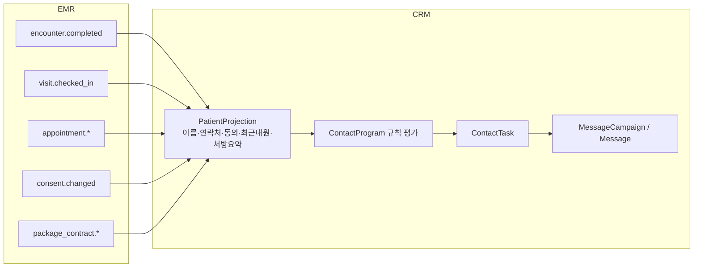

# CRM: 연락 자동화·메시지

재진 유도·복약 관리·해피콜 같은 연락 업무와 문자·알림톡 발송을 다룹니다.

## 현행에서 고칠 점

- **같은 문제를 푸는 시스템이 세 벌 있습니다.** 연락목록 v1(`/crm/contact-list`), 수 복용관리 lite-trigger(`/crm/lite-trigger`), 트리거 엔진 v2(`/crm/trigger-engine`). 여기에 dev 전용 `/schedulers`(루틴)까지 있고 `hospital-variables`도 두 곳에 있습니다
- **경계가 뒤집혀 있습니다.** CRM 개념(연락 일정·트리거·MCP 승인)이 EMR 서버(`emrClient /crm/*`)에 있고, 메시지 발송은 CRM 서버(`crmClient`)에 있습니다. lite-trigger는 상태가 CRM 서버, 규칙이 EMR 서버입니다
- **발송 경로가 채널·유형마다 다릅니다.** `/messages/send/groups/{id}`(PUT), `/messages/kakao/{brand|alimtalk}/groups/{id}`, `/send/patient`, `/kakao/*/patient`, `/send/test`, `/send/test/manual`
- **법적 표기·제한이 클라이언트에 있습니다.** 광고 머리말 `(광고)`·무료거부 꼬리말을 클라이언트가 붙이고, 야간 광고 제한 시각이 수동 발송 20:50, 자동 발송 20:30으로 서로 다릅니다
- **동의 데이터가 두 군데입니다** (EMR 환자 3값, CRM 수신거부 bool)
- **opt-in/opt-out을 클라이언트가 이벤트마다 N번 호출합니다.** 일부만 실패할 수 있습니다
- **되돌리기 방식이 두 가지입니다** (v1 `undoToken`, v2 `actionLogId`)
- **저장 필터가 UI 상태를 이중 JSON으로 `description`에 넣습니다.** 같은 필터인지 문자열 비교로 판정합니다
- 하드코딩: 병원명 `"경희수한의원"`이면 결제수단 알림 숨김, prod 번들의 목 데이터

## 경계

CRM은 EMR 데이터를 **읽기 전용 투영(projection)** 으로만 씁니다.



- CRM은 EMR DB를 직접 조회하지 않습니다. 이벤트로 투영을 갱신하고, 상담 화면에 필요한 상세(최근 3개월 처방, 누적 처방 수)는 EMR 공개 API를 부릅니다
- 환자 동의의 단일 출처는 Patients입니다 ([patients.md](patients.md#동의)). CRM은 환자의 수신거부 요청을 받으면 Patients에 동의 변경을 기록하고, 그 이벤트로 투영을 갱신합니다. 환자가 아닌 번호의 차단만 CRM이 직접 소유합니다 ([동의와 수신거부](#동의와-수신거부))

## 용어

| 업무 용어 | 키 |
|---|---|
| 연락 프로그램 (시나리오, 규칙 묶음) | `ContactProgram` |
| 연락 규칙 | `ContactRule` |
| 연락 작업 (실행 로그, 연락 일정) | `ContactTask` |
| 본사 제공 프로그램 | `source: CENTRAL` |
| 발송 묶음 (발송 그룹) | `MessageCampaign` |
| 개별 메시지 | `Message` |
| 광고 / 알림 | `purpose: ADVERTISING | INFORMATIONAL` |
| 발신번호 | `SenderNumber` |
| 수신거부 | 동의 `DENIED` / `WITHDRAWN` |
| 대체 발송 (알림톡 실패 시 문자) | `fallback` |

## 연락 자동화 (세 시스템 통합)

### 모델

```
ContactProgram
├─ id, name, source: HOSPITAL | CENTRAL, centralProgramId?
├─ trigger: { kind: PRESCRIPTION | ENCOUNTER | APPOINTMENT | PACKAGE | MANUAL, filter{ feeCodes?, visitTypeIds?, ... } }
├─ rules[]: { id, offsetDays, sendTime, channel: CALL | SMS | KAKAO_ALIMTALK | KAKAO_BRAND, purpose: ADVERTISING | INFORMATIONAL, smsFallback: boolean, templateId?, delivery: AUTO | SEMI_AUTO | MANUAL, active }
├─ variables{}            # 병원 변수 (현행 hospital-variables 두 곳을 하나로)
├─ overrides{}            # CENTRAL 프로그램의 병원별 조정 (offsetDays, sendTime)
└─ status: ACTIVE | PAUSED | ARCHIVED

ContactTask
├─ id, programId?, ruleId?, groupId (한 트리거에서 생긴 묶음)
├─ patientId, reason (사람이 읽는 연락 사유), source{ kind, refId, label }
├─ scheduledAt, channel, purpose, smsFallback, templateId?, content? (템플릿 대신 직접 쓴 본문, AI 제안 포함), delivery
├─ status: SCHEDULED | DONE | FAILED | SKIPPED | CANCELED | PROPOSED
├─ enabled (자동 발송 on/off)
├─ outcome?: { completedAt, by, memo, messageId? }
└─ history[]
```

| 현행 | 재설계 |
|---|---|
| 연락목록 v1 규칙 + 일정(`PENDING/COMPLETED/FAILED`) | `ContactProgram` + `ContactTask` |
| lite-trigger 이벤트·규칙 (수 복용관리) | `source: CENTRAL` 프로그램 그룹 |
| 트리거 엔진 programs / central-programs / program-groups / execution-logs | 같은 개념, 이름만 정리 |
| `/schedulers` 루틴 (dev 전용) | 범위 밖. 필요하면 `trigger.kind: MANUAL` 반복 프로그램 |
| MCP 승인 대기 | `ContactTask.status = PROPOSED` |

### 엔드포인트

```
GET  /contact-programs?source=
POST /contact-programs
GET/PATCH/DELETE /contact-programs/{id}
POST /contact-programs/{id}:duplicate
PATCH /contact-programs/{id}/rules/{ruleId}            { active, offsetDays, sendTime, ... }
GET  /central-program-groups
POST /central-program-groups/{key}:subscribe           { variables }     # 그룹 단위 한 트랜잭션 (현행 N번 opt-in)
POST /central-program-groups/{key}:unsubscribe

GET  /contact-tasks?from=&to=&status=&patientId=&programId=&cursor=
GET  /contact-tasks/summary?date=
POST /contact-tasks                                     { patientId(s), scheduledAt, channel, reason, templateId? }   # 수동 등록
POST /contact-tasks:complete                            { ids[], memo? }
POST /contact-tasks:reopen                              { ids[] }
POST /contact-tasks:cancel                              { ids[], reason }
POST /contact-tasks:set-enabled                         { ids[], enabled }
POST /contact-tasks/{id}:reschedule                     { scheduledAt, reason }
POST /contact-task-groups/{groupId}:shift               { anchorTaskId, days, dryRun? }   # 현행 shift-group + preview
POST /undo                                              { token }   # 공통 되돌리기
GET  /patients/{id}/contact-context                     상담 화면용: 최근 처방·예정 예약·최종 내원·활성 패키지
```

- **규칙 검증(서버):** 완료된 작업은 일정 변경 불가, 자동 발송 작업은 이동 불가, 과거로 미루기 불가, 발송 시각이 지난 작업은 on/off 불가. 현행 클라이언트 검사와 `outcome: not_toggleable` 응답을 422로 통일합니다
- `shift`는 `days`가 음수면 앞당기기입니다. 현행 `direction: "forward"` + 음수 `amountDays`의 의미 중복을 없앱니다
- 현행 `complete`에는 되돌리기를 붙이지 않았습니다. 재설계는 `:reopen`이 역커맨드입니다

### AI 에이전트 제안

API 토큰(MCP)으로 들어온 연락 등록은 `PROPOSED` 상태로 만듭니다.

```
GET  /contact-tasks?status=PROPOSED
POST /contact-tasks/{id}:approve        { content?, scheduledAt? }   # 수정과 승인을 한 번에
POST /contact-tasks/{id}:reject         { reason? }
```

현행은 수정(PATCH)과 승인(approve)이 별도 호출이라 원자적이지 않았고, 미리보기가 항상 `광고`로 고정이었습니다.

AI 에이전트는 실명·차트번호·연락처 대신 **가명 핸들**로 환자를 다룹니다 (현행 안내 문구의 정책). 그래서 제안 API는 `patientHandle`을 받고, 서버가 핸들을 환자로 풀어 `PROPOSED` 작업을 만듭니다 ([identity-access.md](identity-access.md#api-토큰-mcp)).

## 메시지

### 모델

```
MessageCampaign
├─ id, channel: SMS | KAKAO_ALIMTALK | KAKAO_BRAND
├─ purpose: ADVERTISING | INFORMATIONAL
├─ content: { title?, body, attachments[], kakao?{ templateId, variables, buttons, carousel } }
├─ senderNumberId | kakaoChannelId
├─ fallback?: { channel: SMS, overflow: UPGRADE_TO_LMS | EXCLUDE }
├─ audience: { patientIds?, contactGroupIds?, filter?, includeAll? }
├─ dedupe: SEND_ONCE_PER_PHONE | SEND_EACH
├─ scheduledAt?
├─ estimate?: { recipients, excluded{ consent, refusal, nightTime, missingVariables, duplicates }, cost }
├─ status: DRAFT | SCHEDULED | SENDING | COMPLETED | PARTIALLY_FAILED | FAILED | CANCELED
└─ stats: { total, delivered, failed, fallbackDelivered, clicked }

Message
├─ campaignId?, contactTaskId?, patientId?, phone
├─ resolvedBody (변수 치환·법정 표기 포함 최종본)
├─ smsKind (SMS | LMS | MMS, 서버 판정)
├─ status: QUEUED | SENT | DELIVERED | FAILED | CANCELED
├─ fallback?: { status, channel }
└─ failureReason?
```

### 엔드포인트

```
POST /message-campaigns                              { channel, purpose, content, ... }  → DRAFT
PATCH /message-campaigns/{id}                        DRAFT만 (If-Match)
POST /message-campaigns/{id}/recipients:add          { patientIds | contactGroupIds | filter | all }  → Job (대량)
POST /message-campaigns/{id}/recipients:remove       { recipientIds }
GET  /message-campaigns/{id}/recipients?issue=duplicate|consent_undecided|missing_variables
POST /message-campaigns/{id}:estimate                → estimate
POST /message-campaigns/{id}:send                    { scheduledAt? }     Idempotency-Key
POST /message-campaigns/{id}:reschedule              { scheduledAt }
POST /message-campaigns/{id}:cancel
POST /message-campaigns/{id}:resend                  { statuses: ["FAILED"] }  → 새 DRAFT 캠페인
POST /message-campaigns/{id}:test                    { phones[] }
GET  /message-campaigns?status=&from=&to=&cursor=
GET  /message-campaigns/{id}/messages?status=&cursor=
POST /message-campaigns:export                       → Job, X-Access-Reason

POST /patients/{id}/messages                         단건 발송 (같은 규칙, 캠페인 없이)
GET  /patients/{id}/message-variables                템플릿 변수 미리보기
```

- **채널은 필드입니다.** 현행 채널·유형별 경로 6가지를 하나로 합칩니다
- **SMS/LMS/MMS 판정(90/2000 byte, 제목·첨부 유무)은 서버가 합니다.** 클라이언트는 `estimate` 결과를 보여 줍니다
- **법정 표기는 서버가 붙입니다.** 광고면 `(광고)`·병원명 머리말과 무료거부 번호·인증코드 꼬리말을 `resolvedBody`에 넣습니다. 클라이언트 편집기는 미리보기만 받습니다
- **야간 광고 제한은 서버 정책 하나입니다.** 21:00–08:00(법정 야간 시간대)에는 야간 별도 동의(`MARKETING_NIGHT`)가 있는 수신자에게만 광고성 메시지를 보냅니다. 병원은 정책으로 이 시간대를 더 넓게(예: 20:30부터) 잡거나 야간 광고를 아예 막을 수 있습니다. 현행 20:30/20:50 불일치를 없앱니다 ([compliance.md](compliance.md#광고성-정보-전송)). 판정은 [night-advertising.ts](../../src/modules/crm/messaging/night-advertising.ts), 결정은 [crm-send-window](rule-decisions.md#crm-send-window)
- **동의·수신거부 제외는 발송 시점에 서버가 다시 합니다.** 환자 동의([patients.md](patients.md#동의))와 번호 단위 `Suppression`(아래)을 모두 검사합니다. `estimate` 이후 동의가 바뀌어도 발송 시 최신 상태로 거릅니다. 마케팅 동의 `UNDECIDED`인 환자는 광고성 발송에서 제외합니다. 현행은 배너만 띄우고 막지 않았습니다
- 수신자 추가가 오래 걸리면 Job입니다. 현행 `receivers/count` 10회 폴링을 대체합니다

### 템플릿

```
GET/POST/PATCH/DELETE /message-templates              { channel, purpose, title, body, attachments, groupId }
GET/POST/PATCH/DELETE /message-template-groups
GET  /message-templates/library                        본사 제공
GET/POST/PATCH/DELETE /kakao-templates                 { kind: ALIMTALK|BRAND, ... }  심사 상태 포함
GET  /message-templates/usage?frequent=true
```

### 발신 수단

```
GET/POST/PATCH/DELETE /sender-numbers        { number, holder: SELF|INSTITUTION, proofDocumentIds[], verificationId }
                                              status: ACTIVE | UNDER_REVIEW | REJECTED  (최대 15개, 증빙 1개월 이내)
POST /sender-numbers/{id}:set-default
GET/POST /kakao-channels
POST /kakao-channels/{id}:set-default
```

### 동의와 수신거부

수신거부는 두 층입니다.

| 층 | 대상 | 저장 위치 |
|---|---|---|
| 환자 동의 | 등록된 환자 | Patients `consents` (단일 출처) |
| 번호 단위 차단 `Suppression` | 전화번호. 환자가 아닌 번호, 080으로 들어온 번호, 엑셀 일괄 등록 번호 | CRM |

```
Suppression
├─ phoneHash, phoneMasked
├─ purpose: MARKETING | INFO
├─ source: HOSPITAL | PATIENT_080 | IMPORT
├─ patientId? (매칭되면)
└─ createdAt, createdBy, removedAt?
```

```
GET  /opt-outs?purpose=&source=&cursor=              환자 동의 거부 + Suppression 통합 조회
POST /opt-outs                                       { phones[] | patientIds[], purpose }
                                                      patientIds → Patients 동의 이력 / phones → Suppression (매칭 환자가 있으면 둘 다). 대량은 Job, 최대 20,000
DELETE /opt-outs/{id}                                병원 등록분만. 080 등록분은 409 (병원이 해제할 수 없음, 현행 규칙)
GET  /opt-outs/080-code                              광고 꼬리말용 병원 인증 코드
POST /opt-outs:export                                → Job, X-Access-Reason
```

- 번호 단위 차단은 환자 동의보다 우선합니다. 환자가 광고 수신에 동의했어도 그 번호가 080으로 거부됐으면 보내지 않습니다
- 080 거부가 들어오면 Integrations가 `Suppression`을 만들고, 번호가 환자와 매칭되면 Patients에 `consent.changed`도 기록합니다

### 주소록·필터

```
GET/POST/DELETE /contact-groups
POST /contact-groups/{id}/members:add | :remove     { patientIds[] }
POST /contact-groups:from-campaign                   { campaignId }
GET/POST/PATCH/DELETE /saved-filters                 { name, filter (AST), uiState? }
```

- `filter`는 서버가 해석하는 AST(`{ op: "and", items: [{ field: "lastVisitDate", gte: "..." }] }`)이고, UI 상태는 별도 필드 `uiState`에 둡니다. 같은 필터 판정은 AST 정규화 해시로 합니다

### 콘텐츠·링크

```
GET/POST/PATCH /contents              { kind, title, sourceUrl, images, groupId, active }
POST /contents:scrape                  { url } → 제목·썸네일
GET  /content-bundles/{token}          공개 (환자용)
POST /content-bundles/{token}/events   { kind: PAGE_VIEW|SHARE_CLICK }   공개
POST /short-links                      { url } → 코드
GET  /message-campaigns/{id}/link-clicks
```

### 상담 스크립트

```
GET  /consult-scripts/tree
POST/PATCH/DELETE /consult-scripts, /consult-script-groups
GET  /consult-scripts?feeCodes=        처방 조합에 맞는 스크립트 (현행 POST by-prescriptions)
```

## 비급여 관리 환자

현행 `/crm/nonbenefit-patients`는 비급여 처방·패키지 환자를 관리 대상으로 묶고 종료·재시작합니다. 재설계에서는 `ContactProgram`(trigger `PRESCRIPTION`, 비급여 항목 필터)이 만든 **추적 대상(enrollment)** 으로 둡니다.

```
GET  /follow-up-enrollments?kind=NONBENEFIT|PACKAGE&status=ACTIVE&cursor=
POST /follow-up-enrollments:terminate      { ids[] }
POST /follow-up-enrollments:restart        { ids[] }
POST /follow-up-enrollments:export         → Job
```

현행은 목록 전체를 `hasMore`가 거짓일 때까지 반복 조회하고 엑셀도 클라이언트가 만들었습니다. 이 화면의 페이지 권한 메타가 없던 문제는 서버의 `crm_followup:read` 권한으로 막습니다.

## 과금

CRM 발송 요금은 테넌트 과금(`/billing`)에 둡니다. 발송 전 결제수단 확인은 `:send`가 402 `PAYMENT_METHOD_REQUIRED`로 알립니다. 현행 병원명 하드코딩 예외는 테넌트 플래그로 바꿉니다.

## 이벤트

`contact_task.created/updated/proposed`, `message_campaign.status_changed`, `message.delivered/failed`, `opt_out.changed`, `suppression.created/removed`

현행에는 CRM 이벤트가 없어 발송 결과와 연락 일정을 refetch·폴링으로만 반영했습니다.
