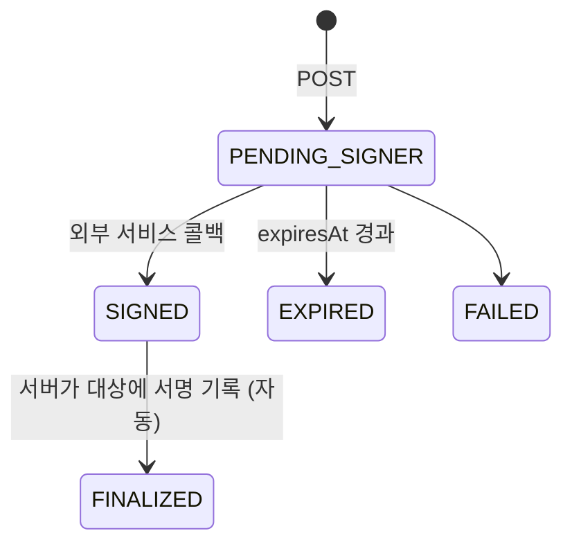

# Documents: 서식 발급·전자서명·태블릿 서식

진단서·소견서·영수증 같은 서식 발급, 진료기록·본인부담금 대장 전자서명, 태블릿 문진·동의서를 다룹니다.

## 현행에서 고칠 점

- **서식마다 발급 엔드포인트가 따로 있습니다.** `POST /documents/medical-certificate`, `/injury-certificate`, `/opinion` 등 20여 개이고, 그중 일부는 `/documents/patients/{pid}/...`에 같은 이름으로 한 번 더 있습니다
- **초안 삭제를 클라이언트가 합니다.** 발급 후 클라이언트가 `DELETE /documents/drafts/{id}`를 보냅니다
- **발급 취소 개념이 없습니다.** 잘못 발급한 진단서를 무효 처리할 방법이 보이지 않습니다
- **전자서명이 5초 폴링입니다.** `request` → `status` 폴링 → `SUCCESS`면 클라이언트가 `finish` 호출
- 태블릿 서식 상태 값을 알 수 없습니다 (`PATCH .../status`)

## 서식 발급

### 모델

```
DocumentTemplate (시스템 제공 서식)
├─ type: MEDICAL_CERTIFICATE | INJURY_CERTIFICATE | OPINION | MEDICATION_OPINION | TRANSFER_OPINION | REFERRAL_LETTER
│       | OUTPATIENT_CERTIFICATE | WORK_ABILITY | MEDICAL_RECORD_COPY | MEDICAL_PAYMENT_RECEIPT | MEDICAL_STATEMENT
│       | HERBAL_MEDICINE_RECEIPT | HERBAL_PRESCRIPTION | PILOT_HERBAL_PRESCRIPTION | PILOT_HERBAL_GUIDE
│       | FUTURE_COST_ESTIMATE | CUSTOMS_CERTIFICATE | MEDICAL_AID_REFERRAL | MEDICAL_AID_TRANSFER
│       | MEDICAL_AID_EXTENSION | COPAYMENT_LEDGER | ...
├─ schemaVersion, fields (JSON Schema)
├─ requiresDoctorSignature: boolean
└─ sources: 서버가 미리 채울 수 있는 데이터 (상병, 진료일, 수납내역, 처방)

DocumentDraft
├─ patientId, type, data, createdBy, updatedAt

IssuedDocument
├─ id, documentNumber (테넌트·연도별 연번), type, patientId
├─ encounterIds[], receiptIds[], herbalPrescriptionId?
├─ data (발급 시점 고정), renderedFileId (PDF)
├─ issuedBy, issuedAt, doctorId?, signature?
├─ status: ISSUED | VOIDED
└─ voided?: { reason, by, at, replacedBy? }
```

### 엔드포인트

```
GET  /document-templates
GET  /patients/{id}/documents/prefill?type=&encounterIds=&receiptIds=   서버가 채운 초기값
GET  /patients/{id}/document-drafts
POST /patients/{id}/document-drafts            { type, data }
PATCH/DELETE /document-drafts/{id}
POST /patients/{id}/documents                  { type, data, draftId?, encounterIds?, receiptIds? }   Idempotency-Key
                                                → 201 IssuedDocument  (draftId가 있으면 같은 트랜잭션에서 초안 삭제)
GET  /documents?type=&patientId=&from=&to=&cursor=    발급대장 (현행 /documents/issued)
GET  /documents/{id}
GET  /documents/{id}/file                      → 서명된 PDF URL, 열람 기록
POST /documents/{id}:void                      { reason, reissue?: { data } }
```

- 현행 서식별 20여 개 POST가 `type` 필드 하나로 합쳐집니다. 서식별 필드 검증은 `DocumentTemplate.fields` 스키마로 서버가 합니다
- **연번은 서버가 발급 트랜잭션 안에서 부여합니다.** 현행 `documentNumber(s)`와 같지만 무효 처리해도 번호를 재사용하지 않습니다
- 렌더링(PDF)은 서버가 합니다. 출력 시점에 클라이언트가 그린 화면과 보관본이 달라지는 일을 막습니다
- 진료비 영수증·세부내역서처럼 수납에서 나오는 서식은 `receiptIds`로 금액을 서버가 계산합니다

### 상용구

서식용 상용구는 [catalog.md](catalog.md#운영)의 `text-snippets`(`context: DOCUMENT`)로 합칩니다. 현행 `/documents/phrases`.

### 연말정산

```
GET  /tax-deduction/receipts?year=&patientId=&cursor=     현행 year-end-tax-settlement/details
GET  /tax-deduction/summary?year=
PATCH /receipts/{id}/tax-deduction                         { excluded: boolean }   현행 receipt-details/deduction-exclusion
POST /tax-deduction:export                                 { year } → Job (국세청 제출 파일)
```

현행 연말정산 라우트는 EMR 전용 가드 목록의 이름 오타(`claim-year-settlement`)로 가드를 받지 않았습니다. 재설계에서는 `tax_deduction:read` 권한과 `EMR` 제품 확인을 서버가 합니다.

## 전자서명

의사가 진료기록, 데스크가 본인부담금 대장에 공인 전자서명을 합니다. 외부 서명 서비스(휴대폰 인증서 등)를 거치는 비동기 절차입니다.

```
SignatureRequest
├─ id, kind: MEDICAL_RECORDS | COPAYMENT_LEDGERS
├─ signerId
├─ targets[]: encounterId | ledgerDate
├─ status: PENDING_SIGNER | SIGNED | FINALIZED | EXPIRED | FAILED
├─ expiresAt
└─ result?: { signedAt, certificateSerial, failedTargets[] }
```



```
GET  /signature-requests/signable?kind=MEDICAL_RECORDS&signerId=&from=&to=     서명할 대상 목록
GET  /signature-requests/signed?kind=&from=&to=
POST /signature-requests                    { kind, targets[] | { from, to, all: true } }  → 202 { id, expiresAt, externalAuthUrl? }
GET  /signature-requests/{id}
```

- **서명 완료 처리는 서버가 합니다.** 외부 서비스 콜백을 받아 `SIGNED`가 되면 서버가 바로 대상에 서명을 기록하고 `FINALIZED`로 만듭니다. 현행처럼 클라이언트가 `finish`를 부를 때까지 기다리지 않습니다
- 클라이언트는 폴링 대신 `signature_request.status_changed` 이벤트를 받습니다
- **서명 후 진료기록이 정정되면** 서명은 이전 버전에 남고, 새 버전은 `signature: null`이 되어 서명 대상 목록에 다시 나타납니다 ([compliance.md](compliance.md#진료기록-정정))

## 태블릿 문진·동의서

```
FormTemplate
├─ kind: QUESTIONNAIRE | CONSENT
├─ title, languages[], versions[]: { version, questions[] | body, publishedAt }
├─ status: DRAFT | PUBLISHED | ARCHIVED
└─ visitTypeIds[]? (자동 제시 조건)

IntakeSubmission
├─ patientId, visitId?, templateId, templateVersion
├─ answers | signatureImageId + renderedFileId
├─ submittedAt, deviceId
└─ corrections[]: { by, at, changes, reason }
```

```
GET/POST /settings/form-templates
PATCH    /settings/form-templates/{id}                DRAFT일 때만 내용 수정
POST     /settings/form-templates/{id}:publish        새 버전 고정
POST     /settings/form-templates/{id}:archive
POST     /settings/form-templates/{id}:duplicate
POST     /intake-links                                { patientId, templateIds[], channel: SMS|KAKAO } → 링크 발송
POST     /tablet-sessions                             { deviceId, patientId, templateIds[] }  → 태블릿에 서식 띄우기
POST     /intake-submissions                          기기 토큰 또는 링크 토큰으로 제출
POST     /intake-submissions/{id}/corrections         { changes, reason }
POST     /photo-requests                              { deviceId, patientId }   태블릿에 사진 촬영 요청
POST     /photo-requests/{id}:cancel
```

- 현행 `PATCH .../status`(값 미상)를 `:publish` / `:archive`로 명시합니다. 발행된 버전은 바꾸지 않아 제출본이 어떤 문항에 답한 것인지 보존합니다
- 동의서 제출은 [patients.md](patients.md#동의)의 `consents`에 `TREATMENT_CONSENT` 이력을 함께 남깁니다
- 문진 제출·동의서 서명은 `intake.submitted` 이벤트로 데스크·진료실에 알립니다. 현행에는 이 이벤트가 없었습니다
