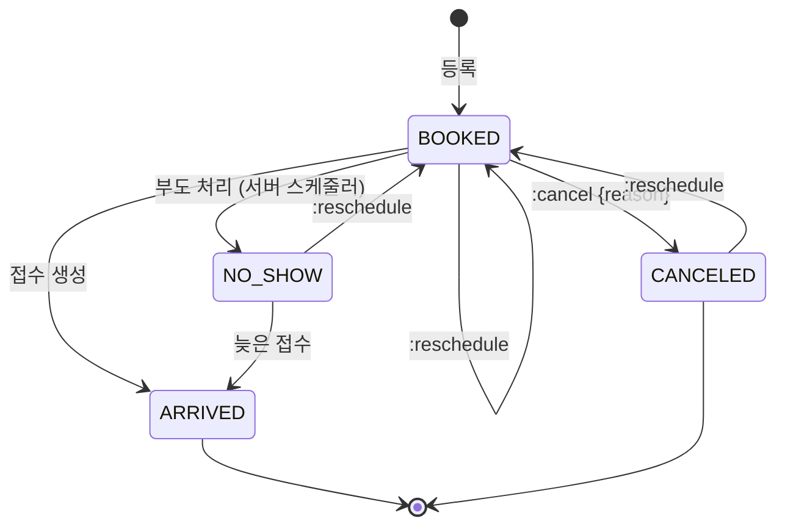
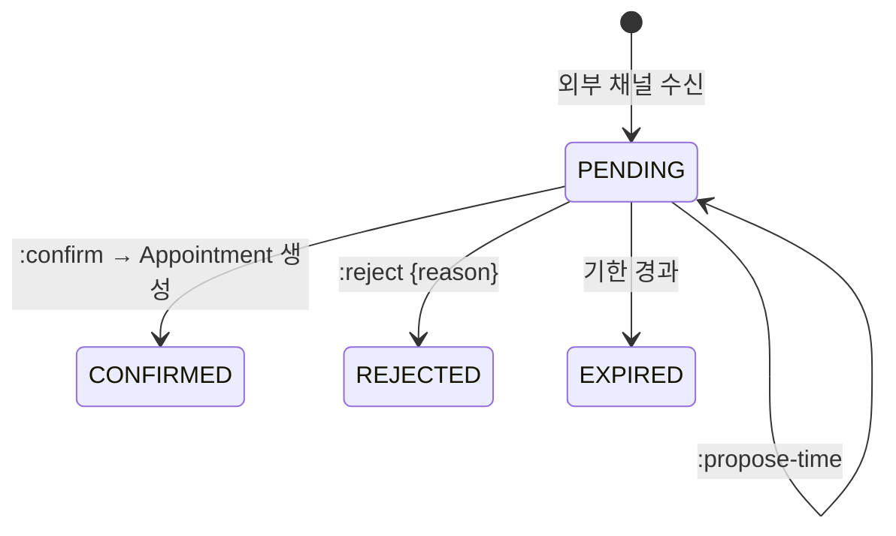
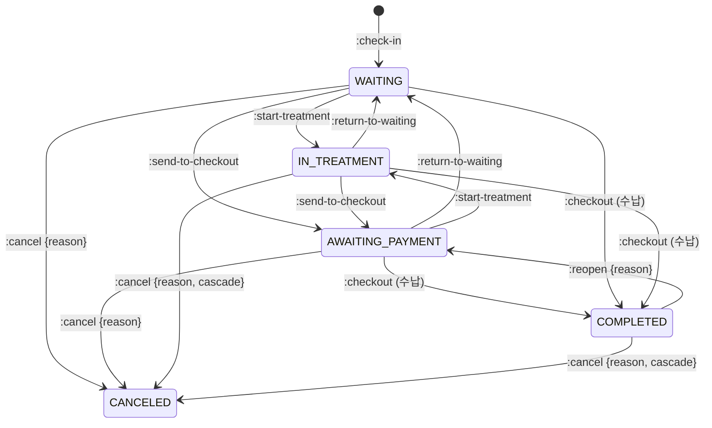

# Front Desk: 예약·내원·수납

하루 단위 환자 흐름을 다룹니다. 예약 → 내원(접수) → 진료·치료 → 수납 → 완료.

## 현행에서 고칠 점

- **내원이 `/desk/waiting`이라는 UI 컬럼 이름으로 노출됩니다.** 상태도 칸반 컬럼 이름(`대기`/`치료`/`수납`/`수납완료`)을 그대로 씁니다
- **상태 전이표가 클라이언트에만 있습니다.** 어느 칸에서 어느 칸으로 끌 수 있는지 서버는 모르는 것으로 보입니다. 버그로 `수납완료` 칸이 `대기` 카드를 받지만 처리 분기가 없습니다
- **수납이 세 단계 호출입니다.** 진료마다 `POST /record/{id}/save` → `POST /desk/v2/receipts` → `PATCH /desk/waiting {상태: 수납완료}`. 중간에 실패하면 돈은 받았는데 상태는 `수납`으로 남습니다
- **예약 상태가 플래그 4개입니다** (`내원여부`, `취소여부`, `부도여부`, `삭제여부`). 화면 표시 상태 7종(`부도후_내원`, `취소후_예약일자_변경` 등)을 클라이언트가 이력에서 추론합니다
- **예약 검증이 클라이언트에 있습니다.** 과거 시간·휴게·휴진·의사 휴진·차단 시간·수용 한도. 서버는 중복일 때 409만 관찰됩니다
- **접수 삭제가 그날 진료기록과 수납까지 지웁니다.** 되돌릴 수 없고 감사 흔적도 보이지 않습니다
- **변경 감지를 폴링으로 합니다.** 1분 폴링 + 소켓 + `GET /desk/receipts/updated-checks/{date}`. 소켓 알림 payload에 환자 이름이 없어 알림 하나에 목록 전체를 다시 받습니다

## 용어

| 업무 용어 | 키 |
|---|---|
| 예약 | `Appointment` |
| 외부 예약 요청 | `BookingRequest` |
| 예약 차단 / 마킹 | `ScheduleBlock` (`kind: BLOCK | MARK`) |
| 접수·내원 | `Visit` |
| 진료항목 (예약 단위) | `visitType` |
| 보험구분 | `coverage`: `NHIS`(건보), `MEDICAL_AID`(의료급여), `AUTO_INSURANCE`(자보), `INDUSTRIAL_ACCIDENT`(산재), `SELF_PAY`(일반) |
| 초진 / 재진 | `isFirstVisit` |
| 수납 | `Receipt` |
| 결제 | `Payment` |
| 손비처리 | `writeOff` |
| 미수 / 과수납 | `outstanding` / `overpaid` |
| 시재 | `CashDrawer` |
| 지출 | `Expense` |

## 예약

### 상태



- `status`: `BOOKED`, `ARRIVED`, `NO_SHOW`, `CANCELED`
- 현행 표시 상태 7종은 `status` + `history`로 서버가 계산한 `displayStatus`로 줍니다 (`ARRIVED_AFTER_NO_SHOW`, `RESCHEDULED_AFTER_CANCEL` …). 클라이언트 추론(`vl()`, `Lnt`)을 없앱니다
- **삭제는 두지 않습니다.** 잘못 만든 예약은 `:cancel {reason: "ENTERED_IN_ERROR"}`로 취소하고 목록에서 거릅니다. 현행 `DELETE`는 알림 메시지까지 지웠습니다
- **부도 처리:** 정책(`noShowAfterMinutes` 10/30/60분 또는 진료 마감 시점)에 따라 서버 스케줄러가 전이합니다. 현행과 같지만 명시적 상태가 됩니다
  - `BOOKED`만 대상이고, 예약 시작 + N분 이상이 되면 바꿉니다. 시간 미정 예약은 진료 마감, 진료 마감 모드는 진료 마감과 시작 + N분 중 늦은 쪽입니다. 진료 마감은 진료의 날짜별 > 진료의 요일별 > 병원 날짜별 > 병원 요일별 일정의 마지막 구간 종료이고, 휴진일이면 자정입니다
  - 설정은 `{noShowAfterMinutes: 10|30|60, noShowAtClinicClose}`이고 다른 분 값은 422 `NO_SHOW_MINUTES_INVALID`입니다. 판정은 [appointment-no-show.ts](../../src/modules/front-desk/appointments/appointment-no-show.ts)의 순수 함수입니다

### 리소스

```
Appointment
├─ patientId? | prospect { name, phone }     # 신환은 환자 없이 예약 가능
├─ date, startTime? (null = 시간 미정), durationMinutes
├─ doctorId, visitTypeIds[], coverage
├─ memo (plain text + 제한된 서식)
├─ reminders { onCreate, dayBefore, sameDay, onChange }
├─ origin: DESK | BOOKING_REQUEST | TELEMEDICINE | ...  + externalOrderRef?
├─ status, displayStatus, history[]
└─ visitId? (ARRIVED일 때)
```

```
GET  /appointments?from=&to=&doctorId=&status=
POST /appointments                                     Idempotency-Key
GET  /appointments/{id}
PATCH /appointments/{id}                                메모·진료항목 등 일정 외 필드
POST /appointments/{id}:reschedule                     { date, startTime, doctorId?, reason? }
POST /appointments/{id}:cancel                         { reason, notifyPatient }
GET  /appointments/{id}/history
GET  /appointments/availability?date=&doctorId=&visitTypeId=   → 슬롯별 { capacity, booked, blockedBy? }
```

- **서버 검증:** 생성·변경 시 과거 시간, 휴게, 병원 휴진, 의사 휴진(종일·오전·오후), 차단 시간, 진료시간 외, 수용 한도를 검사합니다
  - 막는 것은 422(`APPOINTMENT_DURATION_INVALID`, `OUTSIDE_HOURS`, `CLINIC_CLOSED`, `DOCTOR_OFF`, `APPOINTMENT_IN_PAST`, `BREAK_TIME`). 이 순서로 정렬해 모두 돌려줍니다
  - 현행처럼 "확인 받으면 허용"인 것(차단 시간 `SLOT_BLOCKED`, 수용 한도 초과 `CAPACITY_EXCEEDED`)은 `warnings`로 주고, 요청의 `acknowledge`에 그 코드가 있으면 저장합니다. 확인을 받지 않은 경고가 남으면 저장하지 않고 422로 응답하며, 문제 응답의 `warnings`에 그 코드를 담습니다. 경고를 무시했다는 사실이 이력에 남습니다. 막는 오류는 `acknowledge`로 넘길 수 없습니다
  - 예약이 덮는 슬롯(시작 시각부터 길이만큼)을 모두 검사합니다. 시간 미정 예약은 진료 요일, 병원 휴진, 종일 휴진, 지난 날짜만 검사합니다
  - 새 예약에 `exclusiveBooking` 진료항목이 있으면 그 예약이 들어갈 셀의 한도도 1입니다
  - 판정은 [appointment-acceptance.ts](../../src/modules/front-desk/appointments/appointment-acceptance.ts)의 순수 함수입니다
- **수용 한도:** `exclusiveBooking` 진료항목이 하나라도 있으면 1건, 아니면 `capacityPerSlot`. 현행과 같은 규칙을 서버로 옮깁니다
- **취소 알림:** 현행 "취소 안내 문자 보내기" 체크박스는 dev 환경에서만 보이고 값이 요청에 실리지 않습니다 (미완성 기능으로 보임). 재설계는 `notifyPatient`를 명시적 필드로 둡니다
- **플래너 뷰:** 현행 `/desk/appointments/planner`는 같은 목록의 다른 정렬입니다. `GET /appointments?view=planner` 대신 클라이언트가 같은 목록을 그립니다

### 차단·마킹

```
GET    /schedule-blocks?from=&to=
POST   /schedule-blocks                { kind: BLOCK|MARK, doctorId?, ranges[{ date, startTime, endTime }], color?, memo }
DELETE /schedule-blocks/{groupId}
```

현행 `appointment-blocks`와 `appointment-markings`를 `kind`로 합칩니다. 마킹은 차단·휴게 구간에 만들 수 없습니다 (422).

### 외부 예약 요청



```
GET  /booking-requests?status=PENDING
POST /booking-requests/{id}:propose-time     { date, startTime }   # PENDING일 때 일자·시간만 (진료의 변경 불가, 현행 규칙)
POST /booking-requests/{id}:confirm          { date?, startTime?, doctorId? }    Idempotency-Key
POST /booking-requests/{id}:reject           { reason }
POST /booking-requests:batch-confirm         { ids[] }  → Job (항목별 결과)
```

- 현행 대기 판정은 클라이언트가 이력을 보고 추론했습니다. 재설계는 `status`가 있습니다
- 외부 채널(닥톡 등)에 결과를 돌려주는 일은 Integrations가 `booking_request.confirmed` 이벤트를 받아 처리합니다. 실패하면 요청의 `syncStatus: PENDING|SYNCED|FAILED`로 보여 줍니다 (현행 `NONE/SENT/COMPLETED/FAILED`)
- 현행은 일괄 확정을 클라이언트가 100건씩 끊어 보냈습니다. 재설계는 `Job` 하나입니다

## 내원 (접수)

### 상태



| 현행 `상태` | 재설계 `status` |
|---|---|
| `대기` | `WAITING` |
| `치료` | `IN_TREATMENT` |
| `수납` | `AWAITING_PAYMENT` |
| `수납완료` | `COMPLETED` |
| (`DELETE /desk/waiting/{id}`) | `CANCELED` |

- **차팅 완료는 상태가 아닙니다.** 현행처럼 별도 값이지만, 내원의 `encounterStatus`로 Clinical에서 파생해 줍니다
- **현행 "수납완료 → 대기/치료" 이동**은 `:reopen`을 거쳐야 합니다. 이미 받은 돈과 상태가 어긋나지 않게 합니다. 클라이언트는 카드를 끌어 놓을 때 `:reopen` 다음 `:return-to-waiting`/`:start-treatment`를 이어 부르거나, `:reopen {reason, then: "WAITING"}`으로 한 번에 보냅니다
- **취소:** 현행 접수 삭제는 진료기록과 수납까지 지웠습니다. 재설계는 지우지 않고 `CANCELED`로 남깁니다. 진료 내용이나 수납이 있으면 상태와 상관없이 기본으로 409 `VISIT_HAS_CLINICAL_DATA`이고, 권한이 있는 사용자는 [연쇄 취소](#연쇄-취소)로 한 번에 정리할 수 있습니다 ([결정 D3](review.md#결정-필요))
- **지난 날짜:** 진료일이 병원 시간대 오늘보다 이전인 내원은 `:checkout`, `:reopen`, `:cancel`만 받습니다. 진료 흐름 커맨드는 422 `VISIT_DATE_PAST`입니다 ([결정](rule-decisions.md#visit-status-transitions-5-과거-날짜-내원의-전이--채택))

### 리소스

```
Visit
├─ patientId, date, checkedInAt, channel: DESK|TABLET|KIOSK|TELEMEDICINE, origin: ONLINE|OFFLINE_SYNC
├─ appointmentId?
├─ doctorId, visitTypeId, coverage, isFirstVisit (서버 계산, 수정 가능)
├─ eligibility: { status: VERIFIED|UNVERIFIED|NOT_REQUIRED, nhis?, autoInsuranceCaseId?, industrialAccidentCaseId?, identityVerified, selectedInstitution? }
├─ benefitFlags: { fullSelfPay, pregnant, specialCaseCode?, rareDiseaseSupport, pilotHerbal{...}, homeVisitTarget?, telemedicinePilot }
├─ status, statusChangedAt
├─ bed?: { roomId, bedNumber }
├─ handoffNote?
├─ encounterId (생성 시 함께 생성)
└─ derived (목록 응답): encounterStatus, hasReceipt, balance{outstanding, overpaid}, prepaidBalance, activePackages, memoCount
```

```
GET  /visits?date=2026-11-01&status=
GET  /visits/{id}
POST /visits:check-in                     아래
PATCH /visits/{id}                        doctorId, visitTypeId, handoffNote (If-Match)
POST /visits/{id}:change-coverage         { coverage, eligibility }
POST /visits/{id}:start-treatment         { roomId?, bedNumber?, handoffNote?, doctorId? }
POST /visits/{id}:return-to-waiting
POST /visits/{id}:send-to-checkout
POST /visits/{id}:checkout                [수납](#수납)
POST /visits/{id}:reopen                  { reason }
POST /visits/{id}:cancel                  { reason, cascade?, refunds? }   ?dryRun=true 지원
```

### 접수 커맨드

```jsonc
POST /visits:check-in
Idempotency-Key: ...
{
  "patientId": "pat_...",               // 또는 "newPatient": { ...환자 생성 필드 }
  "appointmentId": "apt_...",           // 있으면 예약을 ARRIVED로
  "date": "2026-11-01",
  "doctorId": "usr_...",
  "visitTypeId": "vt_...",
  "coverage": "NHIS",
  "eligibilityLookupId": "elg_...",     // 미리 조회한 자격 결과
  "autoInsuranceCaseId": null,
  "benefitFlags": { ... },
  "jejuSubsidy": { "enrollmentId": "..." },
  "initialStatus": "WAITING",           // 또는 IN_TREATMENT
  "acknowledge": []
}
→ 201 { visit, encounter, appointment? }
```

한 트랜잭션에서 하는 일:

1. 신환이면 환자 생성 (중복 주민번호면 409)
2. 자격조회 결과가 환자 정보와 다르면(건보증번호 등) 환자 갱신. 현행은 클라이언트가 `PATCH /patients`를 따로 보냈습니다
3. 내원·진료(encounter) 생성, 예약 `ARRIVED`
4. 제주 지원 스냅샷 생성. 현행은 접수 후 별도 호출이었습니다
5. 이벤트 `visit.checked_in`

서버 검증 (현행 클라이언트 규칙):

| 규칙 | 오류 | 현행 동작 ([check-in-validation](../reference/rules/check-in-validation.md)) |
|---|---|---|
| 건보·의료급여 접수인데 자격 조회 결과가 없거나 자격 코드를 알 수 없음 | 422 `NHIS_NOT_ELIGIBLE` | 다이얼로그로 막음 |
| 급여제한 `01` 무자격·`04` 사망·`05` 국외이민이면 `SELF_PAY`만 가능. `02`·`03` 체납은 접수하고 급여제한 표시 | 422 `NHIS_BENEFIT_RESTRICTED` | 급여제한 코드 `01`(무자격)만 일반으로 자동 전환하고 경고. `02`–`05`는 그대로 ([결정](rule-decisions.md#check-in-validation-1-급여제한-코드별-처리--채택)) |
| 의료급여(자격 7·8) + 본인부담 M001/M002/B001/B002 환자가 선택기관 1–4에 우리 기관이 없으면 선택 사유(B005 등) 필수. 의뢰 코드 `B005`·`B006`·`B008`을 골랐는데 의뢰 기관이 없어도 같은 오류 | 422 `SELECTED_INSTITUTION_REQUIRED` | 같음 |
| 자보 누적 진료비가 지급보증 한도 초과 (`fullSelfPay` 아니면) | 422 `AUTO_INSURANCE_LIMIT_EXCEEDED` | 다이얼로그 경고 |
| 자보 지급보증 기간 만료 | 422 `AUTO_INSURANCE_CASE_EXPIRED` | **신규 규칙.** 현행은 검사하지 않음 |
| 예약일이 오늘이 아님 | 422 `APPOINTMENT_NOT_TODAY` | 버튼 비활성으로만 막음 |
| 본인확인이 필요한데 하지 않음 (첫 내원, 확인 이력 없음, 마지막 확인이 6개월보다 오래됨. 공단 예외 `Y`·만 19세 미만·임산부·본인부담 100%는 예외) | 422 `IDENTITY_VERIFICATION_REQUIRED` | 필드 오류로 막음 ([결정](rule-decisions.md#check-in-validation-9-본인확인--채택)) |

**보험구분 변경**(`:change-coverage`)은 이미 승인된 처방(추나·첩약 심평원 승인)이 있으면 409입니다. 새 보험구분에서 쓸 수 없는 처방 라인은 서버가 지우지 않고 `invalid: COVERAGE_MISMATCH`로 표시해 응답의 `invalidatedPrescriptionLines[]`로 알립니다. 진료가 `DRAFT`면 의사가 고치기 전까지 진료 완료가 막히고, 이미 `COMPLETED`면 [정정 제안](clinical.md#진료-encounter)이 만들어집니다. 처방은 면허 행위라 데스크 동작이 진료기록을 직접 바꾸지 않게 합니다. 현행은 클라이언트가 판단해 `record/save`로 지웠습니다.

### 접수 구현 결정

구현은 [visits.ts](../../src/modules/front-desk/visits/visits.ts)의 `checkIn`·`get`·`list`입니다 (#16).

- **범위:** 등록된 환자를 오늘 진료로 접수하고(`POST /visits:check-in`), 내원 하나(`GET /visits/{id}`)와 그날 목록(`GET /visits?date=&status=`)을 엽니다. 내원은 보험구분·초진 여부·판정한 자격·본인부담 표시(`fullSelfPay`·`pregnant`)·접수 시각을 저장합니다
  - 미룸: 신환 동시 등록(`newPatient`), 예약 `ARRIVED`(`appointmentId`), 진료의·진료항목(`doctorId`·`visitTypeId`), 제주 지원 스냅샷, 자격 조회 결과로 환자 갱신, `channel`·`origin`, `acknowledge`, 나머지 `benefitFlags`, `PATCH /visits/{id}`, 목록의 `derived`. 모두 그 모듈이 생길 때 같은 트랜잭션에 더합니다
- **아직 받지 않는 필드는 400입니다.** 위 요청 예의 `date`·`appointmentId`·`newPatient`·`doctorId`·`eligibilityLookupId`처럼 미룬 필드를 보내면 조용히 버리지 않고 `VALIDATION_FAILED`로 알립니다. 버리면 예약이 `ARRIVED`가 되지 않거나 다른 날로 접수된 것을 모릅니다. 이 엔드포인트만 남는 키를 거절하고(`PayloadParseOptions`), 필드를 더할 때 함께 받습니다
- **진료일은 서버가 정합니다.** 본문에 `date`를 받지 않고 병원 시간대의 오늘로 접수합니다. 지난 날짜 접수를 열면 지난 날짜 내원 규칙(`VISIT_DATE_PAST`)과 청구 마감이 함께 흔들립니다. `APPOINTMENT_NOT_TODAY`는 예약을 받을 때 씁니다
  - 되돌릴 조건: 오프라인 엣지가 밀린 접수를 올릴 때(offline.md)는 그 경로에서 엣지의 진료일을 받습니다
- **자격·자보는 결과를 본문으로 받습니다.** 자격 조회·자보 사고 모듈이 없어 `eligibilityLookupId`·`autoInsuranceCaseId` 대신 공단 응답(`eligibility`)과 지급보증(`autoInsurance`)을 받습니다. 클라이언트가 보낸 값을 믿는 것이라, 조회 모듈이 생기면 ID로 바꾸고 서버가 조회 결과를 읽습니다. 건보·의료급여가 아니면 받은 자격 결과를 저장하지 않습니다
- **검증 오류는 `CHECK_IN_REJECTED` 하나로 모두 돌려줍니다.** 422 문제 응답의 `errors`에 `validateCheckIn`의 코드를 검사 순서대로 담습니다. 위 표의 코드는 `errors`의 값입니다
  - 대안: 코드마다 문제 타입(`NHIS_NOT_ELIGIBLE` 등)을 두고 첫 오류만 돌려주기. 데스크가 한 번에 모든 이유를 고칠 수 없어 버렸습니다
- **본인확인·초진은 이전 내원에서 셉니다.** 첫 내원일은 환자의 `firstVisitDate`(아직 아무도 채우지 않음), 없으면 취소하지 않은 가장 이른 내원의 진료일입니다. 마지막 본인확인일은 `identityVerified`로 접수한 취소하지 않은 마지막 내원의 진료일입니다. 취소한 내원은 잘못 받은 접수라 세지 않습니다. 이전 내원이 없으면 초진(`isFirstVisit: true`)입니다
  - 대안: 환자에 `lastIdentityVerifiedOn`을 저장하기. 내원을 취소할 때 되돌릴 값이 생겨 버렸습니다. 이력이 길어져 느려지면 환자에 캐시합니다
- **요양기관기호는 병원 설정(`hiraInstitutionCode`)입니다.** 없으면 선택의료기관 적용자 판정을 하지 않습니다(의뢰 코드의 기관 누락만 봅니다)
- **같은 ID 재접수는 409 `VISIT_ALREADY_EXISTS`입니다.** 오프라인 엣지가 ID를 정해 보내므로(`id`), 응답을 못 받고 다시 보내면 409를 받고 `GET /visits/{id}`로 확인합니다. 저장소의 새 내원 충돌(`VersionMismatch`)을 바꾼 것입니다. 다른 병원의 같은 ID도 409라 ID가 겹쳤다는 것만 드러나는데, ULID라 실제로 겹칠 일이 없습니다
  - 대안: `Idempotency-Key`로 처음 응답을 다시 주기. conventions.md의 대상(돈·외부 효과)이 아니고 ID로 중복이 막혀 미뤘습니다
- **같은 환자의 같은 날 접수를 막지 않습니다.** 오전·오후 따로 오는 환자가 있습니다. 실수로 두 번 받은 접수는 취소합니다
  - 같은 환자를 동시에 두 번 접수하면 둘 다 이전 내원을 보지 못해 둘 다 초진이 되고 본인확인 판정도 같이 통과할 수 있습니다. 이력 읽기와 저장이 한 트랜잭션이 아니기 때문입니다. 데스크 한 곳이 한 환자를 접수하는 것이 보통이라 받아들이고, 둘째 접수를 취소하면 바로잡힙니다. 되돌릴 조건: 초진 산정이 청구에 쓰이기 시작하면 저장소의 같은 트랜잭션에서 이력을 읽습니다
- **바로 진료는 `visit:update`도 필요합니다.** `initialStatus: IN_TREATMENT`는 `:start-treatment`와 같아, 본문에 따라 서비스가 더 확인합니다(D3의 연쇄 취소와 같은 방식). 없으면 403 `PERMISSION_DENIED`입니다
- **바로 진료(`initialStatus: IN_TREATMENT`)도 이벤트는 `visit.checked_in` 하나입니다.** 데이터는 `{ visitId, patientId, date, coverage, isFirstVisit, status }`이고 `tenantId`·`actor`를 채웁니다
- **응답은 내원 하나입니다.** 위 예의 `{ visit, encounter, appointment? }` 대신 conventions.md의 "커맨드 응답은 바뀐 주 리소스"를 따릅니다. 함께 만든 진료는 내원의 `encounterId`로 잇고(#22, [clinical.md](clinical.md#진료-구현-결정)), 함께 바뀐 예약은 이벤트로 알립니다
- **자격 필드 이름:** 리소스 표의 `selectedInstitution?` 대신 `selectedInstitutionCode`(기호)를 두고, 직원이 고른 `copayCode`(공백·`없음`은 `null`)와 체납 표시 `benefitRestricted`를 더했습니다. `UNVERIFIED`는 오프라인 엣지가 자격 조회 없이 받은 접수에 쓸 값이라 그 경로가 생길 때 더합니다
- **자보 지급보증이 없으면 한도·만료를 보지 않습니다.** `autoInsurance`를 보내지 않은 자보 접수는 통과하고, 보증 값은 저장하지 않습니다. 자보 사고 모듈이 생기면 사고 ID를 필수로 받아 서버가 보증을 읽습니다
- **병원 시간대는 아직 `Asia/Seoul` 하나입니다.** 병원의 `timezone` 설정이 있지만 상태 커맨드(`VISIT_DATE_PAST`)와 같이 `clinicDate`를 씁니다. 다른 시간대의 병원이 생기면 두 곳을 함께 병원 설정으로 바꿉니다
- **목록은 쪽을 나누지 않습니다.** 하루 내원은 수백 건 안쪽이라 접수 시각, ID 순서로 모두 줍니다. 날짜가 없으면 오늘입니다
- **저장:** 마이그레이션 `0006_visit_check_in`이 `visits`를 새로 만듭니다(그 전 내원은 개발용 샘플뿐). 자격·표시는 JSON 열이고 본인확인 이력은 `json_extract`로 셉니다. `patient_id`에 외래 키를 걸지 않습니다. 환자는 다른 모듈의 테이블이라 모듈 사이는 ID로만 잇고(0004와 같음), 접수가 환자를 읽어 확인합니다. 개발 서버의 샘플 내원은 없앴습니다. 이제 접수로 만듭니다
- **되돌릴 조건:** 오프라인 엣지가 생기면 그 경로의 진료일·`origin`을 받습니다. 자격 조회 모듈이 생기면 본문의 자격 결과를 받지 않습니다

### 연쇄 취소

접수를 잘못 받았거나 환자가 진료 후 취소를 원하는 경우, 그 내원에 딸린 기록을 한 트랜잭션에서 모두 취소합니다.

```jsonc
POST /visits/{id}:cancel?dryRun=true
{ "reason": "WRONG_PATIENT", "cascade": true }
→ 200 {
  "impacts": {
    "encounters": [{ "id": "enc_...", "action": "RETRACT" }],
    "receipts": [{ "id": "rcp_...", "action": "VOID" }],
    "payments": [{ "id": "pay_...", "method": "CARD", "action": "REFUND_REQUIRED" }],
    "packageUsages": [{ "id": "...", "action": "CANCEL" }],
    "prepaidTransactions": [{ "id": "...", "action": "CANCEL" }],
    "procedures": [{ "id": "...", "action": "CANCEL" }],
    "herbalPrescriptions": [{ "id": "...", "action": "CANCEL" }],
    "claims": [{ "id": "...", "action": "EXCLUDE" }]
  },
  "blockers": [{ "code": "HERBAL_COMPOUNDING_STARTED", "subject": "hp_..." }]
}
```

- **권한:** `visit:cancel`, `receipt:void`, `encounter:retract`를 모두 가진 사용자만 `cascade: true`를 쓸 수 있습니다. `encounter:retract`는 면허 행위이므로 사실상 의사입니다. 내용이 없는 `DRAFT` 진료(접수 때 자동 생성된 빈 진료)는 연쇄가 아니어도 함께 철회됩니다
- **한 트랜잭션에서 하는 일:** 진료 `ENTERED_IN_ERROR`, 영수증 `VOIDED`, 패키지 사용·선수금 차감 취소(잔액 복원), 치료실 시술 취소, 미조제 탕전 처방(`DRAFT`·`READY`) 취소, 집계 중이거나 전송 전(`AGGREGATING`·`READY`)인 청구에서 제외, 내원 `CANCELED`, 예약은 `ARRIVED`에서 `BOOKED`로 되돌리지 않고 그대로 둡니다
- **돈:** 현금·계좌이체 결제는 본문 `refunds[]`로 환불을 함께 기록합니다. 카드·간편결제처럼 외부 취소가 필요한 결제는 먼저 [환불](#환불과-정정)을 끝내야 하며, 남아 있으면 `blockers`에 `PAYMENT_REFUND_REQUIRED`가 나옵니다
- **막는 경우 (`blockers`, 실제 요청이면 409):**

| `code` | 상황 |
|---|---|
| `PAYMENT_REFUND_REQUIRED` | 외부 취소가 필요한 결제가 남음 |
| `CLAIM_SUBMITTED` | 진료가 들어간 청구가 `SUBMITTING` 이후 상태 |
| `HIRA_PRE_SUBMISSION_ACTIVE` | 추나·첩약 심평원 사전 제출이 `SUBMITTED`·`APPROVED`·`OUTCOME_UNKNOWN`. 먼저 [사전 제출 취소](claims.md#심평원-사전-제출) |
| `HERBAL_COMPOUNDING_STARTED` | 탕전이 `COMPOUNDING` 이후이거나 원외 주문이 접수됨 |
| `NON_REFUNDABLE_PAYMENT` | 비대면 수납·제주 지원금 행이 있음 |
| `DOCUMENT_ISSUED` | 이 내원으로 발급한 서식이 있음. 먼저 [발급 무효](documents.md#서식-발급) |

- 연쇄 취소는 `Undo-Token`을 주지 않습니다. 되돌리려면 새로 접수합니다
- 감사 로그에는 연쇄 전체가 하나의 `correlationId`로 묶이고, 각 리소스의 이벤트(`encounter.retracted`, `receipt.voided` 등)에도 같은 값이 들어갑니다
- 오프라인에서는 연쇄 취소를 받지 않습니다 ([offline.md](offline.md#범위))

### 치료 시작

`:start-treatment`가 베드 배정, 담당 의사 변경, 전달사항을 한 번에 받습니다. 현행은 `PUT /noti/instructions` + `PATCH waiting{진료의Id}` + `PUT /treatments/patients/{id}` 세 번 호출이었습니다.

### 비대면 진료

비대면 진료는 `channel: TELEMEDICINE`인 내원입니다. 현행 `/desk/telemedicine-consultations/{id}/status {status: "cancel"}`, `/invoice`를 다음으로 바꿉니다.

```
POST /visits/{id}:cancel                       { reason }     # 외부 채널에 취소를 알리는 일은 Integrations가 이벤트로 처리
POST /visits/{id}/telemedicine-invoice         { amount, items[] }  → 환자 결제 요청 발송
```

비대면 수납은 외부 채널에서 결제되므로 환불·정정할 수 없습니다 ([수납](#환불과-정정)).

## 수납

### 모델

```
Receipt
├─ visitId?, patientId, date, cashierId, memo
├─ encounters[]: encounterId
├─ charges: { insuredCopay, nonbenefit{taxable, taxExempt}, packageSales, discounts, total }   # 서버 계산
├─ payments[]: Payment
├─ settlement: { received, due, result: PAID|OUTSTANDING|OVERPAID|WRITTEN_OFF, outstanding, overpaid, writtenOff }
├─ flags: { excludeFromTaxDeduction, writeOff }
└─ status: ACTIVE | VOIDED

Payment
├─ id, groupId? (카드 분할 등 한 묶음)
├─ method: CARD | CASH | BANK_TRANSFER | KAKAO_PAY | LOCAL_CURRENCY | ZERO_PAY | PREPAID | OVERPAID_CREDIT | JEJU_SUBSIDY | PACKAGE
├─ amount { taxable, taxExempt }
├─ processorRef? (카드 승인번호 등), cashReceipt?
├─ receiptId? (UNAPPLIED이면 없음)
├─ status: UNAPPLIED | CAPTURED | REFUNDED | PARTIALLY_REFUNDED | VOIDED
└─ refunds[]: Refund { amount, method, reason, writeOff, at, by }
```

### 수납 커맨드

**외부에서 이미 승인된 결제는 먼저 따로 기록합니다.** 카드 단말·간편결제처럼 수납 커맨드 전에 돈이 오간 결제는 승인 직후 `POST /payments`로 `UNAPPLIED` 상태로 남깁니다. 그래서 수납 커맨드가 어떤 이유로 실패해도 "돈은 받았는데 기록이 없음"이 생기지 않고, 적용되지 않은 결제는 수납현황에 미적용으로 보입니다.

```
POST /payments          { patientId, visitId?, method, amount, processorRef }   Idempotency-Key   → Payment (status: UNAPPLIED)
```

```jsonc
POST /visits/{id}:checkout
Idempotency-Key: ...
{
  "quoteId": "qt_...",                  // :quote-checkout 결과. 그 뒤 청구 금액이 바뀌었으면 409 QUOTE_STALE
  "encounterIds": ["enc_..."],          // 생략하면 이 내원의 진료 전부
  "paymentIds": ["pay_..."],            // 미리 기록한 외부 승인 결제
  "payments": [                          // 서버 안에서 끝나는 결제 (선수금, 현금 등)
    { "method": "PREPAID", "prepaidKind": "CASH_LIKE", "amount": { "taxable": 0, "taxExempt": 10000 } }
  ],
  "useOverpaidCredit": "TAX_EXEMPT",   // TAX_EXEMPT | TAXABLE | null. 과수납금은 한쪽에만 씁니다
  "writeOffRemainder": false,
  "acknowledge": ["OUTSTANDING"],       // 결제 없이 미수로 남길 때
  "excludeFromTaxDeduction": false,
  "memo": ""
}
→ 200 { receipt, visit }
```

한 트랜잭션에서 하는 일:

1. 진료의 처방이 미확정이면 확정(진료 완료와는 별개로 금액만 잠금). 현행은 클라이언트가 진료마다 `record/save`를 먼저 보냈습니다
2. 청구 금액 계산: 본인부담금, 비급여, 할인(환자 등급), 패키지 차감, 제주 지원금 자동 행(`min(지원금 합, 급여 본인부담)`)
3. 결제 기록, 선수금·과수납금 차감
4. `settlement.result` 계산
5. 내원 `COMPLETED`, 패키지 판매분이 있으면 `PackageContract` 생성
6. 이벤트 `receipt.created`, `visit.status_changed`

- **금액 미리보기:** `POST /visits/{id}:quote-checkout`이 같은 입력으로 계산만 해서 `quoteId`와 함께 돌려줍니다. 화면은 이 값을 그립니다
- **동시성:** 수납은 내원 `version`(`If-Match`)이 아니라 `quoteId`로 검증합니다. 다른 단말이 베드나 메모를 바꿔도 수납은 통과하고, 청구 금액에 영향을 주는 변경(처방 수정)이 있을 때만 409로 다시 견적을 받게 합니다
- 409가 나도 미리 기록한 결제는 `UNAPPLIED`로 남아 있으므로 새 견적으로 다시 수납하면 됩니다
- **남은 금액 판정**은 서버가 합니다. 현행 코드도 `due − received`(과세+비과세 합산)로 판정해 아래 정의와 방향이 같습니다 ([checkout-settlement](../reference/rules/checkout-settlement.md)). 정의: `due - received > 0`이면 `OUTSTANDING`(미수), `< 0`이면 `OVERPAID`(과수납), `writeOffRemainder`이면 `WRITTEN_OFF`(손비)
- 과수납이면 손비 처리를 할 수 없습니다 (422 `WRITE_OFF_OVERPAID`). 남은 금액이 0이면 `writeOffRemainder`를 무시하고 `PAID`입니다
- 제주 지원금을 비과세에서, 과수납금을 고른 부분에서 뺀 뒤 남은 금액을 판정합니다. 둘 다 그 부분의 받을 금액까지만 씁니다. `settlement.received`는 입력 결제에 제주 지원금·과수납금 결제를 더한 값이라 `due − received`가 남은 금액입니다. 손비면 `writtenOff`에 손비 금액을 남깁니다
- 입력 결제(0원 결제 제외)가 없는데 남은 금액이 있고 손비도 아니면 미수 확인이 필요합니다: `acknowledge: ["OUTSTANDING"]`. 확인을 받지 않으면 422로 응답하고 `warnings`에 담습니다
- 결제 금액이 0 이상 정수가 아니면 요청 스키마가 400 `VALIDATION_FAILED`로 막습니다
- 결제 검사(422): 서버가 만드는 수단(`JEJU_SUBSIDY`, `OVERPAID_CREDIT`, `PACKAGE`)을 보내면 `PAYMENT_METHOD_NOT_ALLOWED`, 선수금에 `prepaidKind`가 없으면 `PREPAID_KIND_REQUIRED`, 계열별 잔액을 넘으면 `PREPAID_BALANCE_INSUFFICIENT`
- 판정은 [checkout-settlement.ts](../../src/modules/front-desk/receipts/checkout-settlement.ts)의 순수 함수이고, 견적과 수납이 같은 계산을 씁니다

### 수납 구현 결정

구현은 [receipts.ts](../../src/modules/front-desk/receipts/receipts.ts)의 `quote`·`checkout`, 금액은 [receipt-charges.ts](../../src/modules/front-desk/receipts/receipt-charges.ts), 결산은 이미 포팅한 [checkout-settlement.ts](../../src/modules/front-desk/receipts/checkout-settlement.ts)의 `settleCheckout`입니다 (#33).

- **범위:** `POST /visits/{id}:quote-checkout`과 `:checkout`. 위 [수납 커맨드](#수납-커맨드)의 3·4·5(내원 `COMPLETED`)·6입니다
  - 미룸: 급여 본인부담(#36), 시재(#37), 내원 없는 수납(`POST /receipts`), 패키지 판매·사용, 등급 할인, 제주 지원금, 선수금·과수납금 잔액(환자 원장이 생길 때)
- **1(금액 잠금)은 진료 쪽에서 막습니다.** 단가는 처방 라인이 저장할 때 이미 고정합니다. 수납한 뒤에는 유효한 영수증에 들어간 진료의 처방 라인을 바꾸거나(`PATCH`·`:amend`) 진료를 철회하면 409 `ENCOUNTER_BILLED { receiptId }`입니다. 본문·상병은 바꿀 수 있습니다. 처방을 바꾸려면 영수증을 취소(`:void`)합니다([환불과 정정 구현 결정](#환불과-정정-구현-결정))
  - 대안: 진료에 수납 표시를 저장하기. 영수증을 취소할 때 표시도 함께 되돌려야 해, 영수증에서 바로 판정했습니다
- **일반(`SELF_PAY`) 진료만 금액을 계산합니다.** 급여 본인부담을 계산하는 규칙이 아직 없어, 보험 진료는 견적·수납 모두 422 `CHECKOUT_COVERAGE_UNSUPPORTED`입니다. 진찰료는 아직 처방 라인이 아니어서, 처방이 없어도 본문·상병이 있으면 진찰료 본인부담이 있는 진료로 보고 막습니다. 아무것도 쓰지 않은 보험 진료만 0원으로 수납합니다. 일반 진료는 처방 라인 금액의 합이 모두 비과세 비급여입니다. 라인에 과세 여부가 없고 한의원 진료는 대부분 면세라서입니다. 과세 비급여는 비급여 항목 설정이 생길 때 라인에 표시를 더합니다
  - 대안: 보험 진료를 30% 같은 고정 비율로 계산하기. 정액제·의료급여·가산을 빼먹은 금액을 돈 기록으로 남기게 되어 버렸습니다. #36에서 현행 규칙을 정리한 뒤 엽니다
- **견적은 저장하지 않습니다.** `quoteId`는 고른 진료별 받을 금액에서 계산한 해시(`qt_` + 26자)라, 수납이 같은 계산을 다시 해서 견적과 다르면 409 `QUOTE_STALE`(새 `quoteId` 포함)입니다. 메모·진료 본문처럼 금액과 상관없는 변경은 견적을 깨지 않습니다(위 동시성 설계대로). 결제 입력은 `quoteId`에 넣지 않습니다. 결제를 바꿔 다시 보내는 것은 견적을 다시 받을 일이 아니기 때문입니다
  - 대안: 견적을 만료 시각과 함께 저장하기. 저장·청소가 늘고 얻는 것(견적 유효기간)이 지금은 필요 없어 버렸습니다. 되돌릴 조건: 할인 승인처럼 견적 시점의 판단을 수납이 그대로 써야 하면 저장합니다
- **견적은 결산이 막을 이유가 있어도 200입니다.** `errors`·`warnings`를 담아 화면이 그대로 그립니다. 수납은 같은 이유로 422 `CHECKOUT_REJECTED { errors, warnings }`입니다. 수납할 수 없는 내원(수납했거나 취소함, 유효한 영수증이 남음)의 견적은 수납과 같은 409입니다. 받을 수 없는 금액을 보여 주지 않기 위해서입니다
- **수납 요청의 `payments`는 서버 안에서 끝나는 결제만 받습니다(현금·계좌이체·선수금).** 카드·간편결제·지역화폐·제로페이는 단말 승인 뒤 `POST /payments`로 먼저 남기고 `paymentIds`로 적용하는 설계라([외부 승인 결제 구현 결정](#외부-승인-결제-구현-결정)), 여기로 보내면 `PAYMENT_METHOD_NOT_ALLOWED`입니다. 서버가 만드는 수단(제주 지원금·과수납금·패키지)도 같습니다. 선수금은 잔액이 아직 0이라 늘 `PREPAID_BALANCE_INSUFFICIENT`입니다. 0원 결제는 수단과 상관없이 받지만 기록하지 않습니다
- **`Idempotency-Key`는 필수입니다(conventions.md).** 병원별 키 하나에 처음 성공 응답을 24시간 남기고([idempotency.ts](../../src/shared/http/idempotency.ts)), 같은 요청이면 그 응답을 그대로, 커맨드나 내원·본문이 다르면 422 `IDEMPOTENCY_KEY_REUSED`입니다. 지문(fingerprint)은 커맨드 이름(`visits.checkout`)과 내원 ID·본문의 해시입니다. 기간이 지난 키는 같은 키가 다시 올 때 덮어쓰고, 지난 키를 지우는 작업은 미룹니다(행이 늘어 문제가 되면 `created_at` 인덱스와 정리 작업을 더합니다). 실패한 요청은 남기지 않아 고쳐서 같은 키로 다시 보낼 수 있습니다. 응답 기록은 수납과 같은 트랜잭션입니다
  - 대안: 실패 응답도 남기기(Stripe 방식). 미수 확인처럼 사용자가 고쳐 다시 보내는 422가 많은 커맨드라 새 키를 강요하게 되어 버렸습니다
- **한 트랜잭션에서 읽기·판정·쓰기를 합니다.** 내원 `CHECKOUT` 전이(`Visits.apply`, `visit.status_changed`)를 먼저 하고 영수증과 `receipt.created`를 씁니다. 전이 권한(`visit:update`)은 따로 보지 않습니다. 이미 수납했거나 취소한 내원은 금액을 보기 전에 409 `VISIT_TRANSITION_INVALID`입니다
- **내원 하나에 유효한 영수증은 하나입니다.** DB 부분 유일 인덱스로도 막습니다. 수납 뒤 `:reopen`한 내원을 다시 수납하면 409 `RECEIPT_ALREADY_EXISTS { receiptId }`입니다. 추가 처방을 받으려면 영수증을 취소한 뒤 처방을 고치고 다시 수납합니다. 내원 취소의 진료 내용 판정은 유효한 영수증도 기록으로 봐, 연쇄가 아닌 취소는 409 `VISIT_HAS_CLINICAL_DATA`입니다
  - 연쇄 취소는 유효한 영수증도 취소합니다(#35, [환불과 정정 구현 결정](#환불과-정정-구현-결정)). 영수증을 남긴 채 내원만 취소하면 시재·일자 현황이 취소한 내원의 돈을 세기 때문입니다
- **수납일은 수납한 날(병원 시간대)입니다.** 내원일이 아닙니다. 시재가 현금이 오간 날로 세기 때문입니다
- **권한:** 견적·수납 모두 `receipt:create`입니다. 견적은 수납 화면이 그리는 값이라 수납과 같은 권한으로 봅니다
- **이벤트:** `visit.status_changed`, 이어서 `receipt.created { receiptId, visitId, patientId, date, total, result, acknowledged, paymentIds }`. 내원 전이를 먼저 쓰므로 위 6의 순서와 반대입니다
- **모델:** 위 `Receipt`의 `flags.writeOff`는 두지 않고 `settlement.result: WRITTEN_OFF`와 `writtenOff`로 나타냅니다. `charges`는 `insuredCopay`·`nonbenefit`·`total`만 있고 패키지·할인은 그 기능과 함께 더합니다. 견적을 추적할 수 있게 `quoteId`를 남깁니다
- **저장:** 마이그레이션 `0012_receipts`가 `receipts`(청구·결산은 JSON 열)와 `idempotency_keys`를 만듭니다. 결제는 처음에 영수증의 JSON 열이었고, 영수증 없이 결제가 남는 #34에서 `payments` 테이블로 옮겼습니다(아래)

### 외부 승인 결제 구현 결정

구현은 [payments.ts](../../src/modules/front-desk/receipts/payments.ts)의 `record`·`get`, 적용은 [receipts.ts](../../src/modules/front-desk/receipts/receipts.ts)의 `paymentIds`입니다 (#34).

```
POST /payments        { patientId, visitId?, method, amount{taxable, taxExempt}, processorRef }   Idempotency-Key   → Payment (UNAPPLIED)
GET  /payments/{id}                                                                                            → Payment
```

- **범위:** 위 [수납 커맨드](#수납-커맨드)의 `POST /payments`와 수납·견적의 `paymentIds`입니다. `Payment`는 위 모델에서 `groupId`·`cashReceipt`·`refunds`를 빼고 `patientId`·`visitId`·`recordedBy`·`createdAt`·`updatedAt`·`version`을 더했습니다. 상태는 `UNAPPLIED`·`CAPTURED`만 씁니다
  - 미룸: 카드 분할(`groupId`), 현금영수증(`cashReceipt`). 미적용 결제 목록과 환불은 #35에서 열었습니다
- **받는 수단은 밖에서 승인되는 것만입니다(`CARD`·`KAKAO_PAY`·`LOCAL_CURRENCY`·`ZERO_PAY`).** 현금·계좌이체는 수납 요청 안에서 받으므로 미리 남길 이유가 없어 400입니다. 금액은 과세·비과세 합이 0보다 커야 하고, `processorRef`(승인번호 등, 1–100자, 앞뒤 공백 없음)는 필수입니다. 단말 승인 뒤에만 부르는 커맨드라서입니다
  - 이 제약은 이 커맨드의 것이지 모델의 것이 아닙니다. 오프라인 동기화([offline.md](offline.md))처럼 현금을 `UNAPPLIED`로 남기는 경로는 그 기능에서 엽니다
- **환자는 있어야 하고(404 `PATIENT_NOT_FOUND`), 내원을 정하면 그 환자의 내원이어야 합니다(404 `VISIT_NOT_FOUND`, 422 `PAYMENT_VISIT_MISMATCH`).** 내원 상태는 보지 않습니다. 돈은 이미 오갔으므로 수납했거나 취소한 내원의 결제도 남겨야 기록이 사라지지 않습니다
- **적용:** 견적·수납의 `paymentIds`(20개 이하, 중복은 하나로)는 이 병원·이 환자의 `UNAPPLIED` 결제이고, 결제에 내원이 있으면 이 내원이어야 합니다. 하나라도 아니면 422 `CHECKOUT_PAYMENT_INVALID { paymentIds }`입니다. 통과한 결제는 입력 결제(`payments`) 앞에 더해 결산에 넣습니다. 그래서 결산의 `entered`·`received`에 들어가고, 결제가 있으니 미수 확인이 필요 없습니다. 수납이 성공하면 같은 트랜잭션에서 `CAPTURED`와 `receiptId`를 쓰고 `version`을 올립니다. 수납이 실패하면(409 `QUOTE_STALE` 등) 결제는 `UNAPPLIED`로 남아 새 견적으로 다시 수납합니다
  - `paymentIds`는 `quoteId`에 넣지 않습니다. 결제 입력과 같은 이유입니다
  - 내원이 없는 결제는 그 환자의 어느 내원에도 적용할 수 있고, 적용하면 그 내원이 결제의 `visitId`가 됩니다. 시재·수납현황이 내원으로 결제를 찾을 수 있게 하려는 것입니다. 취소한 내원에 묶인 결제는 다른 내원에 적용할 수 없어 환불합니다
  - 대안: 수납이 결제 ID 대신 승인번호로 찾기. 승인번호는 단말·카드사마다 겹칠 수 있어 서버가 만든 ID로 고릅니다
- **영수증의 `payments`는 이제 적용한 결제를 `payments` 테이블에서 읽어 붙입니다.** 받은 시각, 같으면 ID 순입니다. 미리 기록한 결제는 먼저 받았으므로 보통 앞에 오고(같은 밀리초면 ID 순), 수납 요청 안에서 받은 결제는 요청 순서입니다(같은 시각이라 요청 순서대로 커지는 ID를 줍니다). 각 결제에 `processorRef`를 더했습니다
  - `0013` 전에 만든 영수증의 결제는 모두 같은 시각이고 ID가 무작위라 원래 요청 순서를 잃습니다. 배포한 DB가 없는 지금은 순서 열을 따로 두지 않았습니다. 되돌릴 조건: 결제 순서를 사용자가 바꾸는 기능이 생기면 순서 열을 더합니다
- **`Idempotency-Key`는 필수입니다.** 지문의 커맨드 이름은 `payments.record`이고, 수납(`visits.checkout`)과 같은 키를 쓰면 422 `IDEMPOTENCY_KEY_REUSED`입니다. 승인 직후 네트워크가 끊겨 다시 보내도 결제가 둘로 남지 않습니다. 다시 보내면 처음 응답(`UNAPPLIED`)을 그대로 돌려주므로, 지금 상태는 `GET /payments/{id}`로 봅니다
  - 대안: 병원·수단·승인번호 유일 제약. 승인번호가 겹칠 수 있는 데다 다시 보내기는 키로 막혀서 두지 않았습니다
- **권한:** 남기기는 `receipt:create`(수납과 같음), 보기는 `receipt:read`입니다. 결제만의 권한은 현행에 없어 더하지 않았습니다
- **이벤트:** `payment.recorded { paymentId, patientId, visitId, method, amount }`. 적용은 따로 내지 않고 `receipt.created`의 `paymentIds`(그 영수증의 모든 결제, 미리 기록한 것과 수납 요청 안에서 받은 것)로 알립니다
- **저장:** 마이그레이션 `0013_payments`가 `payments` 테이블(금액은 과세·비과세 정수 열)을 만들고, 기존 영수증 JSON의 결제를 `CAPTURED`로 옮긴 뒤 `receipts.payments` 열을 지웁니다. `UNAPPLIED`이면 `receipt_id`가 없고 `CAPTURED`이면 있도록 CHECK로 막습니다. 환불·취소 상태는 영수증 유무를 정하지 않아, 미적용 결제를 영수증 없이 환불할 수 있습니다. 수단·선수금 계열·금액(0 이상)도 CHECK입니다. 저장소는 영수증과 결제를 같은 `ReceiptRepository`에 둡니다. 수납이 영수증과 결제 적용을 한 번에 쓰기 때문입니다

### 내원 없는 수납

미수금 회수, 선수금 충전, 패키지 단독 판매처럼 내원과 무관한 수납은 `POST /receipts`로 받습니다. 형태는 같고 `visitId`가 없습니다.

### 환불과 정정

```
GET  /receipts?date=&patientId=&cursor=
GET  /receipts/{id}
POST /payments/{paymentId}:refund          { amount, refundMethod, reason, writeOff }    Idempotency-Key
POST /payment-groups/{groupId}:refund      { refundMethod, reason, writeOff }
POST /receipts/{id}:void                   { reason }      # 잘못 입력한 수납 전체 취소
POST /receipts/{id}:correct                { payments[...], reason }   # void + 재수납을 한 트랜잭션으로
```

- **환불 수단 제약(서버):**

| 원 결제수단 | 허용 환불수단 |
|---|---|
| `CARD` | `CARD_CANCEL` |
| `KAKAO_PAY`, `LOCAL_CURRENCY`, `ZERO_PAY` | 같은 수단 취소, `BANK_TRANSFER`, `CASH` |
| `CASH`, `BANK_TRANSFER` | `BANK_TRANSFER`, `CASH` |
| `OVERPAID_CREDIT` | `OVERPAID_CREDIT` |
| `PREPAID` | 같은 계열 선수금 |

- 비대면 진료 수납과 제주 지원금 행은 환불·정정할 수 없습니다 (409). 각 결제의 `allowedActions`로 알려 줍니다
- 현행 "삭제"(`DELETE /desk/receipts/details/{id}`)는 없앱니다. 돈 기록은 지우지 않고 `VOIDED`로 남깁니다
- 현행 `결제그룹Id`가 있으면 "삭제 후 재수납"하라던 안내는 `:correct` 하나로 대체합니다

### 환불과 정정 구현 결정

구현은 [receipts.ts](../../src/modules/front-desk/receipts/receipts.ts)의 `list`·`get`·`void`·`correct`, [payments.ts](../../src/modules/front-desk/receipts/payments.ts)의 `list`·`refund`, 판정은 순수 함수 [receipt-adjustments.ts](../../src/modules/front-desk/receipts/receipt-adjustments.ts)입니다 (#35).

```
GET  /receipts?date=&patientId=&limit=&cursor=                                         receipt:read
GET  /receipts/{id}                                                                    receipt:read
POST /receipts/{id}:void      { reason }                                               receipt:void
POST /receipts/{id}:correct   { paymentIds?, payments?, …결산 선택, reason }  Idempotency-Key   receipt:correct
GET  /payments?status=&patientId=&limit=&cursor=                                       receipt:read
POST /payments/{id}:refund    { amount, refundMethod, reason, writeOff? }    Idempotency-Key   receipt:refund
```

- **범위:** 위 표의 조회·취소·정정·결제 환불, 환불 수단 제약, 연쇄 취소의 영수증 `VOIDED`입니다
  - 미룸: 결제 묶음 환불(`/payment-groups`, `groupId`가 생길 때), 결제의 `allowedActions`, 정정 견적(아래), 연쇄 취소의 `dryRun`·`refunds[]` 본문, 비대면 수납·제주 지원금의 409(그 결제가 생길 때)
- **목록은 커서 방식입니다(conventions.md).** 만든 시각, ID 순서이고 커서는 앞 쪽 마지막 행의 ID입니다. 취소한 영수증도 줍니다. 수납현황의 미적용 결제는 `GET /payments?status=UNAPPLIED`입니다
- **환불은 결제 하나씩 기록을 덧붙입니다(`refunds[]`).** 원 결제는 고치지 않고, 상태가 `PARTIALLY_REFUNDED`·`REFUNDED`가 됩니다. 현행 OK차트처럼 "환불 행을 덧붙이는" 방식입니다
  - 환불 수단은 위 표대로입니다. 과세·비과세 각각 남은 금액까지 받습니다. 어긋나면 422 `REFUND_REJECTED { errors, allowedMethods, refundable }`로 이유를 모두 돌려줍니다(`METHOD_NOT_ALLOWED`·`AMOUNT_EXCEEDED`·`PARTIAL_UNAPPLIED`). 이미 전액 환불했거나 취소한 결제는 409 `PAYMENT_NOT_REFUNDABLE { paymentStatus }`입니다(`status`는 HTTP 상태 필드라 이름을 바꿨습니다). 환불 수단이 없는 제주 지원금·패키지는 지금 `allowedMethods: []`인 422이고, 위 설계의 409는 그 결제가 생길 때 엽니다
  - **미적용 결제는 전액만 환불합니다.** 영수증이 없어 나눌 이유가 없고, 일부만 환불한 미적용 결제를 나중에 적용하면 금액이 둘로 갈리기 때문입니다. 환불하면 `UNAPPLIED`에서 바로 `REFUNDED`이고 `writeOff`는 무시합니다
  - **적용한 결제를 환불하면 같은 트랜잭션에서 영수증 결산을 다시 판정합니다(`settlementAfterRefund`).** 받은 금액에서 돌려준 금액을 빼고 남은 금액이 미수가 됩니다. `writeOff: true`면 늘어난 남은 금액을 손비로 둡니다. 과수납을 돌려주면 `PAID`로 돌아옵니다. 영수증 `version`이 오릅니다
  - **환불 기록에는 요청의 `writeOff` 대신 실제로 손비가 된 금액(`writtenOff`)을 남깁니다.** 과수납을 돌려준 부분은 `writeOff: true`여도 손비가 아니어서, 참·거짓만 남기면 시재·보고가 없는 손비를 셉니다
  - 적용한 결제가 취소한 영수증에 붙어 있으면 결함으로 봅니다(취소는 결제를 취소하거나 정정 영수증으로 옮기므로 생기지 않습니다)
  - 대안: 환불을 영수증의 음수 결제 행으로 두기. 결제마다 남은 환불 가능 금액을 다시 모아야 하고, 원 결제와 환불 수단 제약을 잇기 어려워 버렸습니다
  - 이벤트: `payment.refunded { paymentId, receiptId, visitId, patientId, date, amount, method, writtenOff }`. `date`는 돌려준 날(병원 시간대)입니다. 시재가 그날의 환불로 셉니다
- **취소(`:void`)는 잘못 입력한 수납을 받지 않은 것으로 돌립니다.** 영수증은 `VOIDED`와 `voided { at, by, reason, correctedBy }`를 남기고 지우지 않습니다
  - 서버 안에서 받은 결제(현금·계좌이체)는 `VOIDED`가 됩니다. 일부 환불했으면 남은 금액만 받지 않은 것입니다(시재는 #37에서 이 규칙으로 셉니다)
  - 카드·간편결제처럼 밖에서 취소해야 하는 결제가 남았으면 409 `PAYMENT_REFUND_REQUIRED { receiptId, paymentIds }`입니다. 단말 취소 없이 기록만 지우면 돈 기록이 실제와 어긋나므로 먼저 `:refund`합니다. 연쇄 취소도 같은 오류입니다
  - 내원 상태는 바꾸지 않습니다. 취소한 영수증은 처방을 잠그지 않으므로(`ENCOUNTER_BILLED`는 유효한 영수증만 봄) 처방을 고친 뒤 `:reopen`하고 다시 수납합니다
  - `If-Match`는 받지 않습니다. 이미 취소한 영수증은 409 `RECEIPT_VOIDED`라 두 번 취소되지 않고, 취소 판정은 같은 트랜잭션에서 다시 읽은 결제로 하기 때문입니다
  - 이벤트: `receipt.voided { receiptId, visitId, patientId, date, reason, correctedBy }`. `date`는 취소한 영수증의 수납일입니다
- **정정(`:correct`)은 같은 진료를 결제만 바꿔 다시 수납합니다.** 한 트랜잭션에서 앞 영수증을 취소(`correctedBy`)하고 새 영수증(`correctionOf`)을 만듭니다. 현행 "결제그룹이 있으면 삭제 후 재수납" 안내를 대신합니다
  - 밖에서 취소해야 하는 결제(환불하고 남은 것)는 환불하지 않고 새 영수증으로 옮깁니다. 단말을 다시 거치지 않고 현금·계좌이체 쪽만 고치는 것이 정정의 쓰임이기 때문입니다. 결산에는 환불하고 남은 금액으로 들어갑니다
  - 서버 안에서 받은 결제는 앞 영수증에서 `VOIDED`가 되고, 요청의 `payments`로 다시 받습니다. `paymentIds`로 미적용 결제를 더할 수도 있습니다
  - 결산 선택(`useOverpaidCredit`·`writeOffRemainder`·`acknowledge`)과 판정은 수납과 같아 막히면 422 `CHECKOUT_REJECTED`입니다. 진료는 앞 영수증의 진료 그대로이고, 수납한 진료는 처방이 잠겨 있어 청구 금액이 바뀌지 않으므로 `quoteId`를 받지 않습니다. 새 영수증의 `quoteId`는 서버가 다시 계산한 값입니다
  - 새 영수증의 수납일은 정정한 날입니다. 새로 받은 현금이 오늘 시재에 들어가기 때문입니다
  - 보내지 않은 `memo`·`excludeFromTaxDeduction`은 앞 영수증 것을 이어받습니다. 결제만 바꾸는 정정이 연말정산 제외 표시를 모르게 되돌리면 안 되기 때문입니다
  - 정정으로 옮긴 결제는 앞 영수증의 `payments`에서 빠지고 새 영수증에 보입니다. 결제 하나는 영수증 하나에 속하기 때문입니다. 옮긴 이력은 `receipt.created`의 `correctionOf`와 `paymentIds`로 남습니다
  - 미룸: 정정 견적(`:quote-correct`). 화면이 앞 영수증의 청구 금액으로 그릴 수 있어 미뤘습니다. 되돌릴 조건: 정정에서 진료나 할인을 바꾸게 되면 견적과 `quoteId`를 받습니다
  - 이벤트: `receipt.voided`(앞 영수증), 이어서 `receipt.created { …, correctionOf }`
- **연쇄 취소(`:cancel {cascade: true}`)는 유효한 영수증을 `:void`와 같이 취소합니다.** 같은 트랜잭션에서 내원 취소·진료 철회 뒤 영수증 `VOIDED`와 `receipt.voided`를 씁니다. 카드 등이 남았으면 아무것도 쓰지 않고 409 `PAYMENT_REFUND_REQUIRED`입니다. 되돌리지 못하는 메모리 저장소(테스트·개발용)는 진료 철회와 같이, 그 사이 다른 요청이 영수증을 바꾸면 내원만 취소된 채 남을 수 있습니다. 이것으로 #33의 409 `VISIT_HAS_RECEIPT`를 없앴습니다
  - 미룸: 연쇄 취소 본문의 `refunds[]`(현금을 돌려준 기록). 지금은 현금 결제를 `VOIDED`로만 둡니다. 시재(#37)가 오늘 돌려준 현금을 따로 세야 하면 그때 받습니다
- **저장:** 마이그레이션 `0014_receipt_adjustments`가 `receipts.voided`(JSON)·`correction_of`와 `payments.refunds`(JSON, 기본 `[]`)를 더합니다. 목록 순서용 `(tenant_id, created_at, id)` 인덱스도 둡니다. 저장소 쓰기는 `commit` 하나로 모았습니다. 영수증·결제 여러 행을 읽은 버전 그대로일 때만 함께 쓰고, 하나라도 어긋나면 아무것도 쓰지 않습니다(결함). 취소한 영수증을 새 영수증보다 먼저 써서 정정이 부분 유일 인덱스에 걸리지 않습니다
- **멱등성:** `:refund`·`:correct`는 `Idempotency-Key`가 필수이고 커맨드 이름은 `payments.refund`·`receipts.correct`입니다. 같은 키로 다시 보내면 그 뒤 바뀐 상태와 상관없이 처음 응답을 돌려주므로, 지금 상태는 `GET`으로 봅니다. 지문은 보낸 본문 그대로라 `writeOff`를 빼고 보낸 요청과 `false`로 보낸 요청은 다른 요청입니다(수납과 같음)
- **권한:** 조회 `receipt:read`, 취소 `receipt:void`, 정정 `receipt:correct`, 환불 `receipt:refund`입니다(현행 `receipt_create/update/delete`의 재설계, review.md)

### 시재와 지출

```
CashDrawer (일자당 하나)
├─ date, openingAmount, carriedOver
├─ expectedClosing (서버 계산: 시작 + 현금 수납 + 선수금 현금 충전 − 지출 − 현금 환불)
├─ closing?: { countedAmount, difference, closedAt, closedBy }
└─ status: NOT_OPENED | OPEN | CLOSED | REOPENED
```

```
GET  /cash-drawers/{date}
POST /cash-drawers/{date}:open             { openingAmount, carryOver }
POST /cash-drawers/{date}:close            { countedAmount }
POST /cash-drawers/{date}:reopen           { reason }
GET  /expenses?from=&to=
POST /expenses                             { date, amount, categoryId, memo }    # 시재가 OPEN·REOPENED일 때만
DELETE /expenses/{id}
GET/POST/DELETE /settings/expense-categories
```

- 현행 예상마감금액 fallback 계산(서버 값이 없으면 클라이언트가 계산)을 없애고 항상 서버 값을 줍니다
- 마감 후 수정은 `REOPENED` 상태와 사유로 남습니다 (현행 `마감후수정여부`)
- 현금은 수단이 `CASH`인 수납 결제·선수금 충전·환불 기록으로 셉니다. 섞인 수납의 환불도 환불 기록의 수단으로 판단합니다. 지출은 모두 현금입니다
- `closing.difference = countedAmount − expectedClosing`이고 마감할 때 계산해 남깁니다. 마감 뒤 그날 현금 원장이 바뀌면 서버가 사유 `CHANGED_AFTER_CLOSE`로 `REOPENED`로 바꾸고, 다시 `:close`해야 `CLOSED`입니다. 지출은 `OPEN`·`REOPENED`일 때 받습니다
- 현금 기록은 현금이 오간 날의 시재에 넣습니다. 지난 날짜 수납을 오늘 취소해 돌려준 현금은 오늘의 현금 환불입니다
- 계산은 [cash-drawer.ts](../../src/modules/front-desk/cash-drawers/cash-drawer.ts)의 순수 함수입니다

### 일자 현황

```
GET /front-desk/summary?date=     → { appointments, arrivals, receiptsTotal, byMethod, asOf }
GET /receipts:export?from=&to=    → Job, X-Access-Reason
```

## 이벤트

| 이벤트 | payload | 현행 |
|---|---|---|
| `appointment.created/rescheduled/canceled/no_show` | `{ appointmentId, patientId, patientName, date }` | `ACTION_APPOINTMENT` |
| `booking_request.received/confirmed/rejected/expired` | | 없음 (폴링) |
| `visit.checked_in` | `{ visitId, patientId, patientName, channel }` | `ACTION_WAITING` + 목록 재조회로 이름 찾기 |
| `visit.status_changed` | `{ visitId, from, to }` | `ACTION_WAITING` |
| `visit.bed_changed` | `{ visitId, roomId, bedNumber }` | `ACTION_TREATMENT` |
| `payment.recorded` | `{ paymentId, patientId, status }` | 없음 |
| `receipt.created/voided`, `payment.refunded` | `{ receiptId, visitId?, patientId, date }` (미적용 결제의 `payment.refunded`는 `receiptId`가 `null`) | `ACTION_RECEIPT` |
| `cash_drawer.changed` | `{ date }` | `ACTION_RECEIPT`에 섞임 |

오프라인 접수·수납과 동기화 이벤트는 [offline.md](offline.md)에 있습니다.

payload에 화면 알림에 필요한 최소 정보(환자 이름)를 넣어 알림 하나에 목록 전체를 다시 받는 일을 없앱니다. 접수 알림 중복 방지(같은 PC 여러 탭)는 [events.md](events.md#알림-중복-방지)에 있습니다.
