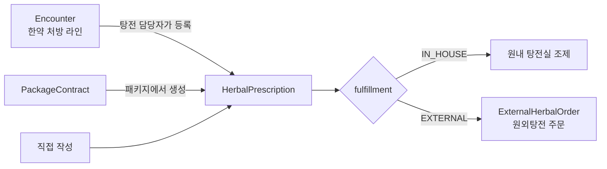
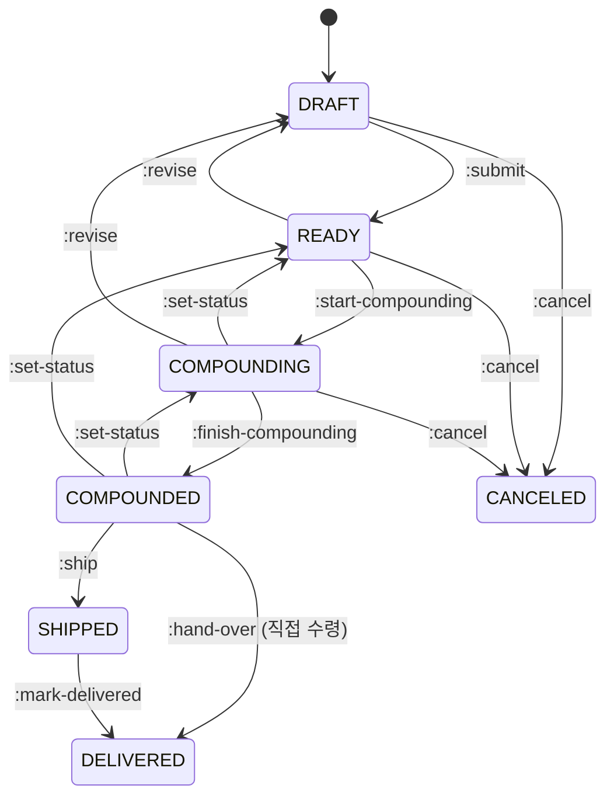

# Herbal Pharmacy: 탕전·원외 주문

한약 처방이 조제(탕전)되어 환자에게 전달되기까지를 다룹니다.

## 현행에서 고칠 점

현행에는 같은 업무를 다루는 경로가 세 갈래 있습니다.

| 현행 | 실체 | 문제 |
|---|---|---|
| `/ocs` (v1) | 원내 탕전 목록·상태 | 신형과 같은 개념을 이중 구현 |
| `/tangjeon` (신형) | 원내 탕전 처방 | 어느 쪽을 쓸지 하드코딩된 요양기관기호 4곳(`epe()`)으로 가름 |
| `/ocsv2` | **외부 원외탕전(외부원탕) 주문** | 이름과 달리 v1의 후속이 아님. 주문을 `draftId`로 식별해 주문 ID가 따로 없음 |

그 밖에:

- v1 PATCH가 404이면 클라이언트가 당일 목록 200건을 뒤져 새 `ocsId`로 다시 시도합니다. 서버 ID가 안정적이지 않다는 뜻입니다
- 복용완료가 v1은 `PATCH /ocs/{id}/taking`, 신형은 `PUT /tangjeon/prescriptions/{id}`의 일부 필드입니다
- v1에서 수령방법을 저장한 뒤 `조제완료` PATCH를 따로 보냅니다
- `복용종료일 = 수령일 + 일수`를 클라이언트가 계산합니다
- 처방전 출력 후 바뀐 칸을 클라이언트가 diff해 역반영합니다
- **재고 확인 우회 버그:** v2 결제 전 `precheck`의 `catch {}`가 네트워크 오류·500까지 삼키고 결제를 계속합니다

## 통합 모델

원내 탕전과 원외 주문을 **한 처방 + 조제 경로(fulfillment)** 로 통합합니다.



### 용어

| 업무 용어 | 키 |
|---|---|
| 탕전 처방 | `HerbalPrescription` |
| 약재 | `HerbLine` |
| 첩 / 팩 / 일투팩수 | `doses` / `packs` / `packsPerDay` |
| 후하 | `addLate` |
| 탕전실 | `Dispensary` |
| 조제상태 | `status` |
| 수령방법 | `delivery.method`: `PICKUP`, `PARCEL`, `QUICK` |
| 원외탕전 주문 | `ExternalHerbalOrder` |
| 견적 | `Quote` |

### 탕전 처방

```
HerbalPrescription
├─ id
├─ patientId, encounterId?, prescriptionLineId?, packageContractId?
├─ origin: ENCOUNTER | MANUAL | PACKAGE | EXTERNAL_ORDER
├─ coverage: SELF_PAY | PILOT_HERBAL | AUTO_INSURANCE | INDUSTRIAL_ACCIDENT    (카테고리 54/35/74/94)
├─ name, prescribedOn, asOf (참조데이터 기준일)
├─ herbs[]: { herbProductId?, name, standardCode, dose, originalDose, unit, unitPrice, addLate, memo }
├─ quantity: { days, doses, packs, packsPerDay, volumeMl, round{ current, total } }
├─ fulfillment: { type: IN_HOUSE|EXTERNAL, dispensaryId?, externalOrderId? }
├─ delivery: { method, scheduledOn?, addressId?, recipient? }
├─ intake: { endsOn (서버 계산), completedAt? }
├─ followUp: { happyCallOn? }
├─ status
├─ sourceStatus: { encounterRetracted, lineRemoved }   # 현행 원진료삭제됨, 원진료처방삭제됨
├─ documents[]: { id, serialNumber, printedAt, printedBy }
└─ version
```

### 상태



| 현행 `조제상태` | 재설계 |
|---|---|
| `임시저장` | `DRAFT` |
| `조제전` | `READY` |
| `조제중` | `COMPOUNDING` |
| `조제완료` | `COMPOUNDED` |
| `수정중` | 원외 주문의 `ExternalHerbalOrder.status = ON_HOLD` (외부원탕 주문 수정 중). 처방 쪽은 `COMPOUNDING` 이전 상태 유지 |
| `배송중` | `SHIPPED` |
| `배송완료` | `DELIVERED` |
| `취소` | `CANCELED` |

- 취소는 조제 완료 전까지만 됩니다. 현행 규칙과 같습니다
- **조제 상태 직접 지정:** 현행은 조제전·조제중·조제완료 중에서 자유롭게 고를 수 있었습니다 (잘못 누른 것 되돌리기 포함). `:set-status { status: READY|COMPOUNDING|COMPOUNDED, reason? }`가 이 세 값 사이 이동을 받고, 되돌릴 때는 이력에 사유를 남깁니다. `:start-compounding`·`:finish-compounding`은 정방향 단축 커맨드입니다
- `:revise`는 약재·수량을 다시 고쳐야 할 때 `DRAFT`로 되돌립니다 (조제 완료 전까지)
- **원외 처방은 상태를 직접 바꿀 수 없습니다** (현행 `조제상태수정가능 = false`). 원외 주문 상태가 바뀌면 서버가 처방 상태를 맞춥니다. 커맨드를 부르면 409 `EXTERNALLY_FULFILLED`
- **복용 완료**는 상태가 아니라 `POST /herbal-prescriptions/{id}:complete-intake`로 `intake.completedAt`을 채웁니다
- `intake.endsOn = 수령일 + days`는 서버가 계산합니다

### 엔드포인트

```
GET  /herbal-prescriptions?status=&from=&to=&dispensaryId=&q=&cursor=
GET  /herbal-prescriptions/stats?from=&to=
GET  /herbal-prescriptions/pending-from-encounters        (현행 treatment-prescriptions/unregistered) 완료된 진료의 한약 라인 중 아직 탕전 처방이 없는 것
POST /herbal-prescriptions                                 { origin: ENCOUNTER, prescriptionLineId } | { origin: MANUAL, ... } | { origin: PACKAGE, packageContractId }
GET  /herbal-prescriptions/{id}
PATCH /herbal-prescriptions/{id}                           DRAFT일 때 약재·수량·메모 (If-Match)
PATCH /herbal-prescriptions/{id}/delivery                  배송 정보는 조제 상태와 무관하게 수정 가능
POST /herbal-prescriptions/{id}:submit / :start-compounding / :finish-compounding / :set-status / :ship / :hand-over / :mark-delivered / :revise / :cancel
POST /herbal-prescriptions/{id}:complete-intake
POST /herbal-prescriptions/{id}/documents                  처방전 발급 (연번 부여)
GET  /herbal-prescriptions/{id}/history
```

- 처방전 출력 화면에서 바꾼 값은 `PATCH` 후 `documents` 발급 순서로 보냅니다. 현행처럼 출력 후 클라이언트 diff로 역반영하지 않습니다
- 첩약 시범사업 처방은 진료 불러오기와 탕전실이 필수입니다 (422 `PILOT_HERBAL_REQUIRES_ENCOUNTER`, `DISPENSARY_REQUIRED`)

## 원외탕전 주문

외부 탕전원에 조제를 맡기는 주문입니다. 결제와 외부 시스템 연동이 있어 처방과 분리된 애그리거트로 둡니다.

```
ExternalHerbalOrder
├─ id                                       # 현행처럼 draftId로 주문을 식별하지 않음
├─ herbalPrescriptionId
├─ provider: "MEDIONE" | ...
├─ draft: { herbs[], materials[], options[], compounding{...}, medicationGuideFileId? }
├─ precheck?: { checkedAt, ok, errors[], lineIssues[{ line (precheck 요청 items[] 순번), code: OUT_OF_STOCK|UNKNOWN, rawCode }] }
├─ quote?: { id, expiresAt, breakdown, payable }
├─ payment?: { methods[], paidAt }
├─ shipping: { recipient, phone, address, memo }
├─ externalRef?
├─ status: DRAFT | QUOTED | PLACED | ON_HOLD | IN_PRODUCTION | SHIPPED | DELIVERED | CANCEL_PENDING | CANCELED
├─ replacedBy? / replaces? (수정으로 생긴 새 주문과의 연결)
└─ snapshots[]: 단계별 스냅샷
```

```
POST /external-herbal-orders                         { herbalPrescriptionId, provider }
PATCH /external-herbal-orders/{id}                   DRAFT일 때
POST /external-herbal-orders/{id}:precheck           → precheck 결과 (재고·자격)
POST /external-herbal-orders/{id}:quote              → quote (precheck 통과 필수)
POST /external-herbal-orders/{id}:place              { quoteId, paymentMethods[] }    Idempotency-Key
POST /external-herbal-orders/{id}:hold / :release / :cancel
PATCH /external-herbal-orders/{id}/shipping          ON_HOLD 또는 PLACED에서 배송 정보만
POST /external-herbal-orders/{id}:amend              { draft, shipping?, paymentMethods? } → Job (아래 사가)
GET  /external-herbal-orders/{id}
GET  /external-herbal-orders?status=&from=&to=&q=&cursor=   서버 필터 (현행은 limit 100 고정 + 클라이언트 필터)
GET  /external-herbal-providers/{provider}/eligibility | /contract | /options
POST /external-herbal-providers/{provider}/herbs:search   { q }   → GET으로: GET .../herbs?q=
```

- **`:place`는 서버가 precheck를 다시 합니다.** precheck가 실패하거나 외부 시스템에 닿지 않으면 422/503으로 결제를 막습니다. 현행 재고 확인 우회 버그를 구조적으로 막습니다. 판정은 [external-herbal-precheck.ts](../../src/modules/herbal-pharmacy/external-orders/external-herbal-precheck.ts) ([결정](rule-decisions.md#external-herbal-precheck))
- **견적 만료:** `quote.expiresAt`이 지나면 `:place`가 409 `QUOTE_EXPIRED`
- **같은 견적은 한 번만 결제:** 결제 결과를 아직 확인하지 못한 견적으로 다시 `:place`하면 Idempotency-Key가 달라도 409 `PAYMENT_UNCONFIRMED` ([결정](rule-decisions.md#external-herbal-precheck))
- **주문 수정:** 현행 "hold → (변경 없으면) info + unhold, 변경 있으면 새 결제 후 기존 cancel"을 클라이언트가 조합했습니다. `:amend`가 서버에서 판단하지만, 외부 결제 두 건이 걸려 있어 **원자적일 수 없습니다.** 그래서 단계를 가진 Job(사가)으로 처리합니다
  1. 기존 주문 `:hold` (실패하면 중단, 변경 없음)
  2. 재견적이 필요 없으면 배송·조제 정보 갱신 → `:release`. 끝
  3. 필요하면 새 주문 생성 → 견적 → 결제(`PLACED`). 결제 실패 시 기존 주문 `:release`로 보상하고 중단
  4. 기존 주문 취소 요청 → `CANCEL_PENDING`. 외부 취소가 확인되면 `CANCELED`, 실패가 계속되면 Job이 `PARTIALLY_SUCCEEDED`로 끝나고 "이중 결제 확인 필요" 경고를 띄웁니다. 두 주문은 `replaces`/`replacedBy`로 연결됩니다
- **결제 금액:** 현행은 결제수단 금액을 서버 결제총액에 맞춰 클라이언트가 조정했습니다. 재설계는 `paymentMethods[]`의 합이 `quote.payable`과 다르면 422입니다
- 외부 상태 변화는 웹훅 또는 폴링 작업으로 받아 `external_herbal_order.status_changed` 이벤트를 냅니다

## 이벤트

`herbal_prescription.created/status_changed/delivery_changed`, `external_herbal_order.status_changed`, `external_herbal_order.precheck_failed`

현행에는 탕전 전용 이벤트가 없고 `ACTION_RECORD`가 OCS 목록 무효화를 겸했습니다.
