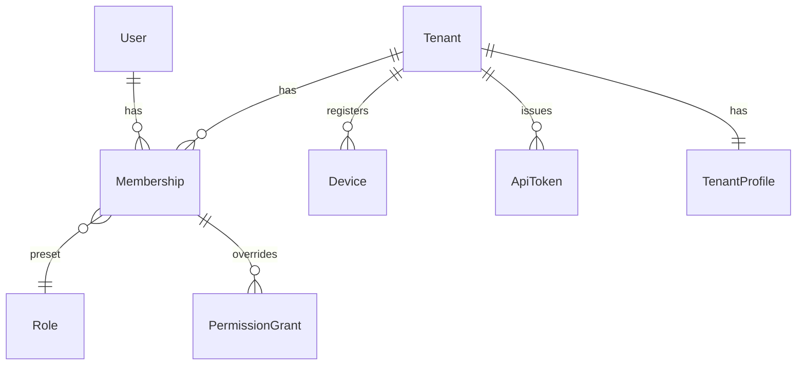

# Identity & Access

병원(테넌트), 사용자, 역할과 권한, 인증 세션, 기기, API 토큰을 다룹니다.

## 현행에서 고칠 점

| 현행 | 문제 | 재설계 |
|---|---|---|
| 권한 트리 노드 하나에 행위코드 하나. `chart_create/update/delete`처럼 코드를 행위별로 3번 정의 | 권한 코드 65개 중 상당수가 행위 조합. 부모를 한 단계만 확인 | `resource × action` 행렬 + 데이터 범위 |
| 역할 `01`·`02`가 모두 대표원장인데 라우트가 `01`과 정확히 일치하는지만 봄 | `02` 대표원장이 MCP·비대면 정산 화면에서 막힘 (추정 버그) | 역할은 권한 묶음 프리셋일 뿐이고 인가는 권한으로만 판정 |
| 화면·버튼 게이트가 모두 클라이언트. 가드 목록의 라우트 이름 오타, `meta` 누락 라우트, `requiresAuth` 없는 `/canvas`·`/treatment/repeat-results` | 서버 강제 여부를 알 수 없음 | 모든 엔드포인트가 서버에서 권한을 선언하고 검사. 선언 없는 엔드포인트는 테스트에서 실패 |
| 비대면 진료 등록 여부를 localStorage로 게이트 | 클라이언트가 조작 가능 | 테넌트의 `features`로 서버가 판정 |
| 탕전 신형 사용 기관 4곳, MCP 데모 계정, 병원명 `"경희수한의원"`을 코드에 하드코딩 | 배포 없이는 바꿀 수 없음 | 테넌트별 기능 플래그 |
| refresh token을 localStorage에 저장, 로그아웃 시 서버 폐기 없음 | XSS 한 번이면 장기 세션 탈취 | refresh token은 `HttpOnly` 쿠키, 로그아웃·비밀번호 변경 시 폐기 |
| 응답 인터셉터가 로그인 정보가 없으면 실패를 `undefined`로 resolve | 오류가 성공처럼 보임 | 클라이언트 문제지만, 서버는 401에 항상 Problem Details를 줌 |

## 모델



| 엔티티 | 핵심 필드 | 비고 |
|---|---|---|
| `Tenant` | `id`, `hiraInstitutionCode`(요양기관기호, 8자리, 없을 수 있음), `kcomwelInstitutionCode`(산재기관기호), `timezone`, `products[]`, `features[]`, `chartLayout` | `products`: `EMR`, `SOO`, `INSURANCE`, `CRM`, `MEMBERS` (현행 `서비스연동`) |
| `TenantProfile` | 상호·대표자·주소·사업자등록번호·청구대행단체·첩약시범기관 여부 등 | 사업자등록번호처럼 증빙이 필요한 필드는 `ChangeRequest`로만 바꿈 |
| `User` | `id`, `loginId`, `name`, `phone`, `licenseNumber`(면허번호), `licenseType`(`KOREAN_MEDICINE_DOCTOR`, `PHARMACIST`…) | 한 사람이 여러 병원에 속할 수 있게 `Membership`으로 분리 |
| `Membership` | `tenantId`, `userId`, `role`, `employmentType`(현행 `근무형태`), `joinedOn`, `status`(`ACTIVE`/`DEACTIVATED`), `deactivatedFrom`, `stampImageId` | 현행 `근무형태`가 없으면 청구 전송이 409로 실패함. 재설계는 진료의 `Membership` 생성 시 필수 |
| `Device` | `id`, `kind`(`DESKTOP_AGENT`, `TABLET`, `BROWSER`), `name`, `lastSeenAt` | 태블릿 계정(현행 `/tablet/accounts` 아이디·비밀번호)을 기기 등록으로 바꿈 |
| `ApiToken` | `id`, `name`, `scopes[]`, `createdBy`, `lastUsedAt`, `revokedAt` | 현행 MCP 토큰 (병원당 1개 제한은 정책값으로) |

## 권한 모델

권한은 `resource:action` 문자열과 데이터 범위로 표현합니다.

| 구성 | 값 |
|---|---|
| resource | `patient`, `appointment`, `visit`, `receipt`, `encounter`, `prescription`, `procedure`, `herbal_prescription`, `external_herbal_order`, `claim`, `hira_pre_submission`, `medical_aid`, `document`, `signature`, `tax_deduction`, `crm_program`, `contact_task`, `message`, `opt_out`, `setting.*`, `finance.*` … |
| action | `read`, `create`, `update`, `delete`, 그리고 리소스별 커맨드(`encounter:amend`, `encounter:retract`, `claim:submit`, `receipt:refund`, `document:issue`, `message:send`) |
| scope | `ALL`(전체 환자), `OWN`(담당 환자, 현행 `owner_only`) |

- **역할은 프리셋입니다.** `OWNER_DOCTOR`(현행 `01`·`02`), `ASSOCIATE_DOCTOR`(`03`), `MANAGER`(`04`), `FRONT_DESK`(`05`), `THERAPIST`(`06`). 병원은 개별 권한을 더하거나 뺄 수 있습니다
- **서버 강제:** 엔드포인트마다 필요한 권한을 선언합니다. 선언이 없는 라우트는 부팅 시 실패하게 해서 현행의 "meta 누락 → 검사 건너뜀"이 생길 수 없게 합니다
- **클라이언트용:** `GET /me`가 계산된 권한 집합(`permissions: ["patient:read", ...]`, `scope`)을 줍니다. 클라이언트는 이걸로 메뉴를 거르기만 합니다. 현행처럼 사이드바가 권한과 무관하게 메뉴를 보여 주고 화면에서 막는 일을 없앱니다
- **면허 기반 행위:** 진료기록 작성·정정·철회(`encounter:write/amend/retract`), 처방(`prescription:*`), 진료기록 전자서명(`signature:sign` + `kind: MEDICAL_RECORDS`)은 권한과 별개로 `licenseType`이 맞아야 합니다. 권한 설정으로 데스크 직원에게 처방 권한을 줄 수 없게 합니다
  - 본인부담금 대장 서명(`kind: COPAYMENT_LEDGERS`)은 데스크 업무라 면허 요건이 없습니다
  - 면허 없는 사용자나 시스템이 진료기록을 바꿔야 하는 경우(청구 자동수정, 보험구분 변경)는 정정 제안만 만듭니다 ([clinical.md](clinical.md#진료-encounter))

현행 65개 코드의 전체 대응표는 [review.md](review.md#권한-코드-대응) 한 곳에 둡니다. 주의할 점만 적습니다.

- 현행 `treatment_write`는 이름과 달리 "진료기록생성수정삭제"입니다 (`docs/reference/permissions.md`). `encounter:write/amend/retract`로 옮기고, 치료실 시술 권한 `procedure:write`는 새로 정의합니다
- 화면 코드(`treatment_rooms`, `ocs`, `bi` …)는 권한이 아닙니다. 화면이 쓰는 리소스의 `read` 권한으로 판정합니다

## 인증

### 로그인과 세션

```
POST /auth/sessions            { loginId, password }        → 200 { accessToken, expiresIn, user, memberships[] }
                                                              Set-Cookie: refresh=...; HttpOnly; Secure; SameSite=Strict; Path=/auth
POST /auth/sessions:refresh    (쿠키)                         → 200 { accessToken, expiresIn }
DELETE /auth/sessions/current                                 → 204, refresh 폐기
POST /auth/sessions:switch-tenant { tenantId }               → 200 { accessToken }
GET  /me                                                       → user + 현재 tenant + permissions + products + features
```

- access token은 짧게(10분) 두고 메모리에만 둡니다
- refresh token은 회전(rotation)하고, 이미 쓴 토큰이 다시 오면 그 계열 세션을 모두 폐기합니다
- 현행은 로그인 응답과 `GET /auth/me`를 합쳐 localStorage에 저장합니다. 재설계는 `/me`를 앱 시작 시 한 번 받고 저장하지 않습니다
- 로그인 실패 코드: `ACCOUNT_NOT_FOUND`와 `PASSWORD_MISMATCH`를 구분하지 않고 `INVALID_CREDENTIALS` 하나로 줍니다. 아이디 존재 여부가 드러나지 않게 합니다. 5회 실패 시 `ACCOUNT_LOCKED`
- `로그인유지시간`(병원 설정)은 refresh token 수명으로 구현합니다

### 잠금 해제·본인확인

```
POST /auth/identity-verifications           { purpose: "UNLOCK" | "PHONE_CHANGE" | ..., name, birthDate, carrier, phone, ... }
                                             → 201 { id, expiresAt }
POST /auth/identity-verifications/{id}:confirm  { otp }
POST /auth/accounts:unlock                  { verificationId }
```

현행 `/unlock/request-otp`·`/verify/request-otp` 두 계열을 목적(`purpose`)이 다른 같은 리소스로 합칩니다. 재발송은 `POST /auth/identity-verifications/{id}:resend`, 시도·재발송 횟수 제한(현행 180초, 재발송 3회)은 서버가 셉니다.

### SSO와 사이트 간 이동

- 외부 IdP(메디스트림 등): `POST /auth/sessions:oauth { provider, code }`. 가입이 안 된 사용자면 409와 함께 `signupToken`을 줍니다
- 자사 사이트 간 이동: `POST /auth/link-tokens` → 1회용 60초 토큰 → 상대 사이트 `POST /auth/sessions:exchange { linkToken }`. 현행처럼 refresh token을 요청 본문에 실어 보내지 않습니다

### 기기

- **태블릿:** 직원이 데스크에서 `POST /devices:pair` → 6자리 코드 → 태블릿이 코드로 기기 토큰을 받습니다. 기기 토큰의 권한은 `intake:*`, `consent:sign`, `photo:upload`, `visit:self_check_in`(환자 본인 접수, 현행 `접수경로: TABLET`)으로 고정합니다. 셀프 접수는 이미 등록된 환자를 본인확인 후 `WAITING`으로만 올릴 수 있고, 보험구분·진료의는 접수 기본값을 씁니다. 현행 태블릿 계정 아이디·비밀번호와 4자리 관리자 PIN은 기기 해제·키오스크 탈출용 PIN으로만 남깁니다
- **데스크톱 에이전트:** 심평원 DDMD·전자서명·인증서 접근이 필요한 PC 앱입니다. 기기 토큰으로 서버의 작업 큐를 가져갑니다 ([claims.md](claims.md#데스크톱-에이전트))
- **엣지:** 병원마다 에이전트 하나를 `POST /devices/{id}:designate-edge`로 지정합니다. 엣지는 오프라인 동안 데스크 단말의 요청을 받고, 사용자별 오프라인 PIN 검증값과 권한 캐시를 가집니다 ([offline.md](offline.md#오프라인-로그인)). 오프라인 PIN 등록·변경도 보안 감사 로그 대상입니다

### API 토큰 (MCP)

```
GET    /api-tokens
POST   /api-tokens        { name, scopes[] }   → 201 { id, token }   # token은 이때 한 번만
DELETE /api-tokens/{id}
```

- AI 에이전트가 만든 쓰기(연락 예약, 환자 메모)는 바로 반영하지 않고 승인 대기 상태로 만듭니다 ([crm.md](crm.md#ai-에이전트-제안))
- 스코프는 `patient:read_pseudonymous`, `contact_task:propose`, `memo:propose`처럼 가명 조회와 제안 권한만 줄 수 있게 합니다
- **가명 핸들:** 현행 정책("환자 이름·차트번호·연락처는 모델에 노출하지 않고 핸들로만 다룹니다")을 서버가 강제합니다. API 토큰으로 들어온 요청에는 환자 식별 필드 대신 토큰별로 다른 `patientHandle`과 나이대·성별 같은 비식별 속성만 돌려줍니다. 핸들 → 환자 매핑은 서버만 압니다

## 가입과 약관

- 계정 신청(`AccountApplication`) 상태: `DRAFT` → `SUBMITTED` → `NEEDS_SUPPLEMENT` ↔ `SUBMITTED` → `APPROVED` | `REJECTED` | `CANCELED`
  - 현행 온보딩이 `approved`를 "승인대기"로 표시하는 버그가 있었습니다. 상태 enum이 하나라 표시 매핑만 맞추면 됩니다
- 약관 동의는 `TermsAgreement { documentId, revision, agreedAt, agreedBy, scope: USER|TENANT }` 하나로 둡니다. 현행 계정용 `/terms/*`와 실손용 `/hospital/terms`를 합칩니다
- `agreedRevision < currentRevision`인 필수 약관이 있으면 해당 제품 API가 403 `TERMS_REAGREEMENT_REQUIRED`를 줍니다. 현행처럼 CRM 화면 진입 시 클라이언트가 확인하는 방식은 API 직접 호출로 우회됩니다

## 감사

- 로그인 성공·실패, 권한 변경, 역할 변경, 토큰 발급·폐기, 기기 페어링은 별도 보안 감사 로그에 남깁니다
- `GET /audit-logs?actor=&resource=&from=&to=`는 `OWNER_DOCTOR`만 봅니다. 현행 `/setting/account-history`는 하드코딩 샘플을 보여 주는 목업이었습니다
