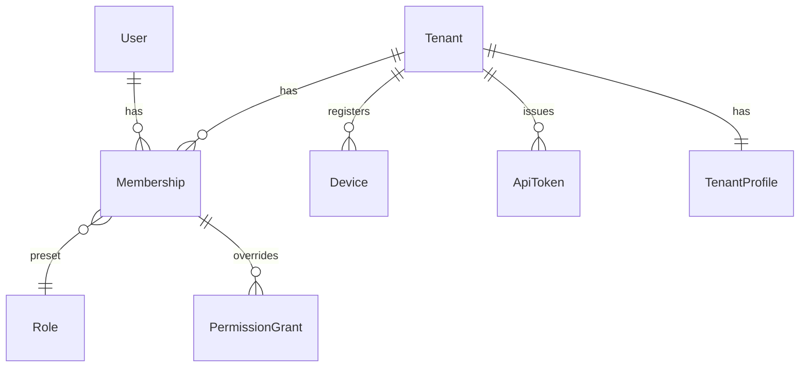

# Identity & Access

병원(테넌트), 사용자, 역할과 권한, 인증 세션, 기기, API 토큰을 다룹니다.

## 현행에서 고칠 점

| 현행 | 문제 | 재설계 |
|---|---|---|
| 권한 트리 노드 하나에 행위코드 하나. `chart_create/update/delete`처럼 코드를 행위별로 3번 정의 | 권한 코드 65개 중 상당수가 행위 조합. 부모를 한 단계만 확인 | `resource × action` 행렬 + 데이터 범위 |
| 역할 `01`·`02`가 모두 대표원장인데 라우트가 `01`과 정확히 일치하는지만 봄 | `02` 대표원장이 MCP·비대면 정산 화면에서 막힘 (추정 버그) | 역할은 권한 묶음 프리셋일 뿐이고 인가는 권한으로만 판정 |
| 화면·버튼 게이트가 모두 클라이언트. 가드 목록의 라우트 이름 오타, `meta` 누락 라우트, `requiresAuth` 없는 `/canvas`·`/treatment/repeat-results` | 서버 강제 여부를 알 수 없음 | 모든 엔드포인트가 서버에서 권한을 선언하고 검사. 선언 없는 엔드포인트는 테스트에서 실패 |
| 비대면 진료 등록 여부를 localStorage로 게이트 | 클라이언트가 조작 가능 | 테넌트의 `features`로 서버가 판정 |
| 탕전 신형 사용 기관 4곳, MCP 데모 계정, 병원명 `"경희수한의원"`을 코드에 하드코딩 | 배포 없이는 바꿀 수 없음 | 테넌트별 기능 플래그 |
| refresh token을 localStorage에 저장, 로그아웃 시 서버 폐기 없음 | XSS 한 번이면 장기 세션 탈취 | refresh token은 `HttpOnly` 쿠키, 로그아웃·비밀번호 변경 시 폐기 |
| 응답 인터셉터가 로그인 정보가 없으면 실패를 `undefined`로 resolve | 오류가 성공처럼 보임 | 클라이언트 문제지만, 서버는 401에 항상 Problem Details를 줌 |

## 모델



| 엔티티 | 핵심 필드 | 비고 |
|---|---|---|
| `Tenant` | `id`, `name`, `hiraInstitutionCode`(요양기관기호, 8자리, 없을 수 있음), `kcomwelInstitutionCode`(산재기관기호), `timezone`, `products[]`, `features[]`, `chartLayout` | `products`: `EMR`, `SOO`, `INSURANCE`, `CRM`, `MEMBERS` (현행 `서비스연동`) |
| `TenantProfile` | 상호·대표자·주소·사업자등록번호·청구대행단체·첩약시범기관 여부 등 | 사업자등록번호처럼 증빙이 필요한 필드는 `ChangeRequest`로만 바꿈 |
| `User` | `id`, `loginId`, `name`, `phone`, `licenseNumber`(면허번호), `licenseType`(`KOREAN_MEDICINE_DOCTOR`, `PHARMACIST`…) | 한 사람이 여러 병원에 속할 수 있게 `Membership`으로 분리 |
| `Membership` | `tenantId`, `userId`, `role`, `employmentType`(현행 `근무형태`), `joinedOn`, `status`(`ACTIVE`/`DEACTIVATED`), `deactivatedFrom`, `scope`(`ALL`/`OWN`), `grants[]`, `stampImageId` | 현행 `근무형태`가 없으면 청구 전송이 409로 실패함. 재설계는 진료의 `Membership` 생성 시 필수 |
| `Device` | `id`, `kind`(`DESKTOP_AGENT`, `TABLET`, `BROWSER`), `name`, `lastSeenAt` | 태블릿 계정(현행 `/tablet/accounts` 아이디·비밀번호)을 기기 등록으로 바꿈 |
| `ApiToken` | `id`, `name`, `scopes[]`, `createdBy`, `lastUsedAt`, `revokedAt` | 현행 MCP 토큰 (병원당 1개 제한은 정책값으로) |

지금 구현([identity.ts](../../src/modules/identity/identity.ts))은 `Tenant.kcomwelInstitutionCode`·`chartLayout`, `Membership.stampImageId`, `TenantProfile`·`Device`·`ApiToken`을 아직 두지 않습니다. 쓰는 기능을 만들 때 더합니다.

## 권한 모델

권한은 `resource:action` 문자열과 데이터 범위로 표현합니다.

| 구성 | 값 |
|---|---|
| resource | `patient`, `appointment`, `visit`, `receipt`, `encounter`, `prescription`, `procedure`, `herbal_prescription`, `external_herbal_order`, `claim`, `hira_pre_submission`, `medical_aid`, `document`, `signature`, `tax_deduction`, `crm_program`, `contact_task`, `message`, `opt_out`, `setting.*`, `finance.*` … |
| action | `read`, `create`, `update`, `delete`, 그리고 리소스별 커맨드(`encounter:amend`, `encounter:retract`, `claim:submit`, `receipt:refund`, `document:issue`, `message:send`) |
| scope | `ALL`(전체 환자), `OWN`(담당 환자, 현행 `owner_only`) |

- **역할은 프리셋입니다.** `OWNER_DOCTOR`(현행 `01`·`02`), `ASSOCIATE_DOCTOR`(`03`), `MANAGER`(`04`), `FRONT_DESK`(`05`), `THERAPIST`(`06`). 병원은 개별 권한을 더하거나 뺄 수 있습니다
- **서버 강제:** 엔드포인트마다 필요한 권한을 선언합니다. 선언이 없는 라우트는 부팅 시 실패하게 해서 현행의 "meta 누락 → 검사 건너뜀"이 생길 수 없게 합니다
- **클라이언트용:** `GET /me`가 계산된 권한 집합(`permissions: ["patient:read", ...]`, `scope`)을 줍니다. 클라이언트는 이걸로 메뉴를 거르기만 합니다. 현행처럼 사이드바가 권한과 무관하게 메뉴를 보여 주고 화면에서 막는 일을 없앱니다
- **면허 기반 행위:** 진료기록 작성·정정·철회(`encounter:write/amend/retract`), 처방(`prescription:*`), 진료기록 전자서명(`signature:sign` + `kind: MEDICAL_RECORDS`)은 권한과 별개로 `licenseType`이 맞아야 합니다. 권한 설정으로 데스크 직원에게 처방 권한을 줄 수 없게 합니다
  - 본인부담금 대장 서명(`kind: COPAYMENT_LEDGERS`)은 데스크 업무라 면허 요건이 없습니다
  - 면허 없는 사용자나 시스템이 진료기록을 바꿔야 하는 경우(청구 자동수정, 보험구분 변경)는 정정 제안만 만듭니다 ([clinical.md](clinical.md#진료-encounter))

### 역할 프리셋 기본값

권한 카탈로그와 계산은 [permissions.ts](../../src/modules/identity/permissions.ts)에 있습니다. 현행 역할별 기본 권한은 서버에 있어 분석으로 확인할 수 없었습니다. 그래서 아래 기본값을 정했고, 병원은 `PermissionGrant`로 조정합니다.

| 역할 | 기본 권한 |
|---|---|
| `OWNER_DOCTOR` | 카탈로그 전체 |
| `ASSOCIATE_DOCTOR` | 데스크 조회 + 처방·원외탕전·청구·연말정산·CRM·수신거부 조회 + 데스크 업무 + 진료(`encounter:write/amend/retract`, 방문진료 서식, `prescription:*`, `procedure:write`) |
| `MANAGER` | 봉직의의 조회와 데스크 업무 + 매출 리포트 + 환자 삭제·문서 무효·청구 전송·사전심사·의료급여 승인·CRM·수신거부 관리 + 설정(구성원 관리 제외) |
| `FRONT_DESK` | 데스크 조회(환자·예약·내원·수납·진료·시술·첩약·문서·연락·메시지) + 데스크 업무 |
| `THERAPIST` | 환자·예약·내원·진료 조회, `visit:update`, `procedure:read/write` |

데스크 업무는 환자 등록·수정, 예약, 접수·취소, 수납·정정·무효·환불, 문서 발급, 서명, 문자 발송, 연락 작업입니다. 감사 로그와 구성원 관리(`setting.members:update`)는 대표원장만, 매출 리포트(`report:read`)는 대표원장과 실장만 가집니다. 봉직의에게 매출을 보이지 않는 병원이 많기 때문입니다. 연쇄 취소(D3)에 필요한 세 권한을 모두 가진 프리셋은 원장 둘뿐입니다.

- **프리셋은 목록으로 직접 적습니다.** 카탈로그에 권한을 더해도 프리셋에 저절로 들어가지 않습니다. 테스트가 프리셋 내용을 고정해, 바꾸면 리뷰에서 드러납니다
- **설정 영역:** 현행 설정 권한 코드를 영역 이름으로 씁니다(`normal_setting` → `setting.normal:update`, catalog.md). `billing`·`normal`·`info`·`record`·`prescription`·`template`·`appointment`·`caller_number`·`system`·`schedule`·`tablet`·`message_template`이고, 구성원·권한 관리 `members`를 새로 둡니다. 재무 `finance.*`는 범위가 정해지면 더합니다
- **조정 규칙:** 한 권한에 조정은 하나입니다. 저장할 때 `GRANT`·`REVOKE`가 함께 오면 `REVOKE`만 남깁니다. 카탈로그에 없는 권한은 부여할 수 없고, 카탈로그에서 사라진 권한의 조정은 읽을 때 뺍니다
  - 대안: 나중에 저장한 조정이 이기기. 순서를 저장해야 하고, 막으려던 권한이 실수로 열릴 수 있어 버렸습니다
- **면허 권한:** 면허 권한은 `licenseType`이 한의사가 아니면 부여했어도 계산 결과에서 빠집니다. 그래서 `/me`에도 나오지 않습니다. 진료기록 서명은 서명 종류에 따라 판정이 달라 따로 판정합니다(`canSign`). 계산 결과에 면허를 함께 담아, 다른 사람의 면허로 판정하는 실수를 막습니다
- **데이터 범위:** `scope`(`ALL`/`OWN`)는 권한마다가 아니라 소속마다 하나입니다. 현행 `all`/`owner_only`도 권한 코드가 아니라 사용자 단위 설정이었습니다. 기본은 `ALL`입니다
- **소속 유효 기간:** 입사일(`joinedOn`) 전, `status: DEACTIVATED`, `deactivatedFrom` 날짜(병원 시간대)부터는 권한이 없습니다
- **진료의 근무형태:** `OWNER_DOCTOR`·`ASSOCIATE_DOCTOR` 소속은 `employmentType`이 있어야 합니다. DB 제약과 저장 검증이 함께 막습니다
- **로그인 아이디:** 전체에서 유일하고, 앞뒤 공백을 빼고 소문자로 저장·비교합니다. `Doctor`와 `doctor`는 같은 아이디입니다. 중복은 DB 유니크 제약으로 판정합니다
- **되돌릴 조건:** 현행 역할별 기본 권한을 확보하면 프리셋을 그 값에 맞춥니다. 이관하는 병원은 현행 권한을 `PermissionGrant`로 옮겨 차이를 메웁니다

현행 65개 코드의 전체 대응표는 [review.md](review.md#권한-코드-대응) 한 곳에 둡니다. 주의할 점만 적습니다.

- 현행 `treatment_write`는 이름과 달리 "진료기록생성수정삭제"입니다 (`docs/reference/permissions.md`). `encounter:write/amend/retract`로 옮기고, 치료실 시술 권한 `procedure:write`는 새로 정의합니다
- 화면 코드(`treatment_rooms`, `ocs`, `bi` …)는 권한이 아닙니다. 화면이 쓰는 리소스의 `read` 권한으로 판정합니다

### 권한 강제 구현 결정

구현은 [access.ts](../../src/modules/identity/auth/access.ts)와 [authorization.ts](../../src/modules/identity/auth/authorization.ts)에 있습니다.

- **선언:** 엔드포인트마다 `Access` annotation으로 규칙 하나를 붙입니다. `Access.public`(상태 확인·로그인·refresh·로그아웃), `Access.signedIn`(`/me`·병원 전환처럼 병원을 고르기 전에 쓰는 곳), `Access.requires('visit:update', ...)`(병원 업무)입니다. 병원 업무에 권한 없는 규칙은 두지 않습니다
- **부팅 검사:** `accessCheck(Api)`가 앱 Layer에 들어 있어, 규칙이 없거나 규칙과 미들웨어가 맞지 않는 엔드포인트가 있으면 서버가 뜨지 않습니다. 규칙만 붙이고 검사할 미들웨어를 빠뜨려도 아무도 검사하지 않으므로, `PERMISSIONS`는 `Authorization`이, `SIGNED_IN`은 `Authentication`만 있어야 하고(`Authorization`은 권한 목록이 필요합니다) `PUBLIC`에는 둘 다 없어야 합니다. 테스트가 실제 API와 일부러 틀린 API로 이를 확인합니다
  - 대안: 테스트만으로 잡기. 이슈는 테스트를 요구했지만 설계는 부팅 실패였고, 둘 다 해도 비용이 거의 없어 둘 다 합니다
- **`Authorization` 미들웨어:** access token(세션 폐기 포함)을 확인하고, 토큰이 가리키는 병원의 오늘 소속으로 권한을 계산해 `CurrentAccess`(사용자·세션·병원·권한·범위·면허)를 넣습니다. 요청마다 세션·소속·사용자 조회가 듭니다
  - 401 `UNAUTHENTICATED`: 토큰이 없거나 틀림
  - 403 `TENANT_NOT_SELECTED`: 토큰에 병원이 없음. 병원 전환을 먼저 해야 합니다
  - 403 `TENANT_ACCESS_DENIED`: 그 병원 소속이 오늘 유효하지 않음(퇴사·비활성)
  - 403 `PERMISSION_DENIED` + `missing`: 선언한 권한 중 빠진 것. 클라이언트가 `/me`로 자기 권한을 이미 알아 이름을 알려 줘도 새로 드러나는 것이 없습니다
- **본문에 따라 달라지는 권한:** 연쇄 취소처럼 본문을 봐야 정해지는 권한은 서비스가 `requirePermissions`로 확인합니다. 내원 취소는 엔드포인트가 `visit:cancel`을, `cascade: true`면 `Visits.apply`가 `visit:cancel`·`receipt:void`·`encounter:retract`를 모두 확인합니다(D3). 내원을 읽기 전에 확인해 내원 상태보다 403이 먼저입니다. `encounter:retract`는 면허 권한이라 면허 없는 대표원장도 연쇄 취소를 못 합니다
  - 대안: 커맨드 권한을 모두 서비스에서도 다시 확인하기. 같은 규칙이 두 곳에 생겨 어긋날 수 있어, 서비스는 엔드포인트 선언으로 정할 수 없는 것만 봅니다. HTTP가 아닌 호출(MCP·오프라인 동기화)이 생기면 그 입구가 같은 선언을 따르게 합니다
- **병원 격리:** 내원은 `tenantId`를 가지고, 저장소는 고른 병원의 내원만 찾습니다. 다른 병원의 내원은 403이 아니라 404 `VISIT_NOT_FOUND`라 존재가 드러나지 않습니다. 같은 ID로 다른 병원의 내원을 덮어쓰려 하면 버전을 알려 주지 않고 `currentVersion: 0`으로 거절합니다. `visits.tenant_id`는 Identity의 `tenants`에 외래 키를 걸지 않습니다. 모듈 사이는 ID로만 잇습니다
  - 마이그레이션 `0004`는 `visits`를 새로 만듭니다. 접수 엔드포인트가 없어 있던 내원은 병원 없는 개발용 샘플뿐이라 옮기지 않습니다
- **도메인 이벤트:** 병원 업무 이벤트는 `tenantId`와 `actor: { kind: 'USER', id }`를 채웁니다
- **미룬 것:** 담당 환자 범위(`scope: OWN`)는 환자–담당자 관계가 생길 때 저장소 조회에 더합니다. 권한 거절은 아직 `security_events`에 남기지 않습니다
- **되돌릴 조건:** 요청마다 드는 조회가 병목이면 소속·권한을 짧게 캐시하고, 권한 변경 때 캐시를 비웁니다

## 인증

### 로그인과 세션

```
POST /auth/sessions            { loginId, password }        → 200 { accessToken, expiresIn, user, memberships[] }
                                                              Set-Cookie: refresh=...; HttpOnly; Secure; SameSite=Strict; Path=/auth
POST /auth/sessions:refresh    (쿠키)                         → 200 { accessToken, expiresIn }
DELETE /auth/sessions/current                                 → 204, refresh 폐기
POST /auth/sessions:switch-tenant { tenantId }               → 200 { accessToken }
GET  /me                                                       → user + 현재 tenant + permissions + products + features
```

- access token은 짧게(10분) 두고 메모리에만 둡니다
- refresh token은 회전(rotation)하고, 이미 쓴 토큰이 다시 오면 그 계열 세션을 모두 폐기합니다
- 현행은 로그인 응답과 `GET /auth/me`를 합쳐 localStorage에 저장합니다. 재설계는 `/me`를 앱 시작 시 한 번 받고 저장하지 않습니다
- 로그인 실패 코드: `ACCOUNT_NOT_FOUND`와 `PASSWORD_MISMATCH`를 구분하지 않고 `INVALID_CREDENTIALS` 하나로 줍니다. 아이디 존재 여부가 드러나지 않게 합니다. 5회 실패 시 `ACCOUNT_LOCKED`
- `로그인유지시간`(병원 설정)은 refresh token 수명으로 구현합니다

#### 세션 구현 결정

구현은 [auth.ts](../../src/modules/identity/auth/auth.ts)에 있습니다.

- **access token:** HS256 JWT입니다(`sub` 사용자, `sid` 세션, `tid` 고른 병원, `exp`). 발급과 검증을 서버 하나가 하므로 대칭 키로 충분합니다. 키는 `AUTH_SECRET`(32자 이상)이고 없으면 서버가 시작하지 않습니다. 로컬 개발 모드(`HEMR_DEV=1`, `pnpm dev`)에서만 프로세스마다 새 키를 만들고, 알려진 비밀번호의 개발 계정을 넣습니다
  - 권한은 토큰에 넣지 않고 요청마다 소속에서 계산합니다. 권한·소속 변경이 다음 요청부터 바로 반영됩니다
  - 검증할 때 세션이 폐기됐는지도 봅니다. 로그아웃이나 재사용 감지 뒤에는 만료 전 access token도 거절합니다. 요청마다 세션 조회 한 번이 듭니다
  - 대안: 순수 무상태 검증. 조회는 없지만 폐기 뒤 최대 10분 동안 토큰이 살아 있어 버렸습니다
- **refresh token:** 256비트 난수이고 저장소에는 SHA-256 값만 둡니다. `hemr_refresh` 쿠키(`HttpOnly; Secure; SameSite=Strict; Path=/v1/auth`)로만 오갑니다. 쓸 때마다 새 토큰으로 바꾸고, 쓴 토큰은 재사용 감지를 위해 남깁니다(정리 작업은 미룹니다). 수명은 12시간(하루 진료)이고 refresh할 때마다 새로 셉니다. 절대 수명은 아직 두지 않습니다
- **동시 refresh 유예(10초):** 바꾼 지 10초 안에 이전 토큰이 다시 오면 탭 여러 개가 함께 refresh한 것으로 봅니다. 세션은 두고 access token만 주며 쿠키는 바꾸지 않습니다(먼저 끝난 응답이 이미 바꿨습니다). 10초가 지난 뒤 오면 탈취로 보고 세션을 폐기하고 `REFRESH_TOKEN_REUSED`를 남깁니다
  - 대안: 유예 없음. 앱을 탭 두 개로 열기만 해도 로그아웃돼 버렸습니다. 유예 안의 재전송은 access token(10분)만 얻습니다
- **로그인 직후 병원:** 오늘 유효한 소속이 하나면 그 병원을 고르고, 여럿이거나 없으면 `tenantId: null`로 줍니다. 클라이언트는 `memberships`에서 골라 테넌트 전환을 부릅니다. 고른 병원은 세션에 남아 refresh 뒤에도 이어집니다. 다만 탭마다 다른 병원을 볼 수 있어, refresh는 탭이 보던 병원을 `?tenantId=`로 받아 그 병원으로 줍니다. 다른 탭의 전환이 이 탭의 병원을 몰래 바꾸지 않게 하려는 것입니다. 물은 병원에 유효한 소속이 없으면 병원 없이(`tenantId: null`) 주고, 회전한 쿠키를 잃지 않게 실패로 돌리지 않습니다 고른 병원이 없거나 소속이 유효하지 않으면 `/me`의 `tenant`가 `null`이고 권한이 비어 있습니다
- **잠금:** 성공 뒤 연속 5회 실패하면 잠그고 `423 ACCOUNT_LOCKED`를 줍니다. 잠긴 동안은 맞는 비밀번호도 거절합니다. 시간이 지나도 풀리지 않고 본인확인 잠금 해제로만 풉니다(뒤 이슈). 실패 횟수는 한 SQL 문장으로 세 동시 실패도 놓치지 않습니다
  - 잠그는 순간 그 사용자의 세션을 모두 폐기합니다. 비밀번호를 맞힌 로그인도 세션을 만들기 직전에 잠금 확인과 실패 횟수 초기화를 한 문장으로 다시 합니다. 동시에 여러 번 추측해 잠금을 지나치는 경로를 막습니다
  - 아이디는 64자, 비밀번호는 256자까지 받습니다. 긴 입력으로 해시 계산 시간을 끌지 못하게 합니다
  - 잠긴 계정은 아이디가 있다는 것이 드러납니다. 없는 아이디는 몇 번 틀려도 `INVALID_CREDENTIALS`라 5회 넘게 시도하면 구분할 수 있습니다. 현행도 같고, 막으려면 없는 아이디의 실패도 세야 해서 미룹니다
  - 없는 아이디도 고정 해시로 검증해 응답 시간으로 존재 여부가 드러나지 않게 합니다
- **비밀번호 해시:** Node `scrypt`(N=16384, r=8, p=1)이고 외부 의존성이 없습니다. 비용 인자를 해시 문자열에 함께 저장해 나중에 올려도 이전 해시를 검증할 수 있습니다
- **로그아웃:** refresh 쿠키의 세션을 폐기하고, 쿠키가 없으면 `Authorization`의 access token 세션을 폐기합니다. 어느 쪽도 없어도 204입니다
- **보안 감사 로그:** `security_events` 테이블에 로그인 성공·실패(사유 `UNKNOWN_LOGIN_ID`·`PASSWORD_MISMATCH`·`LOCKED`·`NO_PASSWORD`), 잠금, refresh 재사용, 로그아웃, 테넌트 전환을 남깁니다. 실패도 남아야 해서 업무 트랜잭션·outbox와 따로 씁니다. IP·User-Agent는 아직 남기지 않습니다
- **되돌릴 조건:** 여러 서버가 토큰을 검증해야 하면 비대칭 키(EdDSA)로 바꿉니다. 병원 설정이 생기면 refresh 수명을 `로그인유지시간`으로 바꾸고 절대 수명을 더합니다

### 잠금 해제·본인확인

```
POST /auth/identity-verifications           { purpose: "UNLOCK" | "PHONE_CHANGE" | ..., name, birthDate, carrier, phone, ... }
                                             → 201 { id, expiresAt }
POST /auth/identity-verifications/{id}:confirm  { otp }
POST /auth/accounts:unlock                  { verificationId }
```

현행 `/unlock/request-otp`·`/verify/request-otp` 두 계열을 목적(`purpose`)이 다른 같은 리소스로 합칩니다. 재발송은 `POST /auth/identity-verifications/{id}:resend`, 시도·재발송 횟수 제한(현행 180초, 재발송 3회)은 서버가 셉니다.

### SSO와 사이트 간 이동

- 외부 IdP(메디스트림 등): `POST /auth/sessions:oauth { provider, code }`. 가입이 안 된 사용자면 409와 함께 `signupToken`을 줍니다
- 자사 사이트 간 이동: `POST /auth/link-tokens` → 1회용 60초 토큰 → 상대 사이트 `POST /auth/sessions:exchange { linkToken }`. 현행처럼 refresh token을 요청 본문에 실어 보내지 않습니다

### 기기

- **태블릿:** 직원이 데스크에서 `POST /devices:pair` → 6자리 코드 → 태블릿이 코드로 기기 토큰을 받습니다. 기기 토큰의 권한은 `intake:*`, `consent:sign`, `photo:upload`, `visit:self_check_in`(환자 본인 접수, 현행 `접수경로: TABLET`)으로 고정합니다. 셀프 접수는 이미 등록된 환자를 본인확인 후 `WAITING`으로만 올릴 수 있고, 보험구분·진료의는 접수 기본값을 씁니다. 현행 태블릿 계정 아이디·비밀번호와 4자리 관리자 PIN은 기기 해제·키오스크 탈출용 PIN으로만 남깁니다
- **데스크톱 에이전트:** 심평원 DDMD·전자서명·인증서 접근이 필요한 PC 앱입니다. 기기 토큰으로 서버의 작업 큐를 가져갑니다 ([claims.md](claims.md#데스크톱-에이전트))
- **엣지:** 병원마다 에이전트 하나를 `POST /devices/{id}:designate-edge`로 지정합니다. 엣지는 오프라인 동안 데스크 단말의 요청을 받고, 사용자별 오프라인 PIN 검증값과 권한 캐시를 가집니다 ([offline.md](offline.md#오프라인-로그인)). 오프라인 PIN 등록·변경도 보안 감사 로그 대상입니다

### API 토큰 (MCP)

```
GET    /api-tokens
POST   /api-tokens        { name, scopes[] }   → 201 { id, token }   # token은 이때 한 번만
DELETE /api-tokens/{id}
```

- AI 에이전트가 만든 쓰기(연락 예약, 환자 메모)는 바로 반영하지 않고 승인 대기 상태로 만듭니다 ([crm.md](crm.md#ai-에이전트-제안))
- 스코프는 `patient:read_pseudonymous`, `contact_task:propose`, `memo:propose`처럼 가명 조회와 제안 권한만 줄 수 있게 합니다
- **가명 핸들:** 현행 정책("환자 이름·차트번호·연락처는 모델에 노출하지 않고 핸들로만 다룹니다")을 서버가 강제합니다. API 토큰으로 들어온 요청에는 환자 식별 필드 대신 토큰별로 다른 `patientHandle`과 나이대·성별 같은 비식별 속성만 돌려줍니다. 핸들 → 환자 매핑은 서버만 압니다

## 가입과 약관

- 계정 신청(`AccountApplication`) 상태: `DRAFT` → `SUBMITTED` → `NEEDS_SUPPLEMENT` ↔ `SUBMITTED` → `APPROVED` | `REJECTED` | `CANCELED`
  - 현행 온보딩이 `approved`를 "승인대기"로 표시하는 버그가 있었습니다. 상태 enum이 하나라 표시 매핑만 맞추면 됩니다
- 약관 동의는 `TermsAgreement { documentId, revision, agreedAt, agreedBy, scope: USER|TENANT }` 하나로 둡니다. 현행 계정용 `/terms/*`와 실손용 `/hospital/terms`를 합칩니다
- `agreedRevision < currentRevision`인 필수 약관이 있으면 해당 제품 API가 403 `TERMS_REAGREEMENT_REQUIRED`를 줍니다. 현행처럼 CRM 화면 진입 시 클라이언트가 확인하는 방식은 API 직접 호출로 우회됩니다

## 감사

- 로그인 성공·실패, 권한 변경, 역할 변경, 토큰 발급·폐기, 기기 페어링은 별도 보안 감사 로그에 남깁니다
- `GET /audit-logs?actor=&resource=&from=&to=`는 `OWNER_DOCTOR`만 봅니다. 현행 `/setting/account-history`는 하드코딩 샘플을 보여 주는 목업이었습니다
