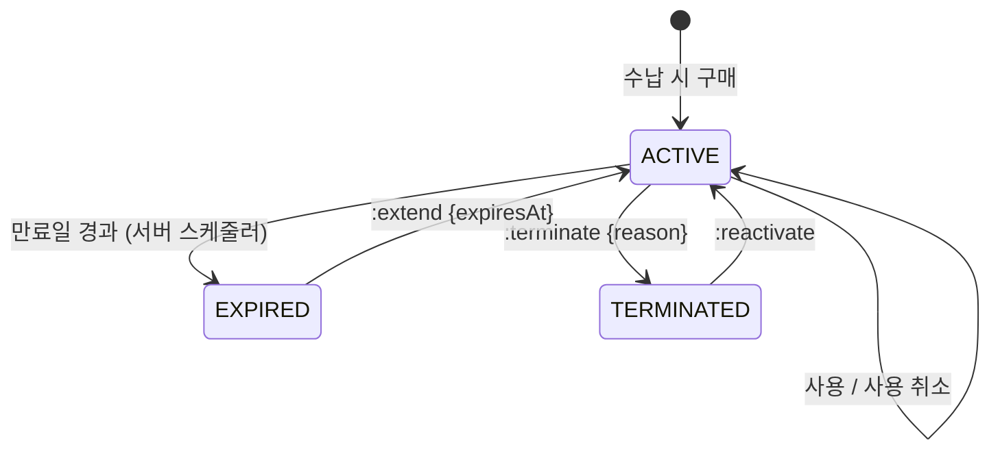

# Patients

환자와 환자에 딸린 장기 데이터(연락처·주소·가족·동의·메모·보험 자격·패키지 계약·선수금)를 다룹니다. 하루 단위 흐름(예약·내원·수납)은 [front-desk.md](front-desk.md)에 있습니다.

## 현행에서 고칠 점

- **`환자Id`와 `차트Id`가 따로 있습니다.** 수납·선수금은 `차트Id`, 나머지는 `환자Id`로 조회합니다. 한 환자에 차트가 여럿인 경우가 관찰되지 않았습니다 (추정: 레거시 이관 흔적)
- **같은 데이터가 여러 경로에 있습니다.** 메모(`/patients/{pid}/memos/{id}` vs `/patients/memos/{id}`), 수납상세 조회 3개 경로, 자보 접수(`/patients/{id}/car-waiting` 생성 vs `/patients/car-waiting/{id}` 수정)
- **차트번호 검증과 저장 사이에 경쟁 조건이 있습니다.** `GET .../validations` → `POST /patients/new`
- **패키지 사용내역이 두 이름입니다.** `usage-records/{id}/cancel`과 `usage/{id}/revive`
- **동의 데이터가 두 군데입니다.** EMR 환자의 `광고수신동의여부`(동의/거부/미정)와 CRM 수신거부의 `isMarketingAgreed`(bool). 동기화 방식이 보이지 않습니다
- **주민등록번호가 목록 응답에 실립니다** (추정: 화면 설정으로 뒷자리를 가림)

## 용어

| 업무 용어 | 키 |
|---|---|
| 환자 | `Patient` |
| 차트번호 | `chartNumber` |
| 주민등록번호 | `rrn` (응답은 `rrnMasked`) |
| 건강보험증번호 | `nhisCardNumber` |
| 최초내원일 | `firstVisitDate` |
| 내원경로 / 소개자 | `referralSourceId` / `referrerPatientId` |
| 환자 등급 | `gradeId` |
| 자보 / 산재 / 의료급여 | `AUTO_INSURANCE` / `INDUSTRIAL_ACCIDENT` / `MEDICAL_AID` |
| 비급여 패키지 계약 | `PackageContract` |
| 선수금 | `PrepaidAccount` |

## 환자 애그리거트

```
Patient
├─ identity: name, rrn(암호화), birthDate, isLunarBirthday, sex
├─ chartNumber (테넌트 내 유일)
├─ contacts[]: { kind: MOBILE|HOME|GUARDIAN, number, isPrimary }
├─ addresses[]: { roadAddress, detail, zipCode, isPrimary }
├─ family: familyId, relation
├─ profile: gradeId, referralSourceId, referrerPatientId, notes, profileImageId
├─ consents[]: { purpose, status, channel, decidedAt, source }
├─ firstVisitDate (파생: 첫 내원 완료 시 서버가 설정)
└─ status: ACTIVE | MERGED | DELETED
```

- **차트 개념은 없앱니다.** `chartNumber`는 환자의 속성이고, 수납·선수금도 `patientId`로 묶습니다. 이관 데이터에 환자 하나 = 차트 여럿인 경우가 실제로 있다면 `MERGED` 상태와 병합 이력으로 처리합니다
- **주소·연락처는 환자 하위 컬렉션입니다.** 현행 `/desk/addresses/{환자Id}`(+`POST .../delete/{id}`)를 `/patients/{id}/addresses`로 옮깁니다

### 엔드포인트

```
GET    /patients?q=&grade=&lastVisitFrom=&cursor=     q는 이름·차트번호·전화번호 뒷자리·초성
POST   /patients                                       { ..., chartNumber? }  # 비우면 정책대로 자동 채번
GET    /patients/{id}
PATCH  /patients/{id}                                  If-Match
DELETE /patients/{id}                                  진료 이력이 있으면 409 (아래 보존 규칙)
GET    /patients/{id}/rrn                              X-Access-Reason 필수, 감사 기록
POST   /patients:merge                                 { sourceId, targetId }
POST   /patients:import                                → Job (현행 /async-tasks/patient-excel-import)
POST   /patients:export                                → Job, X-Access-Reason 필수
GET    /patients/{id}/timeline?types=visit,encounter,receipt,document,message
```

- **중복 확인:** `POST /patients`가 같은 주민번호면 409 `PATIENT_DUPLICATE_RRN`과 기존 `patientId`를 줍니다. 입력 중 확인은 `?dryRun=true`. 현행 `POST /patients/check-ssn`은 없앱니다
- **차트번호:** DB 유일 제약으로 보장합니다. 추천 번호는 `GET /patients:next-chart-number`로 보여 주기만 하고, 저장 시 비우면 서버가 그 순간 채번합니다. 오프라인 신환은 엣지가 미리 빌린 번호를 씁니다 ([offline.md](offline.md#차트번호))
- **보존:** 진료기록이 있는 환자는 삭제하지 않습니다 ([compliance.md](compliance.md#보존)). `DELETE`는 진료 이력이 없는 잘못 등록된 환자에만 허용합니다
- **타임라인:** 현행 환자 상세가 진료·수납·서류·문자·동의 이력을 각각 부르던 것을 한 번에 커서로 받습니다

### 가족

```
GET  /patients/{id}/family                  → { familyId, members[{ patientId, relation }] }
PUT  /patients/{id}/family                  { familyId?, relation }
GET  /reference/family-relations
```

### 메모

```
GET    /patients/{id}/memos?category=
POST   /patients/{id}/memos                 { category: STAFF|DOCTOR|CONSULT|OTHER, body, pinned }
PATCH  /memos/{memoId}
DELETE /memos/{memoId}
```

- AI 에이전트(API 토큰)가 만든 메모는 `status: PROPOSED`로 생성되고, `POST /memos/{id}:approve` / `:reject`로 확정합니다. 현행 `/patients/me/pending-notes`, `/patients/memos/{id}/approve`를 대체합니다

### 동의

동의는 목적별 최신 상태 + 이력으로 둡니다. CRM은 이 값을 읽기만 합니다 ([crm.md](crm.md#동의와-수신거부)).

| `purpose` | 의미 |
|---|---|
| `MARKETING_SMS`, `MARKETING_KAKAO` | 광고성 정보 수신 |
| `MARKETING_NIGHT` | 21:00–08:00 광고성 정보 수신 (정보통신망법상 별도 동의) |
| `INFO_MESSAGE` | 알림성 정보 수신 |
| `THIRD_PARTY_PROVISION` | 제3자 제공 |
| `TREATMENT_CONSENT:{templateId}` | 시술 동의서 (태블릿 서명) |

- `status`: `GRANTED`, `DENIED`, `UNDECIDED`, `WITHDRAWN`
- `source`: `DESK`, `TABLET`, `PATIENT_080`(080 수신거부, 병원이 되돌릴 수 없음), `IMPORT`
- 080 거부는 Integrations가 받아 `consent.changed` 이벤트로 반영합니다
- **환자로 등록되지 않은 전화번호의 수신거부**(080, 번호·엑셀 일괄 등록)는 환자 동의에 담을 수 없으므로 CRM의 번호 단위 `Suppression`에 둡니다 ([crm.md](crm.md#동의와-수신거부)). 발송 시에는 두 곳을 모두 검사합니다

```
GET  /patients/{id}/consents
POST /patients/{id}/consents                { purpose, status, source, evidenceDocumentId? }   # 이력 추가, 덮어쓰지 않음
GET  /patients/{id}/consents/history
```

### 문진·시술동의서 기록

태블릿에서 받은 문진과 동의서는 [documents.md](documents.md#태블릿-문진동의서)의 `IntakeSubmission`으로 저장하고, 환자에서는 목록만 봅니다.

```
GET /patients/{id}/intake-submissions?kind=QUESTIONNAIRE|CONSENT
GET /patients/{id}/questionnaire-trends?questionKey=
```

### 보험 자격

접수 시 조회한 결과를 그 내원의 **스냅샷**으로 남기고, 환자에는 장기적인 보험 정보만 둡니다.

| 리소스 | 내용 | 현행 |
|---|---|---|
| `AutoInsuranceCase` | 자동차보험 사고 건: `accidentReportNumber`(사고접수번호), `guaranteeNumber`, `insurerCode`, `guaranteeFrom/To`, `guaranteeLimit`, `status: ACTIVE|CLOSED` | `/patients/{id}/car-waiting` |
| `IndustrialAccidentCase` | 산재 건: `businessType`(요양/예방), `employerRegistrationNumber`, `approvalNumber`, `accidentDate`, `approvedOn`, `treatmentEndOn` | `/patients/{id}/sanjae-waiting` |
| `JejuSubsidyEnrollment` | 제주 지원사업 자격: `program`, `activeFrom/To`, `status` | `/patients/{id}/jeju-supports` |

```
GET   /patients/{id}/auto-insurance-cases
POST  /patients/{id}/auto-insurance-cases
PATCH /auto-insurance-cases/{caseId}
POST  /auto-insurance-cases/{caseId}:close
GET   /auto-insurance-cases/{caseId}/usage        → { billedTotal, guaranteeLimit, remaining }  # 현행 car-waiting/amount/{사고접수번호}
```

산재·제주도 같은 형태입니다. 현행 제주는 `PATCH .../deactivate`를 `:deactivate` 커맨드로, 산재에 없던 생성·삭제를 추가합니다.

## 패키지 계약

비급여 패키지 상품([catalog.md](catalog.md#진료-항목가격표))을 환자가 구매한 것입니다.

```
PackageContract
├─ productId, productSnapshot (구매 시점 상품 복사)
├─ type: SESSION_COUNT | FIXED_AMOUNT
├─ totalSessions, usedSessions (SESSION_COUNT)
├─ totalAmount, usedAmount (FIXED_AMOUNT)
├─ startsAt, expiresAt
├─ status: ACTIVE | EXPIRED | TERMINATED
└─ usages[]: { id, encounterId, prescriptionLineId, sessions|amount, status: APPLIED|CANCELED, appliedAt }
```



```
GET  /patients/{id}/package-contracts?status=
GET  /package-contracts/{contractId}
POST /package-contracts/{contractId}:terminate     { reason }
POST /package-contracts/{contractId}:reactivate
POST /package-contracts/{contractId}:extend        { expiresAt }
GET  /package-contracts/{contractId}/usages
POST /package-usages/{usageId}:cancel
POST /package-usages/{usageId}:restore
GET  /package-contracts/{contractId}/history
```

- **재개 조건(서버):** 만료일이 하루 이상 남아 있고, `SESSION_COUNT`면 잔여 횟수가 있어야 합니다. 현행은 클라이언트만 확인했습니다. 어긋나면 409 `PACKAGE_NOT_REACTIVATABLE`
- `EXPIRED`는 현행에 명시적 상태로 보이지 않았지만(CRM 목록에만 `EXPIRED`가 있음) 서버 스케줄러가 전이시켜 상태로 둡니다
- **사용 생성은 처방에서만 합니다.** 진료의 처방 라인이 `packageContractId`를 가지면, 그 라인의 금액이 확정될 때(진료 완료와 수납 중 먼저 오는 쪽) 사용이 생깁니다. 사용 내역을 직접 만드는 API는 두지 않습니다. 현행 `DELETE usage/{id}`(사용내역 삭제)는 `:cancel`로 대체하고 지우지 않습니다

## 선수금

```
PrepaidAccount (환자당 계열별 하나)
├─ patientId
├─ kind: CASH_LIKE | CARD_LIKE          # 현행 선수금계열. 환불 수단 제약 때문에 분리
├─ balance (파생)
└─ transactions[]: { type: CHARGE|USE|REFUND|CHARGE_CANCEL|REFUND_CANCEL, amount, method, receiptId?, by, memo, at }
```

```
GET  /patients/{id}/prepaid                         → { accounts[{ kind, balance }] }
GET  /patients/{id}/prepaid/transactions?cursor=
POST /patients/{id}/prepaid:charge                   { kind, amount, method, memo }        Idempotency-Key
POST /patients/{id}/prepaid:refund                   { amounts: [{ kind, amount }], refundMethod, reason }   Idempotency-Key
POST /prepaid-transactions/{txId}:cancel
```

- 현행은 계열마다 환불을 따로 불렀습니다. 재설계는 한 요청에 계열별 금액을 받아 한 트랜잭션으로 처리합니다
- 사용(`USE`)은 수납 커맨드 안에서만 생깁니다 ([front-desk.md](front-desk.md#수납))

## 이벤트

`patient.created`, `patient.updated`, `patient.merged`, `patient.photo_updated`, `memo.created/updated/deleted`, `memo.proposed`, `consent.changed`, `package_contract.status_changed`, `prepaid.changed`
